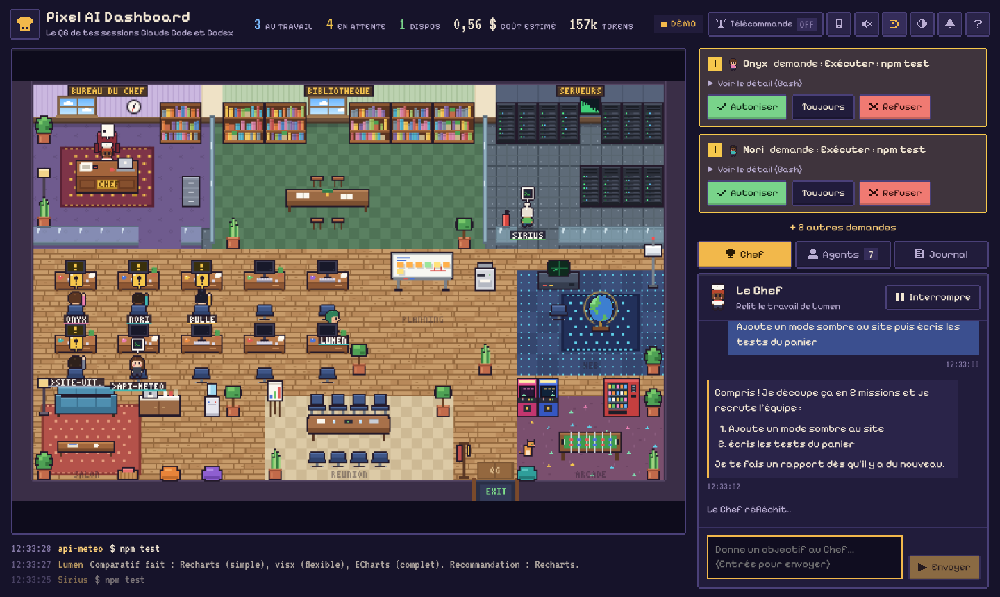
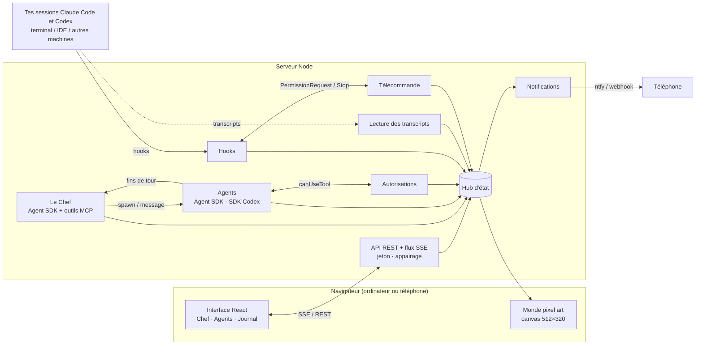

# Pixel AI Dashboard

Le QG pixel art de tes sessions **Claude Code** et **Codex**, en local ou depuis ton
téléphone. Un agent coordinateur, **le Chef**, découpe tes objectifs en missions,
recrute des agents, suit leur travail et te fait des rapports. Chaque session est un
petit personnage qui se déplace dans un bureau en pixel art selon ce qu'il fait.



- **Tu parles au Chef** (onglet *Chef*) : « Ajoute un mode sombre puis écris les tests du panier ».
  Il lit le projet, recrute un agent par mission (Claude Code ou Codex), le briefe, le
  relance si besoin et te remonte des **rapports** (terminé, attention, question…).
- **Tu vois l'équipe travailler** : la bibliothèque quand un agent lit du code, la salle
  serveurs quand il lance des commandes, le coin Web pour les recherches, son bureau
  quand il code, le salon quand il attend une mission. Il lève la main quand il a besoin
  de ton feu vert. Les sous-agents arrivent en stagiaires (casquette) dans la salle de réunion.
- **Tu gardes la main** : autoriser / refuser une action, écrire directement à un agent,
  l'interrompre, l'arrêter, le reprendre plus tard.
- **Tes sessions terminal apparaissent aussi**, Claude Code comme Codex (sweat gris, nom
  précédé de `>`) : sans rien installer en lisant leurs transcripts, ou plus précisément
  avec les hooks.
- **À distance** : ouvre le QG sur ton téléphone (QR code d'appairage), active la
  **télécommande** et réponds d'ici aux demandes d'autorisation et aux fins de tour de tes
  sessions terminal. Notifications ntfy / Discord / Slack en option.

## Démarrage rapide

Prérequis : **Node.js 20+**.

```bash
npm install

# 1) Voir le QG tout de suite, sans clé ni coût (tout est simulé)
npm run demo            # puis ouvre http://localhost:5173

# 2) Pour de vrai : serveur + interface en développement
npm run dev             # http://localhost:5173 (API sur le port 7495)

# 3) En production (un seul processus)
npm run build && npm start   # http://127.0.0.1:7495

# 4) Accessible depuis ton téléphone (même Wi-Fi), protégé par jeton + QR code
npm run remote
```

> Astuce : `http://localhost:5173/?demo` lance la simulation directement dans le navigateur,
> même sans serveur.

### Authentification de Claude

Le Chef et les agents Claude sont de vraies sessions Claude Code lancées avec le
[Claude Agent SDK](https://platform.claude.com/docs/en/agent-sdk/overview). Ils
s'authentifient comme Claude Code : clé `ANTHROPIC_API_KEY` dans l'environnement du
serveur, ou configuration Amazon Bedrock / Google Vertex / Microsoft Foundry
habituelle. Les sessions chargent aussi tes réglages Claude Code (`CLAUDE.md`,
permissions, serveurs MCP…) comme le ferait `claude` dans le dossier de travail.

Chaque agent consomme des tokens : le coût estimé est affiché en haut de l'écran et
sur chaque fiche. Voir la section [Garde-fous](#sécurité-et-garde-fous).

### Agents Codex (optionnel)

Le dashboard peut aussi recruter des agents **Codex** (OpenAI) via le
[SDK Codex](https://developers.openai.com/codex/sdk). Le SDK n'est pas installé par
défaut (son binaire pèse plusieurs centaines de Mo) :

```bash
npm run codex:install   # installe @openai/codex-sdk sans l'ajouter au package.json
codex login             # si ce n'est pas déjà fait : Codex utilise ta connexion habituelle
```

À relancer après un `npm install`, qui retire les paquets non déclarés. Le SDK utilise son
propre binaire `codex` ; s'il manque, le dashboard prend celui de ton `PATH`, et
`CODEX_PATH` force un binaire précis.

Ensuite, dans **Recruter**, choisis *Codex* ; le Chef peut aussi en recruter
(`agent: "codex"`). Un agent Codex piloté travaille dans un **bac à sable** et ne pose
pas de questions :

| Choix dans le dashboard | Bac à sable Codex |
| --- | --- |
| Bac à sable : dossier de travail (défaut) | `workspace-write` (sans réseau, sauf `CODEX_NETWORK=1`) |
| Lecture seule | `read-only` |
| Accès complet (`ALLOW_BYPASS=1`) | `danger-full-access` |

Les agents Codex portent un sweat anthracite et une étiquette turquoise.

## Tes sessions terminal / IDE

### Sans rien installer : les transcripts

Comme [pixel-agents](https://github.com/pablodelucca/pixel-agents), le serveur lit les
transcripts de tes sessions en cours : `~/.claude/projects/*/*.jsonl` (Claude Code) et
`~/.codex/sessions/AAAA/MM/JJ/rollout-*.jsonl` (Codex). Les sessions actives depuis moins
de 10 minutes apparaissent avec le badge **Observée**, en **lecture seule**.

Le transcript ne dit pas quand une autorisation est demandée : un outil sans résultat au
bout d'un moment (4 s pour une écriture, 25 s pour une commande) fait lever la main au
personnage, avec la mention « autorisation probable ». Désactivation : `WATCH_TRANSCRIPTS=0`.

### Plus précis et pilotable : les hooks

```bash
npm run hooks:install                                  # Claude Code, toutes tes sessions (~/.claude/settings.json)
npm run hooks:install -- --codex                       # Codex (~/.codex/hooks.json)
npm run hooks:install -- --project ~/code/mon-app      # un seul projet (.claude/settings.local.json, ou .codex/hooks.json avec --codex)
npm run hooks:install -- --mode http                   # Claude Code : hooks HTTP natifs plutôt qu'un script Node
npm run hooks:install -- --dry-run                     # voir le résultat sans rien écrire
npm run hooks:uninstall [-- --codex]                   # tout retirer
```

- Une sauvegarde du fichier est créée avant chaque modification, et tes autres hooks sont
  conservés. Les sessions déjà ouvertes doivent être relancées.
- **Codex demande de valider les nouveaux hooks** : au prochain lancement, ouvre `/hooks`
  dans Codex et accepte-les (sinon ils restent inactifs). À refaire si tu réinstalles avec
  une autre URL ou un autre jeton : Codex détecte que la commande a changé.
- Le hook est un petit script (`hooks/pixel-hook.mjs`) lancé en arrière-plan pour les
  événements ordinaires : il ne ralentit jamais l'outil et reste silencieux si le
  dashboard est éteint. Seuls `PermissionRequest` et `Stop` sont synchrones : ils
  répondent aussitôt, sauf quand la [télécommande](#la-télécommande) est active.
- Une session repérée par son transcript passe automatiquement en mode hooks (badge
  **Terminal**), sans doublon. Les sessions pilotées par le dashboard sont ignorées
  (variable `PIXEL_MANAGED`).
- Les sous-agents (outil Agent de Claude Code, sous-agents Codex) deviennent des
  personnages à part entière, qui repartent quand ils ont rendu leur travail.

## Piloter à distance

### Ouvrir le QG sur ton téléphone

```bash
npm run remote
```

Le serveur écoute alors sur le réseau local, génère un jeton d'accès (gardé dans
`data/remote-token`) et affiche dans le terminal un **QR code d'appairage**. Scanne-le :
le téléphone reçoit un cookie d'appareil valable 30 jours, sans jamais voir le jeton.
Depuis un appareil déjà connecté, le bouton **téléphone** (en haut) génère un nouveau QR
code (valable 10 minutes, une seule fois) ou déconnecte tous les appareils.

Hors de chez toi, passe par un tunnel plutôt que d'ouvrir un port :
[Tailscale](https://tailscale.com/) (le plus simple : ton téléphone rejoint ton réseau
privé) ou [Cloudflare Tunnel](https://developers.cloudflare.com/cloudflare-one/connections/connect-networks/).
Indique alors l'adresse publique pour les QR codes et les notifications :

```bash
PUBLIC_URL=https://qg.mondomaine.fr npm run remote
```

Sur le téléphone, « Ajouter à l'écran d'accueil » installe le dashboard comme une appli.

### La télécommande

Le bouton **Télécommande** (en haut) change le comportement des sessions terminal
branchées via les hooks :

- **Demande d'autorisation** : au lieu d'attendre dans le terminal, elle attend ta réponse
  dans le dashboard (*Autoriser*, *Toujours*, *Refuser*). Sans réponse au bout de 10 minutes
  (`REMOTE_PERMISSION_WAIT`), la question repasse au terminal.
- **Fin de tour** : la session t'attend dans le QG. Tape ta prochaine consigne sur sa
  fiche : elle repart aussitôt avec. *Rendre la main au terminal* la libère ; sans
  consigne au bout de 30 minutes (`REMOTE_STOP_WAIT`), elle s'arrête normalement.
- Couper la télécommande rend immédiatement la main à toutes les sessions retenues.

Fonctionne avec Claude Code et Codex (hooks `PermissionRequest` et `Stop`). Pour Codex,
*Toujours* vaut *Autoriser* : Codex n'accepte pas de règle permanente envoyée par un hook.
Les sessions seulement observées (transcripts) restent en lecture seule.

### Plusieurs machines

Installe les hooks sur une autre machine en les pointant vers ton dashboard :

```bash
npm run hooks:install -- --url https://qg.mondomaine.fr --token "$(cat data/remote-token)" [--codex]
```

Ses sessions apparaissent avec le nom de la machine (badge `@mac-mini`). Sur cette
machine, un clone du dépôt et Node 20+ suffisent : l'installeur et le relais des hooks
n'utilisent que Node, pas besoin de `npm install`.

### Notifications

Pour être prévenu même dashboard fermé (demande d'autorisation, session qui t'attend,
rapport du Chef, erreur) :

```bash
NOTIFY_NTFY=https://ntfy.sh/un-sujet-difficile-a-deviner   # appli ntfy (iOS, Android)
NOTIFY_WEBHOOK=https://discord.com/api/webhooks/…           # ou Slack, ou tout webhook JSON
```

Avec `PUBLIC_URL`, toucher la notification ouvre directement la fiche de l'agent.
Le bouton *Tester* (téléphone → Notifications) vérifie la configuration. Le dashboard
ouvert dans un onglet peut aussi afficher des notifications du navigateur (cloche) et
jouer des sons 8-bit.

> Limite : les sessions Claude Code lancées dans le cloud (claude.ai/code) ne tournent pas
> sur ta machine et n'ont ni transcript local ni hooks joignables : elles n'apparaissent pas.

## Configuration

Variables d'environnement du serveur (toutes optionnelles) :

| Variable | Défaut | Rôle |
| --- | --- | --- |
| `PORT` | `7495` | Port du serveur (API + interface construite). |
| `HOST` | `127.0.0.1` (`0.0.0.0` avec `REMOTE=1`) | Adresse d'écoute. Hors localhost, `PIXEL_TOKEN` est obligatoire. |
| `REMOTE` | — | `1` : accès à distance (jeton généré si absent, QR code d'appairage). C'est ce que fait `npm run remote`. |
| `PIXEL_TOKEN` | — | Jeton d'accès (hooks, scripts, première connexion). Active la protection de l'API. |
| `PUBLIC_URL` | — | Adresse publique du dashboard (tunnel) : QR codes, liens des notifications, contrôle d'origine. |
| `REMOTE_MODE` | — | `1` : télécommande active dès le démarrage. |
| `REMOTE_PERMISSION_WAIT` / `REMOTE_STOP_WAIT` | `600` / `1800` | Attente maximale (secondes) d'une réponse en mode télécommande. |
| `NOTIFY_NTFY` / `NOTIFY_NTFY_TOKEN` | — | Notifications [ntfy](https://ntfy.sh) (URL du sujet, jeton éventuel). |
| `NOTIFY_WEBHOOK` | — | Notifications Discord, Slack ou webhook JSON générique. |
| `WATCH_TRANSCRIPTS` | activé | `0` : ne pas lire les transcripts locaux. |
| `CLAUDE_CONFIG_DIR` / `CODEX_HOME` | `~/.claude` / `~/.codex` | Où trouver les transcripts. |
| `WORKSPACE` | dossier courant | Dossier de travail par défaut des agents. |
| `DEFAULT_PERMISSION_MODE` | `default` | `default`, `acceptEdits`, `plan`, `auto` ou `bypassPermissions`. |
| `MAX_WORKERS` | `6` | Nombre maximal d'agents actifs en même temps. |
| `MANAGER_MODEL` / `WORKER_MODEL` | défaut de Claude Code | Modèle du Chef / des agents Claude (`opus`, `sonnet`, `haiku` ou un identifiant complet). |
| `CODEX_MODEL` | défaut de Codex | Modèle des agents Codex. |
| `CODEX_PATH` | — | Binaire `codex` à utiliser. |
| `CODEX_NETWORK` | — | `1` : accès réseau dans le bac à sable des agents Codex. |
| `CODEX_SKIP_GIT_CHECK` | — | `1` : autoriser Codex hors d'un dépôt git. |
| `PIXEL_HOSTNAME` | nom de la machine | Nom affiché pour la machine du dashboard. |
| `MAX_BUDGET_USD` | — | Budget maximal par session Claude (la session s'arrête au-delà). |
| `ALLOW_BYPASS` | — | `1` pour autoriser les modes sans garde-fou (`bypassPermissions`, Codex `danger-full-access`). |
| `ALLOWED_HOSTS` | — | Noms d'hôte supplémentaires acceptés sans jeton (ex. nom local de la machine). |
| `DEMO` | — | `1` : simulation côté serveur, aucun appel à Claude ni à Codex. |
| `DISABLE_SDK` | — | `1` : observation seule (transcripts, hooks), pas de Chef ni d'agents. |
| `DATA_DIR` | `./data` | Rapports, conversation, historique, jeton et appareils appairés. |
| `NO_PERSIST` | — | `1` : ne rien sauvegarder sur disque (hors jeton généré). |
| `DEBUG` | — | `1` : affiche la sortie d'erreur des processus Claude Code. |

Exemple : `WORKSPACE=~/code/boutique WORKER_MODEL=sonnet MAX_BUDGET_USD=2 npm start`

## Comment travaille le Chef

Le Chef est lui-même une session Claude Code (SDK) qui ne modifie aucun fichier : il ne
peut que lire le projet (`Read`, `Glob`, `Grep`) et utiliser des outils internes au QG :

| Outil | Effet |
| --- | --- |
| `spawn_agent` | Recrute un agent Claude Code ou Codex avec un brief de mission. |
| `message_agent` | Donne des consignes ou répond à un agent (mis en file s'il est occupé). |
| `list_agents` | Fait le point : outil, machine, statut, action en cours, dernier message, autorisations en attente. |
| `get_agent_log` | Relit le journal d'un agent. |
| `interrupt_agent` / `stop_agent` | Interrompt un tour / libère un agent qui a fini. |
| `report_to_user` | T'envoie un rapport (affiché en évidence + notification). |

Quand un agent termine un tour, échoue ou s'arrête, le Chef reçoit automatiquement une
notification (regroupée) et décide : relancer l'agent, lui répondre, te faire un rapport.
Les agents que tu recrutes toi-même peuvent aussi être suivis par le Chef (case à cocher).

## Sécurité et garde-fous

- **Local par défaut** : le serveur écoute sur `127.0.0.1` et vérifie l'en-tête `Host`
  (contre le *DNS rebinding*). Hors localhost, un jeton est obligatoire.
- **Accès à distance** : toute l'API exige le jeton (en-tête `Authorization: Bearer`) ou
  un appareil appairé. Les codes d'appairage expirent au bout de 10 minutes et ne servent
  qu'une fois ; les cookies d'appareil sont `HttpOnly`, `SameSite=Lax`, `Secure` en HTTPS,
  et seule leur empreinte est stockée. Révoquer les appareils coupe aussi leurs flux en
  cours. L'en-tête `Origin` doit correspondre au dashboard. Préfère un tunnel privé
  (Tailscale) ou HTTPS à un port ouvert sur Internet.
- **Autorisations** : en mode `default`, chaque commande ou écriture sensible attend ton
  feu vert dans le dashboard (Autoriser, Toujours, Refuser). Les modes sans garde-fou
  ne sont disponibles qu'avec `ALLOW_BYPASS=1` et ne peuvent jamais être choisis par le Chef.
- **Le Chef ne code pas** : toute action hors de ses outils est refusée d'office.
- **Pas d'emballement** : `MAX_WORKERS` limite le nombre d'agents, le Chef ne peut pas
  relancer un même agent plus de 6 fois sans que tu interviennes, et `MAX_BUDGET_USD`
  plafonne la dépense par session Claude.
- Les agents ne peuvent pas poser de questions interactives : ils les posent en fin de
  tour, le Chef y répond ou te les transmet.

## Architecture



```
shared/            types, état (Hub), correspondance outil → activité, simulateur de démo
server/            serveur Express : API, SSE, sécurité, authentification, hooks, télécommande,
                   transcripts, notifications, persistance
server/agents/     sessions Agent SDK et Codex, Chef + outils MCP, autorisations, traduction des messages
web/src/game/      moteur pixel art : sprites en code, plan du QG, A*, personnages, décor animé
web/src/ui/        interface React (panneaux, dialogues, connexion, icônes pixel)
web/public/        manifeste et icônes de l'appli installable
hooks/             script relais des hooks Claude Code et Codex
scripts/           installation / désinstallation des hooks
docs/              aperçu et prompts de style pour générateur d'images
tests/             tests (node:test)
```

Tout le pixel art (personnages, mobilier, icônes, police 3×5) est dessiné en code. La page
`http://localhost:5173/world.html` affiche le monde seul, utile pour retoucher le décor.

## Développement

```bash
npm run typecheck   # TypeScript strict
npm test            # messages SDK et Codex, hooks, télécommande (HTTP compris), appairage,
                    # transcripts, installeur, autorisations, plan du QG, simulateur
npm run build:demo  # dist/demo/index.html : la démo en un seul fichier autonome
```

## Styles alternatifs

Des prompts prêts à l'emploi pour explorer d'autres univers (guilde fantasy, station
spatiale, cyberpunk néon, village, isométrique…) sont dans
[docs/PROMPTS_IMAGES.md](docs/PROMPTS_IMAGES.md).

## Crédits

L'idée de suivre les sessions par leurs transcripts, sans configuration, et d'animer les
sous-agents comme des personnages vient de [pixel-agents](https://github.com/pablodelucca/pixel-agents)
(extension VS Code, licence MIT). Aucun code ni graphisme n'en est repris : tout le pixel
art d'ici est dessiné en code.

## Idées pour la suite

- Prendre en charge les questions à choix (`AskUserQuestion`) des agents, à distance comprises.
- Notifications Web Push natives (sans service tiers).
- Charger de vraies planches de sprites / tilesets à la place du dessin en code.
- Zoom sur mobile, plusieurs étages, un étage par machine.
