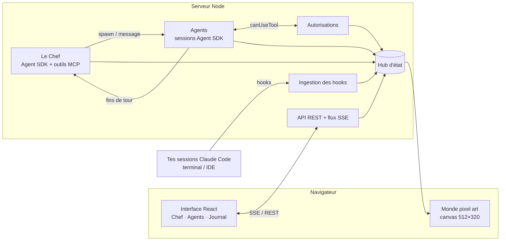

# Pixel AI Dashboard

Le QG pixel art de tes sessions **Claude Code**. Un agent coordinateur, **le Chef**,
découpe tes objectifs en missions, recrute des agents Claude Code, suit leur travail
et te fait des rapports. Chaque session est un petit personnage qui se déplace dans
un bureau en pixel art selon ce qu'il fait.


- **Tu parles au Chef** (onglet *Chef*) : « Ajoute un mode sombre puis écris les tests du panier ».
  Il lit le projet, recrute un agent par mission, le briefe, le relance si besoin et te
  remonte des **rapports** (terminé, attention, question…).
- **Tu vois l'équipe travailler** : la bibliothèque quand un agent lit du code, la salle
  serveurs quand il lance des commandes, le coin Web pour les recherches, son bureau
  quand il code, le salon quand il attend une mission. Il lève la main quand il a besoin
  de ton feu vert.
- **Tu gardes la main** : autoriser / refuser une action, écrire directement à un agent,
  l'interrompre, l'arrêter, le reprendre plus tard.
- **Tes sessions terminal apparaissent aussi** (en sweat gris, nom précédé de `>`) grâce
  aux hooks de Claude Code : le dashboard les observe sans les piloter.

## Démarrage rapide

Prérequis : **Node.js 20+**.

```bash
npm install

# 1) Voir le QG tout de suite, sans clé ni coût (tout est simulé)
npm run demo            # puis ouvre http://localhost:5173

# 2) Pour de vrai : serveur + interface en développement
npm run dev             # http://localhost:5173 (API sur le port 7495)

# 3) En production (un seul processus)
npm run build && npm start   # http://127.0.0.1:7495
```

> Astuce : `http://localhost:5173/?demo` lance la simulation directement dans le navigateur,
> même sans serveur.

### Authentification de Claude

Le Chef et les agents sont de vraies sessions Claude Code lancées avec le
[Claude Agent SDK](https://platform.claude.com/docs/en/agent-sdk/overview). Ils
s'authentifient comme Claude Code : clé `ANTHROPIC_API_KEY` dans l'environnement du
serveur, ou configuration Amazon Bedrock / Google Vertex / Microsoft Foundry
habituelle. Les sessions chargent aussi tes réglages Claude Code (`CLAUDE.md`,
permissions, serveurs MCP…) comme le ferait `claude` dans le dossier de travail.

Chaque agent consomme des tokens : le coût estimé est affiché en haut de l'écran et
sur chaque fiche. Voir la section [Garde-fous](#sécurité-et-garde-fous).

## Brancher tes sessions Claude Code existantes (hooks)

Pour que les sessions que tu lances dans ton terminal (ou ton IDE) apparaissent au QG :

```bash
npm run hooks:install                                  # toutes tes sessions (~/.claude/settings.json)
npm run hooks:install -- --project ~/code/mon-app      # un seul projet (.claude/settings.local.json)
npm run hooks:install -- --mode http                   # hooks HTTP natifs plutôt qu'un script Node
npm run hooks:install -- --dry-run                     # voir le résultat sans rien écrire
npm run hooks:uninstall                                # tout retirer
```

- Une sauvegarde du fichier de réglages est créée avant chaque modification, et tes
  autres hooks sont conservés.
- Par défaut le hook est un petit script (`hooks/pixel-hook.mjs`) lancé en arrière-plan
  (`async`) : il ne ralentit jamais Claude Code et reste silencieux si le dashboard est éteint.
- Les sessions déjà ouvertes doivent être relancées pour prendre en compte les hooks.
- Les sessions pilotées par le dashboard sont automatiquement ignorées par ces hooks
  (variable `PIXEL_MANAGED`), donc pas de doublon.
- Ces sessions sont en **lecture seule** : quand l'une d'elles demande une autorisation,
  le QG te le signale, mais tu réponds dans ton terminal.

## Configuration

Variables d'environnement du serveur (toutes optionnelles) :

| Variable | Défaut | Rôle |
| --- | --- | --- |
| `PORT` | `7495` | Port du serveur (API + interface construite). |
| `HOST` | `127.0.0.1` | Adresse d'écoute. Hors localhost, `PIXEL_TOKEN` est obligatoire. |
| `WORKSPACE` | dossier courant | Dossier de travail par défaut des agents. |
| `DEFAULT_PERMISSION_MODE` | `default` | `default`, `acceptEdits`, `plan`, `auto` ou `bypassPermissions`. |
| `MAX_WORKERS` | `6` | Nombre maximal d'agents actifs en même temps. |
| `MANAGER_MODEL` / `WORKER_MODEL` | défaut de Claude Code | Modèle du Chef / des agents (`opus`, `sonnet`, `haiku` ou un identifiant complet). |
| `MAX_BUDGET_USD` | — | Budget maximal par session (la session s'arrête au-delà). |
| `ALLOW_BYPASS` | — | `1` pour autoriser le mode sans garde-fou `bypassPermissions`. |
| `PIXEL_TOKEN` | — | Jeton exigé par l'API (`?token=…` dans l'URL de l'interface). |
| `ALLOWED_HOSTS` | — | Noms d'hôte supplémentaires acceptés (ex. IP du réseau local). |
| `DEMO` | — | `1` : simulation côté serveur, aucun appel à Claude. |
| `DISABLE_SDK` | — | `1` : observation seule (hooks), pas de Chef ni d'agents. |
| `DATA_DIR` | `./data` | Où sauvegarder rapports, conversation et historique. |
| `NO_PERSIST` | — | `1` : ne rien sauvegarder sur disque. |
| `DEBUG` | — | `1` : affiche la sortie d'erreur des processus Claude Code. |

Exemple : `WORKSPACE=~/code/boutique WORKER_MODEL=sonnet MAX_BUDGET_USD=2 npm start`

### Accès depuis ton téléphone (réseau local)

```bash
HOST=0.0.0.0 ALLOWED_HOSTS=192.168.1.20 PIXEL_TOKEN=un-long-secret npm start
# puis ouvre http://192.168.1.20:7495/?token=un-long-secret
```

## Comment travaille le Chef

Le Chef est lui-même une session Claude Code (SDK) qui ne modifie aucun fichier : il ne
peut que lire le projet (`Read`, `Glob`, `Grep`) et utiliser des outils internes au QG :

| Outil | Effet |
| --- | --- |
| `spawn_agent` | Recrute un agent (nouvelle session Claude Code) avec un brief de mission. |
| `message_agent` | Donne des consignes ou répond à un agent (mis en file s'il est occupé). |
| `list_agents` | Fait le point : statut, action en cours, dernier message, autorisations en attente. |
| `get_agent_log` | Relit le journal d'un agent. |
| `interrupt_agent` / `stop_agent` | Interrompt un tour / libère un agent qui a fini. |
| `report_to_user` | T'envoie un rapport (affiché en évidence + notification). |

Quand un agent termine un tour, échoue ou s'arrête, le Chef reçoit automatiquement une
notification (regroupée) et décide : relancer l'agent, lui répondre, te faire un rapport.
Les agents que tu recrutes toi-même peuvent aussi être suivis par le Chef (case à cocher).

## Sécurité et garde-fous

- **Local par défaut** : le serveur écoute sur `127.0.0.1`. L'API vérifie les en-têtes
  `Host` (contre le *DNS rebinding*) et `Origin` (contre les requêtes d'autres sites).
  Hors localhost, un jeton est obligatoire.
- **Autorisations** : en mode `default`, chaque commande ou écriture sensible attend ton
  feu vert dans le dashboard (Autoriser, Toujours, Refuser). Le mode sans garde-fou
  n'est disponible qu'avec `ALLOW_BYPASS=1` et ne peut jamais être choisi par le Chef.
- **Le Chef ne code pas** : toute action hors de ses outils est refusée d'office.
- **Pas d'emballement** : `MAX_WORKERS` limite le nombre d'agents, le Chef ne peut pas
  relancer un même agent plus de 6 fois sans que tu interviennes, et `MAX_BUDGET_USD`
  plafonne la dépense par session.
- Les agents ne peuvent pas poser de questions interactives : ils les posent en fin de
  tour, le Chef y répond ou te les transmet.

## Architecture



```
shared/            types, état (Hub), correspondance outil → activité, simulateur de démo
server/            serveur Express : API, SSE, sécurité, hooks, persistance
server/agents/     sessions Agent SDK, Chef + outils MCP, autorisations, traduction des messages
web/src/game/      moteur pixel art : sprites en code, plan du QG, A*, personnages, décor animé
web/src/ui/        interface React (panneaux, dialogues, icônes pixel)
hooks/             script relais des hooks Claude Code
scripts/           installation / désinstallation des hooks
docs/              aperçu et prompts de style pour générateur d'images
tests/             tests (node:test)
```

Tout le pixel art (personnages, mobilier, icônes, police 3×5) est dessiné en code : aucun
fichier image n'est nécessaire. La page `http://localhost:5173/world.html` affiche le monde
seul, utile pour retoucher le décor.

## Développement

```bash
npm run typecheck   # TypeScript strict
npm test            # tests : messages SDK, hooks, autorisations, plan du QG, simulateur
npm run build:demo  # dist/demo/index.html : la démo en un seul fichier autonome
```

## Styles alternatifs

Des prompts prêts à l'emploi pour explorer d'autres univers (guilde fantasy, station
spatiale, cyberpunk néon, village, isométrique…) sont dans
[docs/PROMPTS_IMAGES.md](docs/PROMPTS_IMAGES.md).

## Idées pour la suite

- Répondre aux autorisations des sessions terminal depuis le dashboard (hook `PermissionRequest`).
- Prendre en charge les questions à choix (`AskUserQuestion`) des agents.
- Charger de vraies planches de sprites / tilesets à la place du dessin en code.
- Effets sonores 8-bit (rapport reçu, main levée), zoom sur mobile, plusieurs étages.
