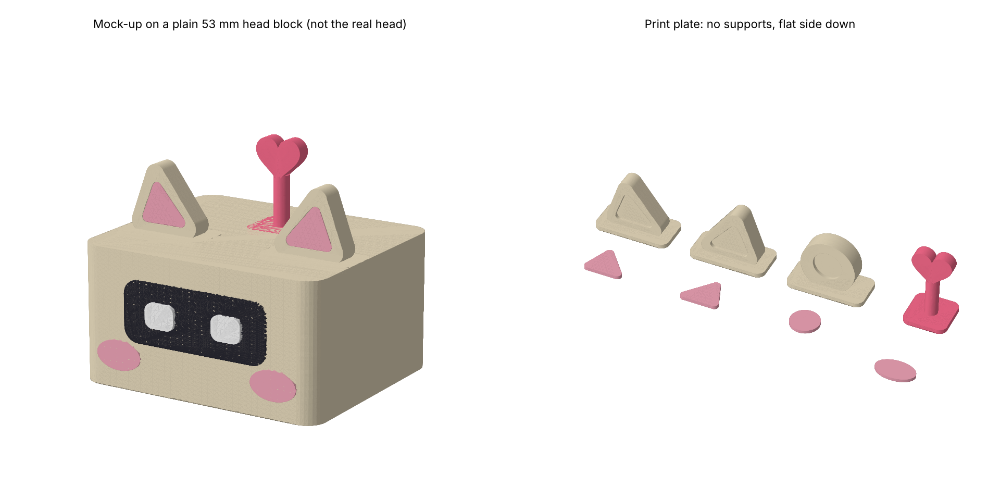

# Cute kit

Stick-on add-ons that make a desk robot head cuter: cat ears (or bear ears), pink inner-ear inserts, blush cheeks and a heart antenna.

They are sized for the default SG90 build of [Tiny Engineer](https://github.com/jamro/tiny-engineer), whose head is about 53 mm wide. They are original shapes, not edits of that project's CAD, and they don't use its screw holes. Each piece has a flat foot pad you stick on with foam tape or glue, so the kit fits any head shape.



The left half of the preview is a mock-up on a plain block, not the real robot head.

## Parts

| File | Qty | Colour | Size (mm) |
| --- | --- | --- | --- |
| `stl/CatEarLeft.stl` / `stl/CatEarRight.stl` | 1 each | body colour (cream) | 20 × 10 × 14.8 |
| `stl/CatEarInnerLeft.stl` / `stl/CatEarInnerRight.stl` | 1 each | pink | 0.8 thick |
| `stl/BearEar.stl` (use instead of the cat ears) | 2 | body colour | 20 × 10 × 14 |
| `stl/BearEarInner.stl` | 2 | pink | 0.8 thick |
| `stl/Blush.stl` | 2 | pink | 10 × 6 × 0.8 |
| `stl/HeartAntenna.stl` (optional) | 1 | hot pink / red | 11 × 11 × 19 |

## Printing

- PLA or PETG, 0.4 mm nozzle, 0.2 mm layers (0.12–0.16 mm makes the ear tips and heart smoother).
- Print every part as exported, flat side on the bed. None of them needs supports.
- Use 3–4 walls so the small parts come out solid. The antenna stem is 3.2 mm thick, and PETG is less likely to snap there.

## Assembly

1. Press each pink insert into the pocket on the front of its ear. If it's loose, add a drop of CA glue.
2. Put the ears on top of the head near the front corners, and leave the hat seam and cable slots clear. Fix them with a small square of double-sided foam tape (reversible) or a dot of CA glue.
3. Glue the blush ovals under the left and right corners of the eye window.
4. Stick the heart antenna on the back half of the head, so it isn't in the way when the head tilts.

Check that nothing hits the chest or the hat when the head nods. Do this in the setup wizard's servo test before you glue anything.

## Resize or tweak

All sizes are constants at the top of `generate.py`. Edit them and regenerate:

```bash
pip install trimesh manifold3d shapely mapbox_earcut numpy
python generate.py
```

On a compact FS0307 / ES9051 build the head is smaller, so scale the parts to about 80 % in the slicer, or lower the constants.

## Make it cuter in software

The firmware already ships an animated "kaomoji" face set (happy, curious, sleepy and so on). Switch to it with one call:

```bash
curl -X POST http://tiny-engineer.local/settings \
  -H "Content-Type: application/json" \
  -d '{"eyes_style":"kaomoji"}'
```

`dots` (round 12 × 12 eyes) is the other soft-looking option. To give it a cuter voice, replace the `welcome`, `attention`, `error` and `abort` clips with an audio mod. That needs a PlatformIO build; see the upstream `mods/README.md`.
