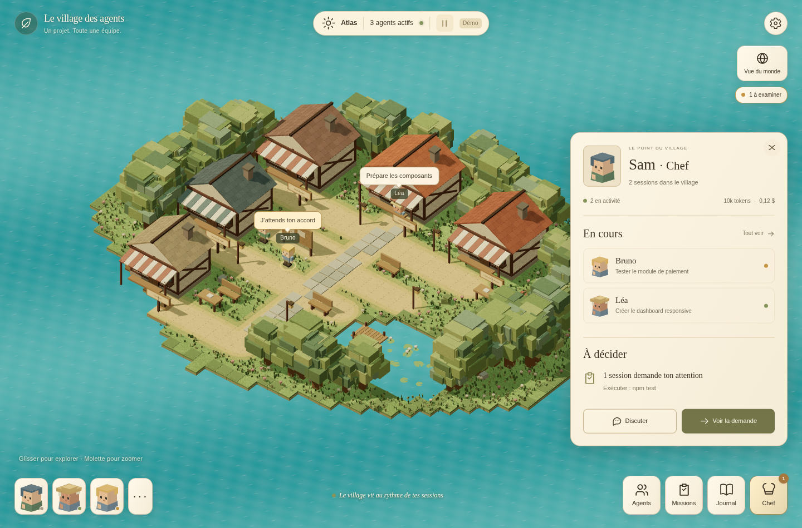

# Le village des agents — PC et mobile

L’interface reprend la direction de Pixel-civ Godot : maisons à colombages,
végétation cubique, sols mats, panneaux crème (`#f9f0de`), encre brune et accents
olive. La référence examinée est le commit `bb7ee361` de `exp/etude-anglais`
(2 octobre 2026), notamment les captures natives de l’ATH et de la fiche habitant.
Les images ci-dessous sont des **captures du code exécuté**, avec les sessions
simulées du serveur de test ; ce ne sont pas les images conceptuelles.

## Captures



[Capture mobile en plein format](village-mobile.png)

## Essayer

```sh
npm ci
npm run demo
# http://localhost:5173
```

`http://localhost:5173/?demo` fonctionne aussi sans le serveur d’agents.
Pour des sessions réelles, lancer `npm run dev`, ou `npm run remote` pour
l’accès au téléphone. L’authentification, l’appairage, les permissions et les
limites de coût restent ceux décrits dans le README.

```sh
npm run build:demo
# dist/demo/index.html : aperçu autonome, simulation uniquement
```

## Interaction

| Action | PC | Mobile |
| --- | --- | --- |
| Déplacer la caméra | Glisser avec le bouton gauche | Glisser avec un doigt |
| Zoomer | Molette | Pincer avec deux doigts |
| Tourner | Glisser avec le bouton droit | Tourner avec deux doigts |
| Revenir au cadrage initial | Vue du monde, puis Le village | Même bouton |
| Inspecter | Personnage, portrait ou menu Agents | Personnage ou menu Agents |
| Fermer une fiche | Croix, même bouton du menu ou Échap | Croix ou même bouton du menu |
| Donner un objectif | Chef → Discuter | Chef → Discuter |
| Examiner une autorisation | Voir la demande → détail → Autoriser/Refuser | Identique |

La pause du bandeau suspend **uniquement les animations**, jamais les agents.
Les données continuent d’arriver par SSE. « Réduire les animations » du système
supprime la marche et les ondulations ; une activité reçue repositionne alors
l’agent sans animation. Le rendu est suspendu quand l’onglet est masqué.

Le panneau du chef résume les statuts, missions et derniers rapports du serveur.
Aucun pourcentage de réalisation n’est déduit du nombre d’outils : le serveur ne
fournit pas cette mesure. Le nom « Laboratoire de tests » représente la zone des
commandes shell ; il ne garantit pas qu’une commande soit un test ou ait réussi.
Le journal et le détail de l’agent conservent ces informations exactes.

Les sessions terminées quittent le village mais restent consultables dans les
filtres Agents/Missions. Une demande non pilotable indique de répondre dans le
terminal : aucun bouton ne prétend l’autoriser à distance.

## Rendu et ressources

- Décor, textures de sol, toits, végétation, tortue et personnages construits en
  code. Aucun asset privé Pixel-civ, capture native ou image générée n’est embarqué.
- Three.js chargé à la demande. Le repli 2D est lui aussi chargé à la demande.
- Cubes du décor instanciés par matériau et ombres statiques mises en cache.
  Les personnages ont des ombres de contact légères.
- Résolution plafonnée à 1,35× sur petit écran et 1,75× sur PC ; cadence de rendu
  plafonnée à 30/45 images/s. Ce sont des limites, pas une mesure de performance.
- Caméra portrait, zones tactiles, marges de sécurité et hauteur dynamique des
  panneaux adaptées au mobile. Un seul panneau de travail est ouvert à la fois.
- Sans WebGL2 ou en cas de perte du contexte graphique, le QG canvas prend le relais.
  `?demo&view=2d` force ce mode. Toutes les commandes restent dans les panneaux React.

Le monde tortue est une interprétation procédurale simplifiée. La fidélité de
l’image conceptuelle reste une direction artistique : ce n’est pas une copie du
moteur Godot ni de ses modèles. Le jour/nuit suit le réglage d’apparence ; il ne
simule pas l’horloge des sessions.

## Vérifications

```sh
npm run typecheck
npm test
npx playwright install chromium
npm run test:ui
npm run build
npm run build:demo
```

Les tests navigateur démarrent un serveur SSE/REST local déterministe sur le
port 7497 et Vite sur le port 5175. Ils vérifient la réception d’un changement
d’activité, la sélection, les missions et filtres, les commandes envoyées au
chef, le recrutement, l’examen et l’envoi d’une permission, le refus HTTP,
les réglages, le petit écran et le repli sans WebGL. Aucun appel LLM n’est effectué.

Validation sous Chromium et émulation tactile iPhone ; pas de mesure sur téléphone
physique, ni de validation d’une session SDK payante dans cet environnement.
