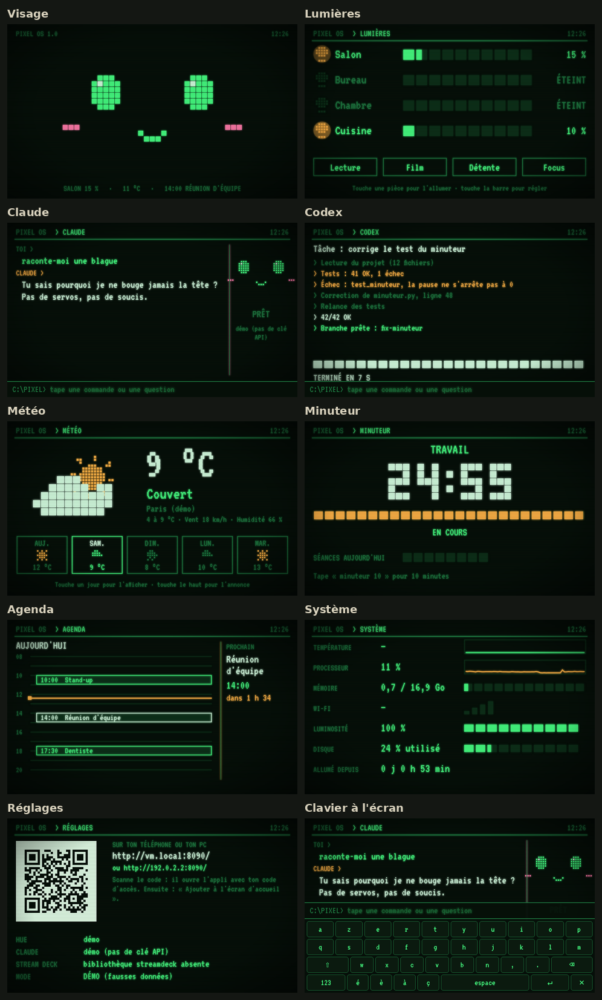
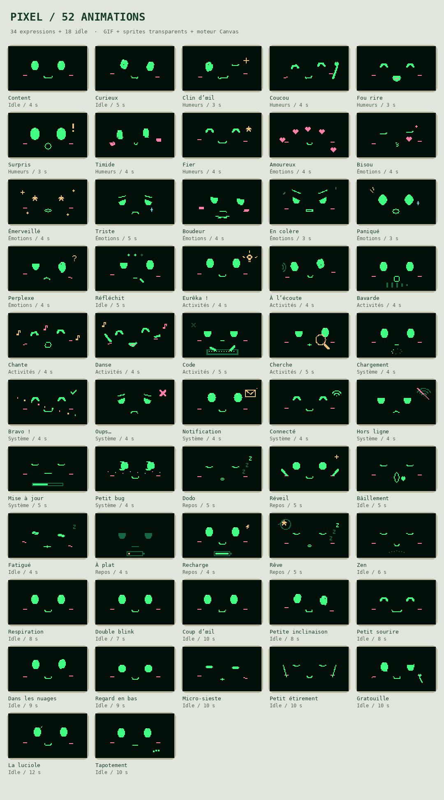
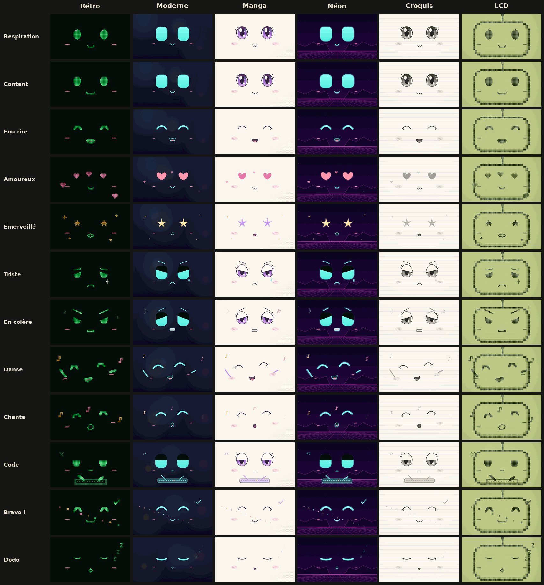
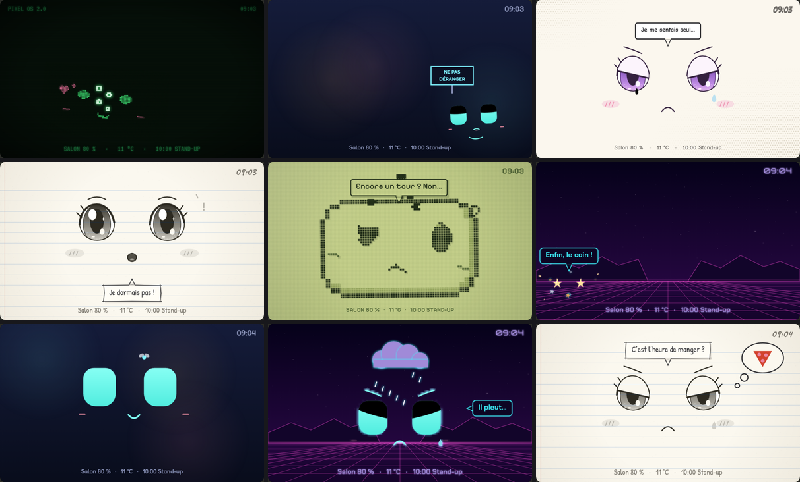
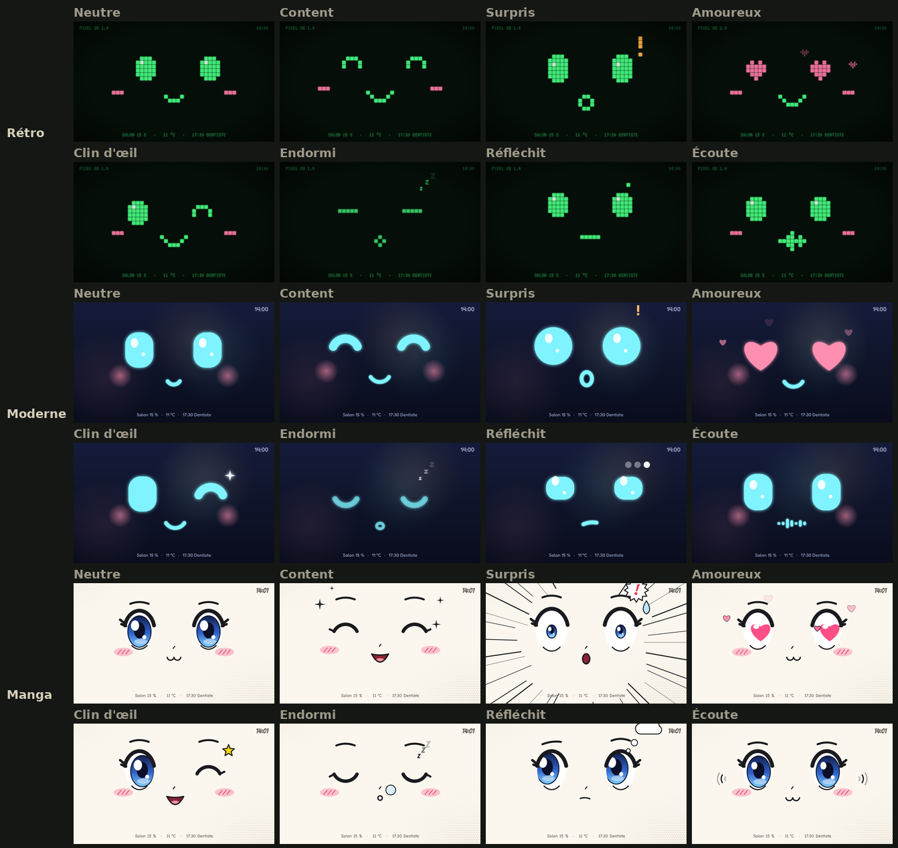
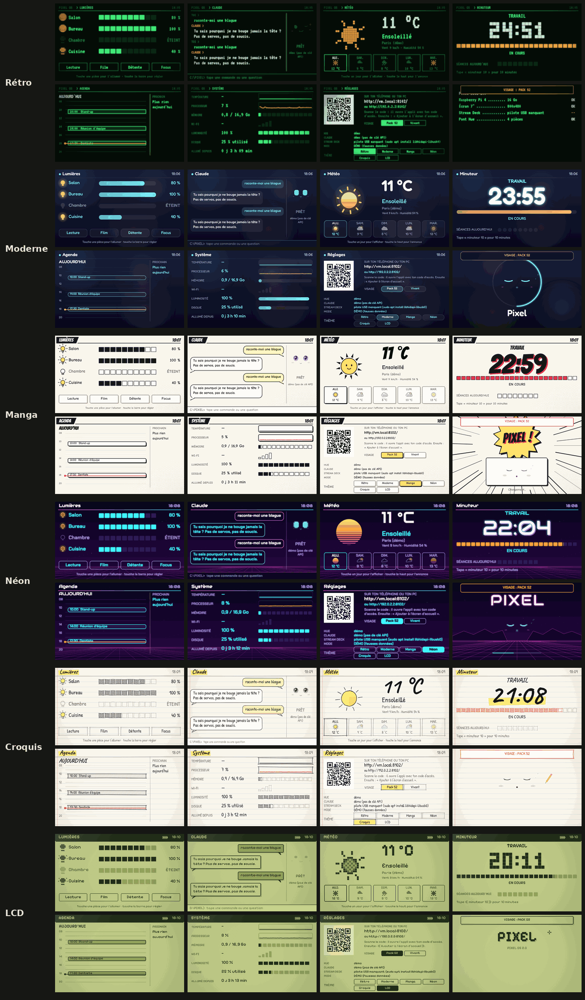
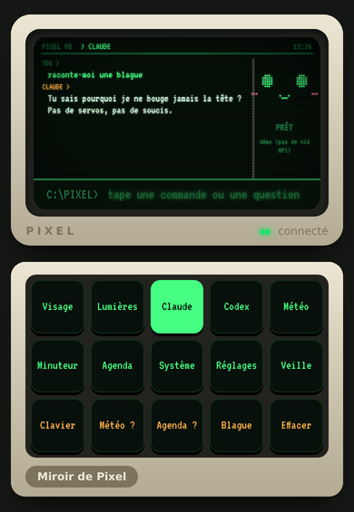

# Pixel : l'appli

L'appli qui tourne sur le Raspberry Pi 4 de Pixel. Elle affiche le visage et les menus sur l'écran de Pixel, et pilote les 15 touches du Stream Deck. La même appli s'ouvre aussi sur ton téléphone ou ton ordinateur, où tu peux taper au clavier. Elle a six thèmes : Rétro, Moderne, Manga, Néon, Croquis et LCD. Le visage de Pixel vient de ton pack de 52 animations ; l'ancien visage vivant reste au choix.



## Ce qu'elle fait

| Écran | Contenu |
| --- | --- |
| **Visage** | Pixel joue les 52 animations de ton pack : il respire, cligne des yeux, regarde autour de lui, change d'humeur, danse ou chante quand tu le demandes. Il s'endort après 10 minutes sans rien. |
| **Lumières** | Tes pièces Philips Hue : allumer, éteindre, régler la luminosité, lancer une scène. |
| **Claude** | Tu écris, Claude répond à l'écran. Il peut aussi agir : régler les lampes, lancer le minuteur, lire la météo et l'agenda, changer d'écran ou de thème, lancer Codex. |
| **Codex** | Lance une tâche de code et affiche son journal en direct. Une notification apparaît sur les autres écrans quand c'est fini. |
| **Météo** | Météo du jour et des 4 jours suivants (Open-Meteo, gratuit, sans compte). |
| **Minuteur** | Séances de concentration de 25 minutes et pauses café. |
| **Agenda** | Aujourd'hui et demain, depuis Google Agenda (donc aussi l'agenda Samsung relié à ton compte Google), iCloud, Outlook… ou un fichier .ics importé. Plusieurs agendas à la fois. |
| **Système** | Température, processeur, mémoire, Wi-Fi et luminosité de l'écran. |
| **Réglages** | Un QR code pour ouvrir l'appli sur ton téléphone, l'association du pont Hue et l'état de chaque service. |
| **Veille** | Un champ d'étoiles avec Pixel qui dort. Les touches du Stream Deck baissent leur lumière. |

## Les thèmes

**Pour le moment, Pixel n'a que le thème Rétro.** Les 5 autres sont toujours là, mais rien ne les propose : ni Réglages, ni le Stream Deck, ni les commandes, ni Claude. Sur Réglages, le Stream Deck montre alors *Effet CRT*, *Visage Pack 52* et *Visage Vivant* à la place des touches de thème. Pixel ne charge que la police du Rétro, ce qui allège aussi son démarrage.

Pour les retrouver, mets dans `config.toml`, partie `[ui]`, puis redémarre Pixel :

```toml
themes = ["retro", "moderne", "manga", "neon", "croquis", "lcd"]
```

Tu peux aussi n'en garder que quelques-uns, par exemple `themes = ["retro", "lcd"]`. Dans Pixel Lab, le bouton **Voir les 6 thèmes** les montre quand même.

| Thème | Style |
| --- | --- |
| **Rétro** | Écran vert de vieux PC, visage en gros pixels, lignes de balayage. Il démarre comme un vieux PC, avec un BIOS. |
| **Moderne** | Fond bleu nuit, grands yeux lumineux et arrondis qui flottent, rebondissent et clignent en douceur. Les messages de Claude sont dans des bulles. |
| **Manga** | Page de manga : grands yeux brillants avec reflets, joues rosées, trame de points. Il a aussi des effets de manga : traits de vitesse quand il est surpris, bulle au nez quand il dort, étoile quand il fait un clin d'œil. |
| **Néon** | Nuit synthwave : grille rose qui défile vers toi, montagnes, coucher de soleil rayé en veille. Le visage est fait de tubes néon qui s'allument en grésillant. |
| **Croquis** | Dessin au crayon sur une page de cahier à lignes. Les traits tremblent un peu, comme un dessin animé fait main. Surligneur jaune et stylo rouge. |
| **LCD** | Écran de console de poche : quatre tons de vert, grille de points, pixels qui font une petite ombre. Pixel y devient une petite créature avec une antenne. |

**Pour changer de thème** (quand il y en a plusieurs) :
- sur l'écran **Réglages**, touche un thème ;
- avec les touches **Thème −** et **Thème +** du Stream Deck, sur Réglages ;
- en tapant `thème néon`, `thème croquis`, `thème suivant`… ;
- en demandant à Claude « mets le thème néon ».

Le choix est gardé au redémarrage. Les touches du Stream Deck et de l'appli sur téléphone changent de couleurs et de police avec le thème.

## Les 52 animations

Le visage de Pixel vient de **ton pack** « Pixel OS — 3 thèmes, 52 animations » (version 2.1) : 34 expressions, activités et états, et 18 animations d'attente. Le pack est copié dans `web/pack52/`. Dans `pixel.js` et `pixel-themes.js`, seuls les noms de deux variables ont changé (`Pixel52` et `Pixel52Themes`), pour ne pas gêner ceux de Pixel OS. `animations.json` garde les 52 animations, sans les liens vers les GIF et les sprites, qui ne sont pas copiés. Les dessins et le moteur des animations sont les tiens.



Pixel les dessine dans ses 6 thèmes :
- **Rétro** reprend les pixels de ton pack, aux couleurs de l'écran vert ;
- **Moderne** et **Manga** reprennent son dessin Moderne et Manga ;
- **Néon** reprend le Moderne, avec un halo de néon ;
- **Croquis** reprend le Manga, au crayon sur la page ;
- **LCD** reprend les pixels en quatre verts, dans la tête de la petite créature.

Le visage tient dans un cadre 16:9 entre le haut de l'écran et la ligne du bas. D'une animation à l'autre, la pose glisse en douceur. En Rétro et en LCD, ce sont les pixels qui se mélangent.



**Quand rien ne se passe**, Pixel enchaîne les 18 animations d'attente, une boucle chacune. Il les tire au sort : les plus discrètes reviennent plus souvent, et jamais deux fois la même de suite. Avant de s'endormir, il pique du nez (Micro-sieste), puis il fait dodo et rêve.

**Chaque humeur a son animation :**

| Humeur | Animation |
| --- | --- |
| Neutre | les animations d'attente |
| Content, Surpris, Amoureux, Réfléchit, Triste, Confus, Fier | les animations du même nom |
| Clin d'œil | Clin d'œil |
| Endormi | Dodo et Rêve |
| Écoute | À l'écoute |
| Fâché | En colère |
| Excité | Émerveillé |
| Malade | À plat |
| Bâille | Bâillement |

**Ce qui se passe autour de lui :**
- une notification fait arriver une enveloppe ;
- Codex au travail : il tape sur son clavier ; réussi : Bravo ! ; en échec : Oups… ;
- Claude réfléchit : Réfléchit ; Claude répond : Bavarde ;
- au réveil et à la fin du démarrage : Réveil.

**Le toucher :** sous ton doigt, le visage s'écrase un peu, puis rebondit. Pour le reste, Pixel a sa personnalité : voir la partie suivante.

**Pour en jouer une :**
- tape `anim danse`, `animation fou rire`, `anim clin d'oeil`… (le nom, avec ou sans accents) ;
- ou simplement `danse`, `chante`, `coucou`, `bisou` ;
- `animations` affiche la liste ;
- sur le Stream Deck, écran Visage : la touche **Anim +** les passe en revue ;
- demande à Claude « fais-moi une petite danse ».

Elle se joue une ou deux fois, puis Pixel revient à son humeur. Ça marche dans les 6 thèmes, quel que soit le visage choisi. Sur l'écran Claude, la petite tête réfléchit, parle et écoute avec les mêmes animations.

**Pour garder l'ancien visage :** dans **Réglages**, touche **Vivant** à côté de « VISAGE ». Tu peux aussi taper `visage vivant`, puis `visage pack` pour revenir au pack. Le choix est gardé au redémarrage.

## Sa personnalité

Pixel réagit à ce que tu lui fais, s'en souvient un moment, et vit sa vie quand personne ne le regarde. Ses expressions viennent de tes 52 animations. Pixel bouge en entier sur l'écran : il nage, part se promener, se cache ou boude dans un coin. Autour de lui : des cœurs, des larmes, des bulles, une mouche… Et il parle dans une bulle. Ça marche dans les 6 thèmes, avec les deux visages. En Rétro et en LCD, tout est dessiné en gros pixels, comme son visage.



**Quand tu le touches**, ça dépend de l'endroit :

| Où | Ce qu'il fait |
| --- | --- |
| un œil | « Aïe, mon œil ! », et une petite larme |
| le haut de la tête | « Bonk ! » : il s'écrase, des étoiles tournent |
| la bouche | il rit : « Ça chatouille ! » |
| un côté | il glisse plus loin : « Hé, pousse pas ! », puis revient |
| à côté de lui | il se penche vers ton doigt : « Y a quoi, là ? » |
| ailleurs sur le visage | au hasard : coucou, youpi, pirouette, timide, bisou, « J'ai une idée… non, rien » |
| deux tapes très vite | une pirouette |

**Quand tu l'embêtes**, il s'énerve petit à petit : d'abord « Hé ho ! », « Pfff… » ; puis il esquive ton doigt (« Raté ! ») ou se met en colère, avec de la vapeur et une veine sur le front. Une dizaine de tapes de suite, et **il boude** : il part dans un coin, de dos, avec un panneau « NE PAS DÉRANGER ». Si tu insistes, il répond sans te regarder (« Pfff. », « Je boude. ») et ça dure plus longtemps. Il pardonne au bout d'une demi-minute, ou avec deux câlins : « Bon… je te pardonne. » Sa colère retombe en une minute environ.

**Les câlins** (caresse le visage d'un côté à l'autre) : des cœurs et un « Ronron… ». Ils le calment quand il est agacé. Beaucoup de câlins de suite, et il s'endort.

**Quand tu reviens** après un moment sans le toucher :
- après 20 minutes : « Ah, te revoilà ! » ;
- après 2 heures : il est triste (« Tu m'as manqué… »), puis il saute de joie ;
- le matin, après la nuit : « Bonjour ! Prêt pour la journée ? » ; le soir : « Bonsoir ! » ;
- réveillé de sa sieste : « Hein ? Je dormais pas ! » ;
- le 24 et le 25 décembre, le premier bonjour de la journée est « Joyeux Noël ! » ; le 1er janvier, « Bonne année 2027 ! ».

Il s'en souvient même si Pixel a redémarré.

**Quand personne ne le regarde**, toutes les 1 à 2 minutes et demie, il fait un des 24 moments de vie, jamais deux fois le même de suite :
- **Le poisson :** il nage en rond en faisant des bulles.
- **La balade :** il sort de l'écran d'un côté et revient de l'autre.
- **Coucou caché :** il se cache en bas, ressort les yeux, puis « Bouh ! ».
- **L'économiseur d'écran :** il rebondit sur les bords comme le vieux logo DVD, jusqu'à toucher le coin : « LE COIN !!! ».
- **La toupie :** il tourne, puis il a la tête qui tourne.
- **La mouche :** il la suit, elle se pose sur sa tête, il éternue.
- **Le hoquet, l'éternuement, il sifflote, la danse en cachette :** si tu le surprends en train de danser, il répond « Euh… t'as rien vu ! ».
- **Toc toc :** il tape à la vitre de l'écran, de l'intérieur.
- **L'ennui, la sieste, le grand étirement, la rêverie, la méditation, la joie, la gym, « Psst ! » :** des petits moments calmes.
- **Selon le moment :** sous la pluie, il a un petit nuage au-dessus de la tête. Au soleil, il bronze. À l'heure des repas, il pense à une pizza. En décembre, il regarde tomber la neige et compte les dodos avant Noël. La nuit, il ne fait que des moments calmes et bâille.

Ils ne passent pas quand quelque chose d'autre a besoin de son visage : une humeur, une animation, Claude, Codex, un bandeau, ou juste avant qu'il s'endorme.

**Autour de lui :**
- quand tu éteins toutes les lumières, il a peur du noir : « Qui a éteint ?! » ;
- quand tu les rallumes : « Ah, la lumière ! » ;
- à chaque heure pile, dans la journée, il fait le coucou de l'heure : « Coucou ! Il est 15 h. » ;
- 10 minutes avant un rendez-vous de ton agenda, une petite horloge sonne à côté de lui : « Hé ! Dans 10 min… Réunion d'équipe ! ». Peu après la fin, il demande : « Ça s'est bien passé ? » ;
- quand le Pi dépasse 70 °C, il a chaud : il transpire, et de l'air chaud monte autour de sa tête. Il le redit toutes les 15 minutes tant que le Pi ne refroidit pas ;
- quand le Wi-Fi tombe : « Hé, le Wi-Fi est parti ! ». Quand il revient : « Ouf, je capte à nouveau ! » ;
- tout le mois de décembre, il porte un bonnet de Noël.

**Pour en voir un :**
- tape `fais le poisson`, `fais la sieste`, `joue la toupie`, `fais l'économiseur d'écran`… ;
- `scènes` affiche la liste ;
- dans Pixel Lab, le panneau **Personnalité** joue chaque moment, l'embête, lui fait un câlin et simule ton retour après 30 min, 3 h ou une nuit ;
- demande à Claude « fais le poisson ! ».

Chaque écran a son propre Pixel : ton téléphone et l'écran de Pixel réagissent chacun à leur toucher. Une scène demandée par une commande ou par Claude passe sur tous les écrans.

**Sa voix :** sur l'écran du Pi, Pixel fait des bips de petit robot :
- une petite musique par scène (des bulles pour le poisson, Jingle Bells pour la neige, une alarme pour un rendez-vous) ;
- un babillage quand il parle.

Les sons sont fabriqués par la page, sans fichier. Branche un petit haut-parleur sur la prise casque du Pi. Le volume se règle dans le menu rapide (ligne SON). Ton téléphone reste muet.

**Le menu rapide :** sur l'écran du Pi, glisse vers le bas. Il contient :
- le thème (s'il y en a plusieurs), la luminosité et le son ;
- **Téléphone**, qui affiche le QR code en grand pour ouvrir l'appli ;
- **Poisson** ;
- **Redémarrer** et **Éteindre**, qui demandent une deuxième touche pour confirmer.

Glisse vers le haut pour le fermer.

**Installer l'appli sur ton téléphone :** sur l'écran du Pi, glisse vers la gauche sur son visage. Le QR code arrive en grand. Glisse vers la droite pour revenir.

## Les humeurs

Tous les thèmes dessinent les 15 humeurs. Avec le visage du pack, chaque humeur joue son animation (voir plus haut). Avec le visage vivant, montré ici, il passe de l'une à l'autre en douceur : les yeux et la bouche se transforment (en Rétro et en LCD, les pixels se mélangent).

| Humeur | Quand |
| --- | --- |
| Neutre | Par défaut : il cligne des yeux (parfois deux fois), regarde autour de lui, suit ton doigt. |
| Content | Quand tu le touches, quand Codex réussit. |
| Surpris | Notification, fin du minuteur, réveil en sursaut. |
| Amoureux | Quand tu lui dis merci, ou quand tu le caresses du doigt. |
| Clin d'œil | Après une blague. |
| Endormi | Après un moment sans rien faire. |
| Réfléchit | Pendant que Claude prépare sa réponse. |
| Écoute | Pendant que tu écris à Claude. |
| Triste | Quand quelque chose rate, par exemple Claude injoignable. |
| Fâché | Quand tu le tapotes trop vite. |
| Confus | Quand il n'a pas compris. |
| Excité | Des étoiles plein les yeux : une super nouvelle. |
| Fier | Lunettes de soleil : il a réussi un truc. |
| Malade | Quand le Raspberry Pi chauffe trop (plus de 80 °C). |
| Bâille | Quand il s'ennuie, juste avant de s'endormir. |

**Le toucher :** sous ton doigt, le visage s'écrase un peu, puis rebondit quand tu le lâches. Ses yeux suivent ton doigt. Tapote-le cinq fois de suite : il se fâche. Caresse-le d'un côté à l'autre : il tombe amoureux.

Tape `humeur triste`, `humeur fier`… pour en voir une. Sur le Stream Deck, la touche **Humeur +** de l'écran Visage les passe toutes en revue.





## Taper au clavier

Il y a trois façons d'écrire :

- **Sur ton ordinateur :** ouvre l'appli et tape directement, ça écrit dans la barre `C:\PIXEL>`. Les flèches ← et → changent d'écran.
- **Sur ton téléphone :** touche la barre `C:\PIXEL>`, le clavier du téléphone s'ouvre.
- **Sur Pixel lui-même :** touche la barre, ou la touche **Clavier** du Stream Deck. Un clavier AZERTY s'affiche sur l'écran tactile. Un clavier Bluetooth marche aussi : le Pi 4 a le Bluetooth, donc il n'ajoute pas de câble.

Ce que tu tapes est d'abord lu comme une commande. Si ce n'en est pas une, ça part à Claude.

| Tu tapes | Ça fait |
| --- | --- |
| `salon 40` | met le salon à 40 % |
| `allume bureau`, `éteins cuisine`, `chambre off` | allume ou éteint une pièce |
| `éteins tout`, `allume tout` | toutes les pièces |
| `scène film` | lance une scène Hue |
| `minuteur 10`, `pause` | lance un minuteur de 10 minutes, le met en pause |
| `codex corrige le test qui échoue` | lance une tâche Codex |
| `météo`, `agenda`, `système`… | ouvre cet écran |
| `humeur content`, `humeur triste`, `humeur fâché`… | change l'humeur du visage |
| `thème néon`, `thème croquis`, `thème lcd`, `thème rétro`… | change le style de l'écran |
| `thème suivant`, `thème précédent` | passe au thème d'après, ou d'avant |
| `anim danse`, `animation fou rire`, `danse`, `coucou`… | joue une des 52 animations |
| `animations` | affiche la liste des animations |
| `fais le poisson`, `fais la sieste`, `joue la toupie`… | un de ses moments de vie (voir « Sa personnalité ») |
| `scènes` | affiche ses moments de vie |
| `visage vivant`, `visage pack` | change de visage |
| `aide` | affiche la liste des commandes |
| n'importe quoi d'autre | c'est envoyé à Claude, par exemple « baisse un peu les lumières, je regarde un film » |

## Le Stream Deck

- **Rangées 1 et 2 :** les 10 écrans.
- **Rangée 3 (en couleur) :** des actions qui changent selon l'écran. Par exemple : humeurs, *Anim +* et *Humeur +* sur Visage, scènes sur Lumières, *Pause café* sur Minuteur, *Clavier* sur Claude, *Thème −* et *Thème +* sur Réglages.
- **Dessin des touches :** aux couleurs et avec la police du thème. L'écran ouvert est mis en valeur.

## Sur ton téléphone

1. Sur l'écran de Pixel, glisse vers la gauche sur son visage (ou ouvre **Réglages**), puis scanne le QR code. Il contient le code d'accès.
2. Dans le navigateur, choisis **Ajouter à l'écran d'accueil**. Pixel s'ouvre alors comme une appli.
3. Le bouton **Miroir de Pixel** :
   - allumé, ton téléphone montre et change l'écran de Pixel ;
   - éteint, tu navigues de ton côté sans changer l'écran de Pixel.

**L'appli Android** (projet Expo [`pixel-mobile`](../pixel-mobile/)) est une vraie appli plein écran, avec les modes **Pixel**, **Clavier** et **Les deux**. En mode Pixel, l'écran du téléphone reste allumé.
- Pose l'APK dans le dossier de données de Pixel, sous le nom `~/.config/pixel/pixel.apk`. Dans Chrome sur Android, un lien **Appli Android** apparaît alors sous le clavier.
- Au premier lancement, l'appli scanne le QR code de Pixel, puis s'en souvient.

L'appli marche sur ton Wi-Fi, en IPv4 comme en IPv6 : un téléphone trouve souvent `pixel.local` par son adresse IPv6. Pixel ne répond qu'aux appareils de la maison, même si ta box laisse passer l'IPv6 depuis Internet. Sans le code d'accès, un autre appareil du réseau voit la page mais ne peut rien faire.



## Pixel de poche

**Tourne ton téléphone en mode paysage** : l'appli devient un deuxième Pixel, comme un petit animal dans ta poche. C'est le même Pixel que sur l'écran du Pi : même thème (Rétro par défaut), mêmes 52 animations, même personnalité et toutes ses scènes. Il reçoit les mêmes nouvelles : notifications, Codex, minuteur, météo, lumières. Remets le téléphone droit et tu retrouves la télécommande. C'est le téléphone lui-même qu'il faut tourner : un écran partagé ou le clavier qui s'ouvre ne le font pas apparaître.

Sur une tablette, ou si la rotation de ton téléphone est bloquée, touche **Pixel de poche** sous l'écran de Pixel. Le bouton **×**, en haut à gauche, ramène la télécommande.

**Comme sur le Pi**, il réagit à ton doigt : les yeux, la tête, la bouche, les côtés. Tapote-le plusieurs fois de suite, il s'énerve. Caresse-le du doigt, ou **appuie longtemps** dessus : c'est un câlin.

**Et en plus, il sent le téléphone :**
- **secoue-le** : il a le tournis (« Je suis pas un cocktail ! ») ;
- **penche-le** : il glisse vers le bas et se penche pour rester droit ; très penché, « Wooo, ça glisse ! » ;
- **sors-le de ta poche**, ou reprends le téléphone posé depuis un moment : « Il faisait tout noir dans ta poche ! » ;
- **la batterie du téléphone** à 15 % puis à 5 % : « Branche-moi ! » ; branché : « Miam, de l'électricité ! » (Android seulement, l'iPhone ne donne pas sa batterie à une page) ;
- **loin de la maison** (le Pi ne répond plus) : il continue de vivre sur le téléphone et dit qu'il ne capte plus la maison ; dès que le Pi répond, il se reconnecte tout seul. Si le téléphone a fermé la page entre-temps, elle ne se rouvre sans le Pi que sur une adresse en https : le téléphone garde alors l'appli et le dernier état de Pixel. En http, il faut la rouvrir à la maison.

**Ses sens demandent une adresse en https.** Un téléphone ne donne ses mouvements (secouer, pencher), sa batterie et « l'écran reste allumé » qu'à une page sûre : en https, ou ouverte sur l'appareil lui-même. Sur l'adresse habituelle de Pixel, en http, le Pixel de poche vit quand même, réagit au doigt et aux câlins, connaît son jumeau et fait le voyage, mais il ne sent pas le téléphone ; il le dit une fois, en bas de l'écran. Dans l'appli Android, l'écran reste allumé même en http : c'est l'appli qui s'en charge. Pour tout avoir, ouvre Pixel par une adresse en https dont le téléphone accepte le certificat.

**Les deux Pixels se connaissent.** Caresse celui du téléphone : celui du Pi est jaloux (« Hé ! Tu caresses l'autre ?! »). Touche-le ou secoue-le : celui du Pi s'inquiète pour son jumeau. Quand tu allumes le Pixel de poche, celui du Pi lui fait coucou. Et dans l'autre sens, si on touche ou caresse le Pixel du Pi, celui de ta poche le remarque.

**Le voyage :** le bouton **Viens !**, en haut à droite, fait venir Pixel dans ton téléphone. Sur le Pi, il prend sa valise et sort de l'écran ; sur le téléphone, son jumeau lui laisse la place et il arrive. Il reste une minute, puis rentre à la maison. **Rentre !** le renvoie plus tôt, et toucher l'écran vide du Pi le rappelle aussi.

**Le téléphone :**
- l'écran reste allumé tant que Pixel est réveillé (en https, ou dans l'appli Android). S'il s'endort (10 minutes sans le toucher, comme sur le Pi), le téléphone peut se mettre en veille ;
- sur Android, la première touche le met en plein écran ; avec le bouton **Pixel de poche**, il reste en paysage. Un iPhone ne permet ni l'un ni l'autre à une page : tourne-le simplement ;
- sur iPhone, la première touche demande la permission d'utiliser les mouvements (secouer, pencher) ;
- l'image est nette, à la densité de pixels du téléphone ; les côtés prennent le fond du thème ; pas de défilement ni de zoom ;
- il reste muet. Pour essayer ses bips quand même, ouvre l'appli avec `?son=1` au bout de l'adresse.

Dans Pixel Lab, le panneau **Pixel de poche** montre le téléphone en paysage, et ses boutons font comme si on secouait, penchait ou caressait l'un ou l'autre des deux Pixels.

## Son caractère

Tu peux changer le caractère de Pixel : câlin, grognon, farceur, timide… Et ça change vraiment ce qu'il fait.

**Pour le régler**, sur ton téléphone, touche **Caractère** sous les touches. Tu y trouves :
- **15 caractères tout prêts**, chacun avec sa phrase : Pixel (équilibré), Câlin, Grognon, Farceur, Timide, Bavard, Paresseux, Pile électrique, Gourmand, Petit prof, Rêveur, Curieux, Zen, Indépendant, et **Surprise**, tiré au hasard ;
- **les réglages fins** : huit curseurs de 0 à 100. Indépendant ↔ Câlin, Patient ↔ Grognon, Taiseux ↔ Bavard, Sérieux ↔ Farceur, Calme ↔ Énergique, Blasé ↔ Curieux, Petit appétit ↔ Gourmand, Pas scolaire ↔ Studieux. À 50 partout, c'est exactement le Pixel de toujours ;
- **son nom** (Pixel au départ) et **comment il t'appelle** (rien au départ) ;
- **ses habitudes** : l'humeur du jour (ses traits bougent un peu chaque jour), s'il peut bouder, s'il parle dans des bulles, et ses heures calmes (de 23 h à 6 h au départ) ;
- **Essayer**, qui lui fait jouer une scène typique de son caractère, et **Réinitialiser** (touche deux fois), qui le remet comme au premier jour.

Le choix est gardé au redémarrage (fichier `caractere.json` dans le dossier de données). Le Pixel du Pi et le Pixel de poche ont le même caractère.

| Trait | Ce qu'il fait |
| --- | --- |
| Grognon | Il s'énerve plus vite quand tu l'embêtes, boude plus souvent et plus longtemps, ronchonne parfois à la première tape et rouspète tout seul. Patient : l'inverse. |
| Câlin | Chaque câlin compte double : il devient vite tout amoureux et te fait de gros câlins. Indépendant : il repousse parfois tes câlins (« Ça va, ça va… »). |
| Bavard | Plus de bulles, et des histoires. Taiseux : il ne dit presque rien. |
| Farceur | Plus de rires, de grimaces et de farces, comme la fausse panne « Pixel.exe ne répond pas ». Sérieux : moins de pitreries. |
| Énergique | Il vit sa vie plus souvent, bouge plus vite et saute partout. Calme : il s'étale et fait la sieste (« La flemme »). |
| Curieux | Il enquête avec sa loupe et répond à tout. Blasé : il laisse passer une bonne partie des notifications. |
| Gourmand, Studieux | Il rêve de gâteaux ; il fait des calculs au tableau, avec ses lunettes. |

Toutes ses scènes suivent son caractère, celles des autres paquets aussi : il choisit plus souvent celles qui lui ressemblent.

**Quand tu changes son caractère, il le montre** : une couronne pour le grognon (« Pff… c'est qui le chef ? »), une ronde de cœurs pour le câlin, des lunettes et un tableau pour le petit prof, un dé pour Surprise, une étiquette « Je m'appelle Bip » pour son nouveau nom…

**En tapant :** `sois grognon`, `caractère câlin`, `caractère surprise`, `caractère normal`, `plus câlin`, `moins bavard`, `un peu plus farceur`, `appelle-toi Bip`, `appelle-moi Max`, `oublie mon surnom`, `tais-toi`, `tu peux parler`. `caractère` tout court affiche la liste.

**Avec Claude :** il connaît son caractère, son nom et ton surnom, et répond avec (grognon veut dire râleur mais gentil). Demande-lui « sois plus câlin » ou « appelle-toi Bip » : il peut le changer lui-même.

Dans Pixel Lab, le panneau **Caractère** fait la même chose.

## Tes agendas (Google et Samsung)

Sur ton téléphone, dans l'appli, touche **Agendas** (sous le clavier). La page te guide.

- **Google Agenda :** colle l'« adresse secrète au format iCal » de ton agenda. Tu la trouves sur un ordinateur, dans les paramètres de Google Agenda, rubrique « Intégrer l'agenda ». Les changements arrivent sur Pixel toutes les 10 minutes, ou tout de suite avec « Actualiser ».
- **Agenda Samsung :** il affiche aussi les agendas de ton compte Google. Crée tes rendez-vous dans un agenda Google (pas « Samsung » ni « Téléphone ») : ils arrivent sur Pixel tout seuls.
- **Rendez-vous seulement dans l'agenda Samsung :** si l'appli te propose de les partager ou de les exporter en fichier .ics (ou .vcs), importe ce fichier sur la même page. C'est une copie : réimporte-le pour le mettre à jour.
- **Autres agendas :** toute adresse .ics ou webcal:// marche aussi (iCloud, Outlook, Proton…).

Les adresses restent sur le Pi (fichier privé), et les écrans n'affichent que le nom de chaque agenda.

## Essayer sur ton ordinateur (mode démo)

Lampes, météo, agenda, Claude et Codex sont alors faux, mais tout s'affiche et réagit :

```bash
cd pixel-app
pip install -r requirements.txt
python server.py --demo
```

Ouvre ensuite <http://localhost:8080> pour la version téléphone, ou <http://localhost:8080/?kiosk=1> pour l'écran de Pixel.

## Tester les animations : Pixel Lab

Le labo d'essai : chaque thème, chaque humeur, les 10 écrans et tous les événements (notification, Claude, Codex, minuteur, veille, démarrage…), avec ralenti, pause et un test du vrai écran 7 pouces (couleurs, bords, toucher, images par seconde). Il est dessiné par le vrai code de Pixel, avec de fausses données.

- **Sur ton ordinateur :** lance le mode démo ci-dessus, puis ouvre <http://localhost:8080/lab>.
- **Sur le Pi, en plein écran :** `chromium-browser --kiosk "http://localhost:8080/lab?kiosk=1"`. Appuie 1 seconde sur l'écran pour ouvrir le menu.

Tout est expliqué dans [web/lab/README.md](web/lab/README.md).

## Économie d'images

Pixel ne redessine son écran 60 fois par seconde que quand ça bouge vite : quand tu le touches (et 2,5 secondes après), quand l'écran ou le thème change, pendant un bandeau et pendant les animations rapides. Le reste du temps :

| Quoi | Images par seconde |
| --- | --- |
| Visage en Moderne, Manga, Néon, Croquis : animations d'attente | 30 |
| Visage en Rétro et LCD (ton pack y est dessiné à 20 images par seconde) | 24 |
| Météo, Claude au repos, Codex au travail, minuteur lancé | 20 à 30 |
| Veille | 15 |
| Écrans immobiles : Agenda, Réglages, Système, Lumières… (20 en Néon et Moderne, dont le décor bouge) | 10 |

Une nouvelle info du serveur s'affiche tout de suite. Mesuré dans Chromium, sur un PC : le processeur utilisé pour l'affichage baisse de 40 à 70 % selon l'écran. Sur le Pi, il chauffe moins et laisse plus de place à Claude et Codex.

Pour tout repasser à 60 images par seconde, ajoute `&fps=full` à l'adresse de l'écran (`http://localhost:8080/?kiosk=1&fps=full` dans `deploy/kiosk.sh`). Dans Pixel Lab, c'est le bouton **Économie d'images**.

## Installer sur le Raspberry Pi

Il faut Raspberry Pi OS avec le bureau (Bookworm ou plus récent), et ce dépôt copié dans ton dossier personnel.

```bash
cd ~/Pixel-ai-dashboard/pixel-app
sh deploy/install.sh
```

Le script fait 5 choses :
1. Il installe les paquets nécessaires.
2. Il crée un environnement Python.
3. Il autorise l'accès au Stream Deck et à la luminosité de l'écran.
4. Il lance le serveur au démarrage.
5. Il ouvre l'écran de Pixel en plein écran à l'ouverture de session.

**Ensuite :**

1. **La clé Claude :** crée une clé sur la console Anthropic, puis écris-la dans `/etc/pixel.env` :
   ```bash
   sudo nano /etc/pixel.env       # ANTHROPIC_API_KEY=sk-ant-...
   ```
   Sans clé, Claude reste en mode démo.

   **Ou ton abonnement Claude** (Pro ou Max), sans clé API :
   1. Sur n'importe quel ordinateur où Claude Code est installé (sur le Pi : `curl -fsSL https://claude.ai/install.sh | bash`), lance `claude setup-token`. Connecte-toi dans le navigateur. Il affiche un jeton valable un an.
   2. Écris-le dans `/etc/pixel.env` sur une ligne `CLAUDE_CODE_OAUTH_TOKEN=...`, sans espace : un jeton affiché sur plusieurs lignes se copie parfois avec des espaces.
   3. Relance `sh deploy/install.sh`. Le script ajoute le SDK Claude Agent, environ 400 Mo.

   Pixel prend l'abonnement quand il trouve ce jeton et pas de clé API. Pour choisir toi-même, mets `backend = "abonnement"` ou `backend = "api"` dans `[claude]` de `config.toml`.

   Avec l'abonnement, ses réponses comptent dans les mêmes limites que claude.ai et Claude Code. Pixel bâille quand le quota est épuisé et te dit à quelle heure il revient. Garde son code d'accès pour toi : si quelqu'un d'autre lui parle, c'est ton abonnement qui répond.
2. **Tes réglages :** ouvre `config.toml` pour indiquer ta ville et le dossier de projet de Codex. Tes agendas s'ajoutent depuis ton téléphone (voir « Tes agendas »).
3. **Codex :** installe-le (`npm i -g @openai/codex`), puis connecte-toi une fois (`codex login`). Ou mets `OPENAI_API_KEY=...` dans `/etc/pixel.env`. La commande lancée se règle dans `[codex] command` de `config.toml`. Tu peux y mettre Claude Code à la place.
4. **Hue :** sur Pixel, ouvre **Réglages**, touche **Associer Hue**, puis appuie sur le bouton du pont dans les 30 secondes.
5. Redémarre : `sudo reboot`.

## Coût

L'appli est gratuite. Les réponses de Claude sont facturées à l'usage sur ton compte API Anthropic. Le modèle est Claude Opus 5.5 avec un effort bas (`effort = "low"`), pour des réponses rapides et courtes. Si Claude refuse une demande pour raison de sécurité, l'API réessaie toute seule avec un autre modèle.

Avec ton abonnement Claude, rien n'est facturé en plus : les réponses comptent dans ton quota. Le modèle est alors Claude Sonnet 5.5 (`abonnement_model`), plus léger qu'Opus, pour que ton quota dure plus longtemps. Pixel envoie sa consigne courte et ses propres outils seulement, soit environ 400 jetons par message.

## Vérifications faites

Testé sur ordinateur, avec les tests du dossier `tests/` :
- **Commandes et accès** (`test_pixel.py`) : lampes, scènes, minuteur, écrans, Claude et Codex en démo, refus d'un appareil sans code d'accès. Chaque thème : choix dans Réglages, touches *Thème −* et *Thème +*, commande `thème …`, choix gardé après un redémarrage (avec les 6 thèmes activés). Sans réglage `themes` : Rétro seul, les autres refusés avec un message, pas de touches de thème, pas d'outil de thème pour Claude. Chaque humeur avec `humeur …`.
- **Données réelles** (`test_real.py`) : la vraie météo d'Open-Meteo, un agenda iCal avec un événement sur la journée et un événement répété, et les 15 touches du Stream Deck dessinées dans chaque thème.
- **Agendas** (`test_agenda.py`) : un agenda Google (heure de Paris, événement répété, vacances sur plusieurs jours, soirée après minuit, événement annulé), un fichier Samsung .vcs importé puis réimporté, un rendez-vous présent dans deux agendas affiché une seule fois, les erreurs (404, page web, pas d'internet), le fichier privé, et l'adresse secrète qui n'arrive jamais sur les écrans.
- **Pixel Lab** : 140 vérifications dans Chromium, sur ordinateur, téléphone et en plein écran 800 × 480.
- **Claude** (`test_claude_loop.py`) : la boucle a tourné face à un faux serveur d'API. Claude règle le salon, change de thème et d'humeur, et un thème inconnu est refusé.
- **Claude avec l'abonnement** (`test_abonnement.py`) : face à un faux SDK Claude Agent. Le test vérifie :
  - le choix entre clé API et abonnement, et le démarrage seulement au premier message ;
  - la consigne de Pixel, aucun outil de Claude Code, les outils de Pixel autorisés (une entrée fausse est refusée) ;
  - la réponse affichée une seule fois, la conversation gardée puis effacée ;
  - l'alerte de quota, le quota épuisé (« je reviens demain à 9 h 00 », sans redemander à Claude), le jeton refusé, et Claude Code qui s'arrête.

  Sur le vrai Pi, avec un vrai abonnement, le premier message a pris 8,5 s : démarrage du SDK, puis l'outil `play_scene` pour faire le poisson. Les messages suivants prennent environ 3 s. Claude Code occupe environ 200 Mo de mémoire.
- **Visage vivant** (`test_life.js`) : clignements, regards, bâillements, étirements, réactions au toucher, et chaque thème dessine chaque humeur et chaque passage d'une humeur à l'autre sans erreur.
- **Animations** (`test_pack.js`) : chaque thème dessine les 52 animations à plusieurs moments, avec les deux visages et les passages de l'une à l'autre. Les humeurs, l'attente tirée au sort, le toucher et les événements jouent les bonnes animations. `test_pixel.py` vérifie aussi `anim.play`, les commandes `anim …`, la touche *Anim +* et le choix du visage après un redémarrage.
- **Personnalité** (`test_persona.js`) : les 63 scènes se dessinent dans les 6 thèmes avec les deux visages, et Pixel finit chaque scène à sa place. Le test vérifie aussi :
  - le rappel 10 min avant un rendez-vous (une seule fois) et la question après ; le Pi trop chaud (pas en boucle) ; le Wi-Fi perdu puis retrouvé ;
  - la neige seulement en décembre, « Plus que 17 dodos avant Noël ! », le bonnet dans chaque thème, « Joyeux Noël » une fois par jour, « Bonne année » ;
  - sa voix (`son.js`, avec un faux WebAudio) : une musique pour chaque sorte de scène, un babillage quand il parle, rien à 0 % ni sur un téléphone ;
  - les endroits du visage, et la colère qui monte, la bouderie, le pardon, les câlins ;
  - les retours (20 min, 2 h, le matin, le soir, la sieste) ;
  - les moments de vie : jamais quand le visage est occupé, jamais deux fois de suite, la pluie seulement quand il pleut, le calme la nuit ;
  - les lumières, une scène demandée par le serveur, et les 60 images par seconde quand il bouge.

  `test_pixel.py` vérifie `scene.play`, les commandes `fais …` et `scènes`, et l'outil de Claude.
- **Pixel de poche** (`test_poche.js`, dans Chromium) : en paysage, sur un Pixel 7 et un iPhone 14 simulés, il s'affiche en plein écran, net et sans erreur dans les 6 thèmes ; l'écran reste allumé ; une tape le fait réagir, un appui long le câline ; secoué, penché, sa batterie, le Pi arrêté puis relancé (et la page rechargée sans le Pi), la sortie de la poche ; en portrait, la télécommande revient ; ni un écran partagé, ni le clavier, ni un aller-retour rapide ne le font apparaître. L'iPhone est imité dans Chromium (pas de plein écran, la permission des mouvements seulement sur une touche, ses axes à l'envers, `window.orientation`). Une adresse en http sans aucune imitation : il vit sans les sens du téléphone et le dit ; dans l'appli Android, il lui demande de garder l'écran allumé. À côté, l'écran du Pi : le Pixel jaloux, le jumeau qui remarque, le voyage aller et retour. Et le cadre de Pixel Lab. `test_poche.py` vérifie les actions `poche.touch` et `poche.voyage` du serveur.
- **Caractère** (`test_caractere.py`, `test_caractere.js`) : les 15 caractères, les valeurs bornées et nettoyées, le fichier gardé (même abîmé), les commandes (et les phrases qui partent toujours à Claude), l'outil et la consigne de Claude, les mêmes règles dans Pixel Lab. À 50 partout, exactement les mêmes scènes et les mêmes phrases qu'avant, pour le même tirage au sort. Sur des centaines d'essais : un Pixel grognon s'énerve et boude plus (et plus longtemps), un câlin devient plus vite amoureux, un indépendant repousse les câlins, un bavard parle plus et un taiseux bien moins, un énergique vit plus souvent et plus vite, un blasé laisse passer des notifications. Aussi : les heures calmes, son nom et ton surnom dans ses phrases, sa réaction à chaque changement, le panneau du téléphone, l'écran du Pi, le Pixel de poche et le panneau de Pixel Lab.
- **Affichage** (`shots.js`) : les 10 écrans, le démarrage, les 15 humeurs et douze animations s'affichent sans erreur dans les 6 thèmes, sur l'écran 800 × 480. Chaque thème tourne à 60 images par seconde dans Chromium sur ordinateur, même avec le processeur ralenti 4 fois, avec le visage du pack comme avec le visage vivant.

Pour les relancer :

```bash
python3 tests/test_pixel.py          # lance son propre serveur de démo sur le port 8102
python3 tests/test_real.py
python3 tests/test_claude_loop.py
python3 tests/test_abonnement.py
python3 tests/test_agenda.py
node tests/test_life.js
node tests/test_pack.js
node tests/test_persona.js
python3 tests/test_poche.py
node tests/test_poche.js             # il faut Playwright ; --shots DOSSIER pour les captures
python3 tests/test_caractere.py      # son propre serveur de démo sur le port 8163
node tests/test_caractere.js         # il faut Playwright ; port 8164 ; --shots DOSSIER pour les captures
```

`node tests/shots.js 8102 shots` prend les captures (il faut un serveur de démo sur ce port et Playwright), puis `python3 tests/sheets.py shots .` refait les images de ce guide.

Pas encore testé avec le vrai matériel :
- le Raspberry Pi ;
- le pont Hue ;
- le Stream Deck ;
- une vraie clé Claude ;
- Codex.

## Fichiers

| Fichier | Rôle |
| --- | --- |
| `server.py` | le serveur : page web, WebSocket, tâches de fond |
| `pixel/` | un module par service : `hue`, `claude` (et `abonnement` : Claude par ton abonnement), `codex`, `weather`, `agenda`, `system`, `timer`, `deck` ; plus `commands` (commandes tapées), `keys` (touches), `state` (état partagé), `anims` (les 52 animations) et `scenes` (ses moments de personnalité) |
| `web/` | l'interface : `themes.js` fait vivre le visage et dessine les 6 styles (fonds, visages, icônes, démarrage), `persona.js` sa personnalité (réactions, souvenirs, moments de vie), `son.js` sa voix (bips fabriqués par la page), `screens.js` les écrans, `app.js` la connexion, les touches et le clavier, `poche.js` le Pixel de poche (le téléphone en paysage, ses scènes dans `scenes/poche.js`) |
| `web/reglages.html` | la page **Agendas** du téléphone |
| `web/lab/` | Pixel Lab, le labo d'essai des thèmes et des animations |
| `web/pack52/` | ton pack de 52 animations : le moteur (`pixel52.js`), le dessin Moderne et Manga (`pixel52-themes.js`), la liste (`animations.json`) et le catalogue |
| `tests/` | les tests et les captures d'écran |
| `tools/` | `build_lab_artifact.py` fait du labo une seule page HTML |
| `deploy/` | installation sur le Pi : script, service systemd, ouverture en plein écran, règles d'accès |
| `config.example.toml` | les réglages à copier en `config.toml` |

Les polices VT323, Fredoka, Bangers, Comic Neue, Audiowide, Chakra Petch, Patrick Hand, Caveat et Pixelify Sans sont sous licence SIL Open Font License (fichiers `web/*-OFL.txt`).
