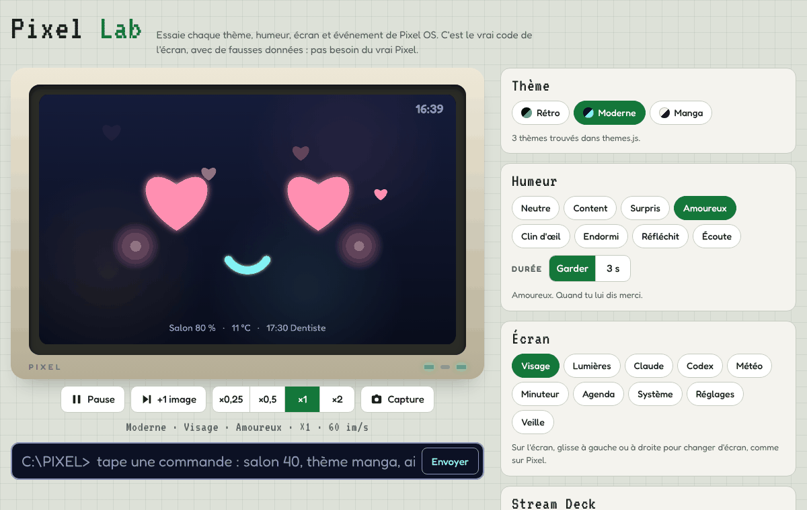
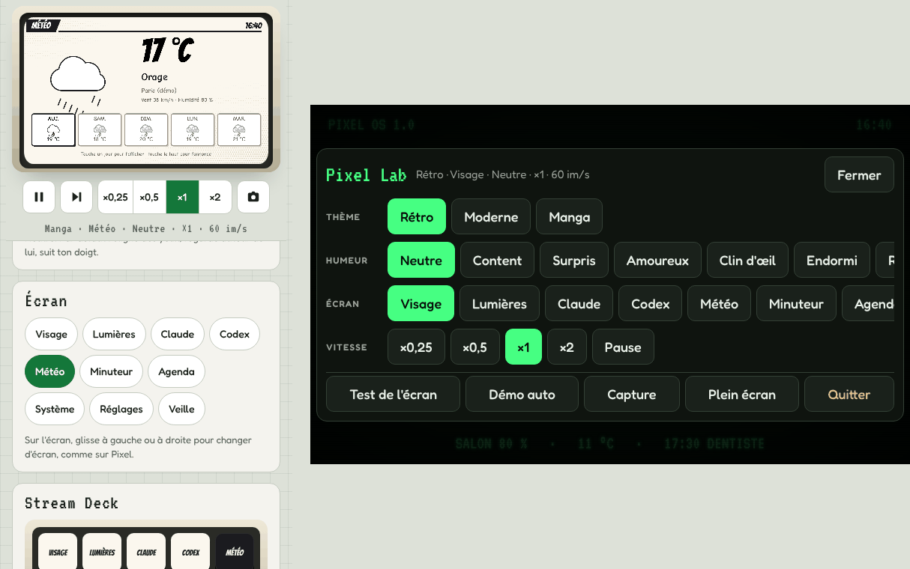

# Pixel Lab

Le labo d'essai de Pixel OS. Tu y essaies chaque thème, chaque humeur du visage, les 10 écrans et tous les événements : notification, Claude, Codex, minuteur, veille, démarrage, lumières, météo, agenda. Tu peux ralentir les animations, les mettre en pause, et tester le vrai écran 7 pouces.

L'écran est dessiné par le vrai code de Pixel (`themes.js` et `screens.js`). Seules les données sont fausses : le labo a son propre petit serveur, dans la page. Il n'a besoin ni du Pi, ni d'internet.



## Le lancer

**1. Sur ton ordinateur, sans le serveur de Pixel**

```
cd pixel-app/web
python3 -m http.server 8080
```

Puis ouvre http://localhost:8080/lab/ dans ton navigateur.

**2. Avec le serveur de Pixel**

```
cd pixel-app
python3 server.py --demo
```

Puis ouvre http://localhost:8080/lab. Le serveur sert déjà le dossier `web/`, rien à changer.

**3. Sur le Pi, avec le vrai écran**

Le serveur de Pixel tourne déjà au démarrage. Branche un clavier, ferme l'écran de Pixel avec Alt+F4, ouvre un terminal et tape :

```
chromium-browser --kiosk "http://localhost:8080/lab?kiosk=1"
```

(Sur les versions récentes, la commande s'appelle `chromium`.) Le labo prend tout l'écran, comme Pixel.

- **Ouvrir le menu :** appuie 1 seconde sur l'écran, ou touche un coin.
- **Changer d'écran :** glisse vers la gauche ou la droite, comme sur Pixel.
- **Revenir à Pixel :** menu, puis **Quitter**.



## Ce que tu peux essayer

| Partie | Ce que ça fait |
| --- | --- |
| **Thème** | Comme sur Pixel, le Rétro seulement pour le moment (réglage `[ui] themes` de `config.toml`). **Voir les 6 thèmes** montre tous les thèmes de `themes.js`, le temps de les essayer ; tu peux aussi ajouter `?themes=all` à l'adresse. Les touches et la barre de commande prennent les couleurs du thème. |
| **Humeur** | Toutes les humeurs du visage. **Garder** la laisse, **3 s** la fait durer 3 secondes. |
| **Écran** | Les 10 écrans. Sur l'écran, tu peux aussi toucher et glisser. |
| **Stream Deck** | Les 15 touches. Rangées 1 et 2 : les écrans. Rangée 3 : les actions de l'écran ouvert. |
| **Animations** | Les 52 animations de ton pack, par famille : Humeurs, Émotions, Activités, Système, Repos, Idle. **Idle vivant** enchaîne les animations d'attente quand rien ne se passe ; éteint, l'animation choisie tourne en boucle. **Pack 52 / Vivant** change de visage. **Tout voir** les joue toutes, une boucle chacune. |
| **Personnalité** | Ses 55 scènes, par famille : quand tu le touches, quand tu l'embêtes, les câlins, quand tu reviens, ses moments de vie, ce qui se passe autour. **Moments de vie** les laisse venir tout seuls quand on ne le touche pas ; **Plus souvent** en fait passer un toutes les 4 à 10 secondes, pour les voir vite. **L'embêter** le tape 10 fois de suite, jusqu'à ce qu'il boude ; **Un câlin** le caresse. **Revenir après 30 min, 3 h, une nuit** fait comme si tu revenais. En haut, son agacement et ses câlins du moment. |
| **Caractère** | Les 15 caractères tout prêts, les huit curseurs, son nom et le tien, ses habitudes (humeur du jour, bouderie, « Il parle », heures calmes), **Essayer** et **Réinitialiser** : le même panneau que sur le téléphone. En dessous, ce que ses traits changent en ce moment (agacement, bouderie, câlins, moments de vie, vitesse). |
| **Nourrir** | Les 24 plats à lui donner, chaque réaction à la demande, son ventre (repu, ça va, petit creux, très faim) et ses envies de manger, ses réglages, **Changer ses goûts** et **Le plateau du Pi** (l'assiette en bas à droite de son écran, comme sur le Pi). |
| **Exos de maths** | Lance un exo, une série de 5, la table de 7, le défi chrono, une énigme ou un type d'exo, au niveau choisi. **Bonne réponse** et **Mauvaise réponse** répondent à ta place ; **Indice**, **Passer**, **Arrêter**. **Il en propose une maintenant** joue « Une petite question ? ». Sur l'écran, touche une réponse ou tape le nombre puis Entrée. Le faux serveur du labo a moins de modèles d'exos que Pixel, et ne garde pas les scores. |
| **Ses habitudes** | Son horloge est en pause dans le labo (il reste réveillé, comme en mode démo ; pour ses amis, son album, ses souvenirs et son pyjama, sa nuit est alors celle de ses heures calmes, de 23 h à 6 h au départ) : **Réveil dans 5 s**, **Sieste dans 5 s**, **Coucher dans 5 s**, **Les dents dans 5 s**, **Bonne nuit dans 5 s**, **10 h** et **Minuit** font comme s'il était à ce moment de sa journée, **Horloge en pause** le remet comme avant. Puis chaque mini-jeu (et **Il propose un jeu**), chaque rire (blague, grimace, bruit, chatouilles, fou rire), chaque peur (l'orage, **Météo : orage**, le noir et **Rallumer**, une araignée, le vide) et **Le rassurer**, une phrase à lui apprendre. Dessous, le même panneau que **Habitudes** sur le téléphone. |
| **Pixel de poche** | **Voir sur un téléphone** change l'écran en téléphone tenu en paysage : c'est le Pixel de poche, avec le même visage. Touche-le, appuie longtemps pour un câlin. Ses boutons font comme si on secouait ou penchait le téléphone, comme si sa batterie était faible, comme si le Pi ne répondait plus. Ils montrent aussi ce que fait son jumeau (jaloux quand on caresse l'autre) et le voyage du Pi au téléphone, dans les deux sens. |
| **Événements** | Notification avec ton texte, conversation avec Claude, tâche Codex réussie ou en échec, minuteur d'une minute et fin tout de suite, veille et réveil, animation de démarrage. |
| **Caster sur Pixel** | Ce que ton téléphone envoie à Pixel : une photo (une carte postale dessinée par le labo), une vidéo (enregistrée par ton navigateur, 4 s), un texte, un lien (une carte avec son QR code), ou ton propre fichier, toujours dans ses vraies couleurs (pas d'effet cathodique pendant un cast). Le partage d'écran : **Écran d'un PC** et **Écran d'un téléphone** (un faux bureau, en direct), **Code de partage** (le code à taper sur l'ordinateur), **AirPlay : code** et **AirPlay**. Tes fichiers restent dans la page. Touche l'écran pour arrêter. **Un lien YouTube** le joue dans le lecteur de YouTube (il faut Internet), **Depuis l'appli YouTube** fait comme le bouton Caster d'un téléphone, **Code TV** montre le code « Associer avec un code TV ». |
| **Lumières, météo, agenda** | Scènes et pièces, chaque météo (soleil, nuages, pluie, neige, orage) pour aujourd'hui et les jours suivants, °C ou °F, agenda d'aujourd'hui ou de demain, rendez-vous dans 10 minutes. |
| **Affichage** | Luminosité et effet cathodique. |
| **Vitesse** | ×0,25, ×0,5, ×1, ×2, **Pause** et **+1 image** (une image de plus, toujours en pause). |
| **Démo auto** | Toutes les humeurs, quelques animations du pack (les 52 sur un tour complet), puis tous les écrans, puis le thème suivant, en boucle. Tu choisis le temps entre deux étapes. |
| **Capture** | Enregistre l'écran de Pixel en image PNG. Sur un téléphone, l'image s'affiche : appuie longuement dessus pour la garder. |
| **Barre de commande** | Les mêmes commandes que sur Pixel : `salon 40`, `thème manga`, `humeur content`, `fais le poisson`, `minuteur 1`, `aide`… Le reste part à Claude, qui répond avec des phrases toutes faites. |

Le labo retient ton dernier thème, ton écran et ta vitesse.

## Le test de l'écran

**Économie d'images** (dans Test de l'écran) : comme sur le Pi, Pixel ne dessine 60 images par seconde que quand ça bouge vite. Éteins-le pour tout voir à 60. **Comparer les thèmes** mesure toujours à 60 images par seconde. La page « Images par seconde » affiche aussi la cadence voulue.

Pour vérifier le vrai écran 7 pouces dans son boîtier. Lance-le sur le Pi, en plein écran : là, 1 pixel de la mire = 1 pixel de l'écran.

- **Couleurs :** barres de couleurs, dégradés, gris. Tu dois voir chaque case sombre et chaque case claire.
- **Grille et bords :** une grille de 1 pixel. Sur chaque bord, des barres partent du bord. Leur chiffre donne leur longueur en pixels. Si une barre manque, le cadre du boîtier cache au moins ce nombre de pixels.
- **Toucher :** touche le centre des 9 cibles. L'écart entre ton doigt et la cible s'affiche, en pixels. Chaque doigt posé s'affiche avec ses coordonnées : essaie avec plusieurs doigts.
- **Images par seconde :** la vitesse de l'animation pour le thème en cours. **Comparer les thèmes** mesure chaque thème à la suite. Sur le Pi, regarde surtout les images par seconde : 60, c'est parfait.

## Pour les curieux

| Fichier | Rôle |
| --- | --- |
| `clock.js` | L'horloge du labo. Chargée avant `screens.js`, elle ralentit ou arrête le temps des animations. L'heure affichée reste la vraie. |
| `demo-hub.js` | Le faux serveur : le même état et les mêmes actions que `server.py`, avec les données de démo. Les actions propres au labo commencent par `lab.`. Il sert aussi à l'appli Android sans le Pi : `../local.js` en retire les données de démo (voir « Pixel sans Pi » dans le guide de Pixel). |
| `testcard.js` | Le test de l'écran. |
| `lab.js`, `lab.css` | La page : menus, boutons, mises en page ordinateur, téléphone et plein écran. |

Les thèmes et les humeurs sont lus dans `themes.js` à l'ouverture. Un nouveau thème ou une nouvelle humeur apparaît donc tout seul dans le labo.

Pour en faire une seule page (un Artifact sur claude.ai) : `python3 tools/build_lab_artifact.py pixel-lab.html` depuis `pixel-app`.
