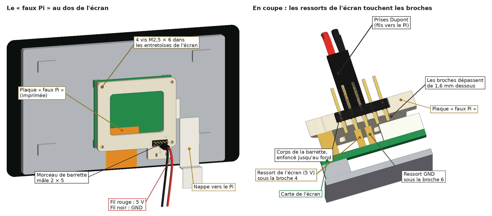

# Pixel (édition rétro) — v1

Un petit PC beige des années 90… qui est en réalité un Raspberry Pi 4.

- **Le moniteur cathodique** contient l'écran tactile **7"** Freenove (800 × 480, IPS). Il a de grandes grilles perforées, comme un vrai tube.
- **Le boîtier de bureau** cache le Pi 4. Sa façade a des lecteurs, des boutons et des voyants **gravés** : du décor pour la v1.
- **Le clavier beige** contient le Stream Deck MK.2 : on sort son module de sa coque noire et on le met dans un clavier rétro imprimé. C'est réversible.

**Aucune soudure, aucun fil à dénuder.** Il n'y a que deux fils : le 5 V de l'écran. Ils se branchent sur une petite plaque imprimée, le « faux Pi ». Un seul câble sort de Pixel : l'alimentation USB-C du Pi.


L'écran affiche l'appli Pixel, avec ses trois thèmes (Rétro, Moderne, Manga) et ses menus pour Hue, Claude, Codex, la météo, l'agenda et le minuteur. Elle est dans [`pixel-app/`](../pixel-app/).


> **Important : l'écran est plus grand que prévu.** Freenove donne **19,3 × 11,1 cm** pour la vitre du FNK0078H (ta version IPS, au dos en métal). Les anciennes cotes (16,5 × 10 cm) étaient celles des modèles à carte bleue. Le moniteur a donc grandi : 205 mm de large. Le boîtier passe à 210 mm pour rester un peu plus large que lui.

## Pièces à imprimer

Elles sont toutes dans `stl/`, déjà posées dans le bon sens, **sans supports**. Tout en PLA beige ou ivoire. Le socle du clavier, le fond et le pied peuvent être d'un beige un peu plus foncé.

| Fichier | Taille (mm) | Sens d'impression | Filament |
| --- | --- | --- | --- |
| `ScreenFitTest.stl` | 172 × 106 × 6 | cadre de test de la vitre (carte bleue), à plat | 19 g |
| `ScreenMountTest.stl` | 170 × 116 × 15 | **à imprimer en premier** : test de l'écran, face avant sur le plateau, environ 50 min (voir plus bas) | 29 g |
| `PixelScreenBracket.stl` | 9 × 115 × 3 | **à imprimer 2 fois** : les barrettes qui tiennent l'écran, à plat | 2 × 4 g |
| `ScrewPilotTest.stl` | 59 × 17 × 11 | test des trous de vis (2,0 à 2,4 mm), à plat, 15 min | 4 g |
| `StreamDeckFitTest.stl` | 112 × 75 × 11 | test des touches du Stream Deck, à plat, environ 35 min. **Avant le clavier** (voir plus bas) | 19 g |
| `PixelScreenPowerAdapter.stl` | 65 × 65 × 4 | « faux Pi », à plat. **À imprimer en premier aussi** | 10 g |
| `PixelMonitorFront.stl` | 205 × 139 × 22 | face avant sur le plateau | 101 g |
| `PixelMonitorBack.stl` | 201 × 135 × 128 | dos sur le plateau | 310 g |
| `PixelStand.stl` | Ø 72 × 10 | à l'envers | 16 g |
| `PixelCase.stl` | 210 × 160 × 64 | à l'envers (dessus sur le plateau) | 239 g |
| `PixelCaseBottom.stl` | 205 × 155 × 7 | à plat | 91 g |
| `PixelKeyboardTop.stl` | 136 × 96 × 8 | dessus du clavier, à l'envers. **À imprimer tôt** (voir plus bas) | 23 g |
| `PixelKeyboardBase.stl` | 136 × 94 × 34 | socle du clavier, à plat | 102 g |
| `PixelStreamDeckTray.stl` | 136 × 94 × 21 | *option* : plateau pour un Stream Deck resté entier, à la place des deux pièces du clavier | 72 g |

- **Imprimante :** tout tient sur une Bambu Lab P2S (256 × 256 × 256 mm), une grosse pièce par plateau. La plus haute est l'arrière du moniteur : 128 mm. Ses 4 tiges sont hautes : si elles bougent pendant l'impression, ralentis les parois extérieures.
- **Réglages :** buse 0,4 mm, couches de 0,2 mm, 3 parois, 15 % de remplissage. Supports désactivés.
- **Filament :** environ **940 g** de beige (estimation : 3 parois de 0,42 mm sur toute la surface, 15 % de remplissage dedans). Prévois plus d'une bobine de 1 kg.
- **Surplombs :** il ne reste que des petits ponts (fentes d'aération, tunnels de câbles). Le plus long fait 14 mm : ça s'imprime sans support.
- **Détails gravés :** les lecteurs CD et disquette, le bouton d'allumage, le Turbo, les voyants, les boutons du moniteur et les badges « PIXEL ». Tu peux colorier les voyants au feutre si tu veux.

### D'abord : le cadre de test de l'écran

1. Imprime `ScreenFitTest.stl`. Pose l'écran dedans, la vitre vers le fond. Il doit entrer sans forcer, avec moins d'un millimètre de jeu.
2. Allume l'écran (voir le « faux Pi » juste après) : l'image doit remplir la fenêtre, avec un peu de noir tout autour.
3. Si ça ne va pas, suis la liste « Demain, quand l'écran arrive » plus bas.

### Avant le moniteur : le test de l'écran

Ton écran, c'est la version à **carte bleue** : vitre de 164,5 × 98,5 mm, 10 mm d'épaisseur avec la carte. `ScreenMountTest.stl` est la zone de l'écran du vrai cadre, coupée court : la même fenêtre, le même logement (166 × 100), et les 4 bossages qui tiennent les **2 barrettes** de l'écran (`PixelScreenBracket.stl`, à imprimer 2 fois). Ça s'imprime face avant sur le plateau, sans support, en 50 min environ (29 g, + 7 g pour les 2 barrettes).

Comment l'écran tient : les 4 bagues en laiton des coins dépassent au dos de la carte. Chaque barrette se pose sur 2 bagues (une en haut, une en bas) et se visse dedans avec 2 vis M2,5 × 6. Ses deux bouts se vissent dans le cadre avec 2 vis M2,5 × 8, directement dans le plastique. La barrette pousse les bagues vers l'avant : la vitre est serrée contre le bord de la fenêtre. Tout le reste du dos de la carte reste libre (12 mm), pour la nappe, la prise blanche et l'interrupteur « Backlight ».

1. Imprime `ScreenMountTest.stl`, 2 × `PixelScreenBracket.stl` et `ScrewPilotTest.stl` (4 g, 15 min).
2. **La vitre :** pose l'écran dedans, vitre vers le fond. Il doit entrer sans forcer.
3. **L'épaisseur :** le dos de la carte bleue doit arriver **juste sous le bord** (0,4 mm). Pose une règle sur le bord : elle ne doit pas toucher la carte, ni rester loin au-dessus.
4. **Les vis :** pose une barrette de chaque côté, sur les bagues. Visse les bouts dans les bossages (M2,5 × 8) : la vis doit mordre fermement, sans fendre le bossage. Puis visse les 2 M2,5 × 6 dans les bagues.
5. **L'image :** branche l'écran (nappe et 2 fils, voir le montage) et allume. Toute l'image doit être visible, avec un fin liseré noir tout autour.
6. **Les prises :** la nappe, la prise blanche avec ses fils et l'interrupteur ne doivent toucher ni le cadre ni les barrettes.

Si ça ne va pas, change la cote en haut de `generate.py`, puis relance `python3 generate.py` et `python3 tools/verify.py`. Le test et le vrai moniteur suivent ensemble :
- **la vitre n'entre pas, ou elle flotte :** `SCR_W`, `SCR_H` (164,5 et 98,5), ou le jeu `SCR_CLR` (0,75) ;
- **la carte dépasse du bord, ou reste loin dedans :** l'épaisseur vitre + carte → `SCR_T` (10) ;
- **les barrettes ne tombent pas sur les bagues :** la distance du centre des bagues aux bords de la vitre → `SCR_HOLE_IN` (6) ;
- **les barrettes ne touchent pas les bagues, ou se tordent beaucoup :** la hauteur des bagues au-dessus de la carte → `SCR_NUT_H` (3), ou le serrage `BRK_SQUEEZE` (0,3) ;
- **la vis tourne dans le vide, ou fend le bossage :** essaie les 5 trous de `ScrewPilotTest` (2,0 à 2,4 mm) et prends celui qui serre le mieux → `SCR_PILOT` (2,2) ;
- **les bagues ne sont pas filetées** (la M2,5 × 6 n'accroche pas) : ce n'est pas grave, les barrettes serrent quand même l'écran en appuyant dessus ;
- **un bout de l'image est caché :** mesure le bord noir autour de l'image, vu de face → `SCR_BORDER` (5 en haut, 8 sur les côtés, 5 en bas : celui du bas reste à mesurer). La fenêtre suit ;
- **une prise ou l'interrupteur touche :** leur place vue de face → `SCR_DSI`, `SCR_PWR`, `SCR_SWITCH`.

### D'abord aussi : le « faux Pi »

D'habitude, le Pi se visse au dos de l'écran. Deux petites broches à ressort de l'écran touchent alors le dessous de son connecteur GPIO, et l'écran prend son 5 V comme ça. Ici, le Pi est dans le boîtier. Le **faux Pi** prend sa place : c'est une plaque imprimée, avec les 4 trous du Pi 4 et un morceau de barrette à broches, exactement là où seraient les broches 1 à 10 du Pi. Les ressorts de l'écran appuient sur les broches, et deux fils Dupont les relient au vrai Pi.



C'est la pièce la plus importante de la v1. Teste-la dès que l'écran arrive, avant les grosses impressions :
1. Monte la barrette et visse le faux Pi sur l'écran (étapes 1 à 3 du montage).
2. Branche les 2 fils sur le Pi, et l'écran au Pi avec une des nappes livrées par Freenove.
3. Allume le Pi : si l'écran s'allume, c'est gagné.

### Avant le clavier : le test du Stream Deck

`StreamDeckFitTest.stl`, c'est le vrai dessus du clavier, coupé autour des touches. Mêmes 15 fenêtres, même pas, mêmes découpes. Dessous, un bord de 9,3 mm : c'est le logement du module dans le socle, avec le même jeu. Ça s'imprime à plat, sans support, en 35 min environ (19 g).


1. Imprime `StreamDeckFitTest.stl`. Le texte « SD TEST » est côté haut du module (là où il y a le plus de marge au-dessus des touches).
2. Pose le module à plat, touches vers le haut. Pose le test dessus et appuie doucement.
3. Les 15 touches doivent passer sans frotter et dépasser d'environ 1 mm. Appuie sur chaque touche : elle doit cliquer et remonter toute seule.
4. Le module doit entrer dans le bord sans forcer, sans jouer de plus d'un demi-millimètre. Retourne le tout : le dos du module doit arriver juste sous le bord (0,3 mm, la place de la mousse).

Si ça frotte, change les cotes en haut de `generate.py`, puis relance `python3 generate.py` et `python3 tools/verify.py`. Le test, le dessus et le socle suivent ensemble :
- **une touche frotte d'un côté, toutes les touches du même côté :** la grille est décalée. Change `MOD_KEY_X` (gauche-droite) ou `MOD_KEY_Y` (haut-bas) ;
- **ça frotte de plus en plus vers un bout :** c'est le pas. Change le `19.26` de `MOD_KEY_X` (ou l'écart de `MOD_KEY_Y`) ;
- **toutes les touches frottent un peu :** agrandis les fenêtres avec `KEY_CUT` (17), ou arrondis plus leurs coins avec `KEY_R` (3,5) ;
- **le module n'entre pas, ou il flotte :** mesure-le → `MOD_W`, `MOD_H` (107 et 70). Le jeu tout autour, c'est `MOD_CLR` (0,25) ;
- **le dos du module dépasse du bord, ou reste loin dedans :** son épaisseur → `MOD_T` (9). La profondeur du logement suit (`MOD_DEPTH`).

### Tôt : le dessus du clavier

Les cotes du module du Stream Deck viennent du plan publié par le projet [Stream Deck Module](https://github.com/stagehacks/Stream-Deck-Module) : 107 × 70 × 9 mm, touches espacées de 19,26 mm, découpes de 17 mm.
1. Quand le test du Stream Deck passe, imprime `PixelKeyboardTop.stl` (environ 25 g) et pose-le sur le module.
2. Les 15 touches doivent passer sans frotter et dépasser d'environ 1 mm.

## Matériel (v1)

| Pièce | Qté | Note |
| --- | --- | --- |
| Raspberry Pi 4 (4 Go ou plus) | 1 | tu l'as |
| Stream Deck MK.2 | 1 | tu l'as. On en sort le module ; garde la coque et la face avant d'origine |
| Écran tactile **Freenove 7" IPS** 800 × 480, DSI (FNK0078H) | 1 | il arrive demain |
| Nappe DSI 15 broches, pas de 1 mm, **300 mm** | 1 | les nappes livrées sont trop courtes. Prends le même type de contacts que la nappe livrée : regarde de quel côté ils sont à chaque bout |
| [Barrette de broches **mâles** sécable, pas de **2,54 mm**](https://www.amazon.fr/s?k=barrette+broches+m%C3%A2les+s%C3%A9cable+2.54mm) | 1 | pour le faux Pi. Double rangée (2 × 40), ou simple rangée : alors deux morceaux de 5 côte à côte |
| [**2 fils Dupont femelle-femelle**, environ 40 cm](https://www.amazon.fr/s?k=c%C3%A2bles+dupont+femelle+femelle+40cm) | 2 | le 5 V et la masse de l'écran. Un rouge et un noir si possible. 30 cm suffisent |
| Petit collier de serrage (2,5 mm de large) | 1 | tient les deux fils sur le faux Pi |
| **Câble USB-C coudé à 90° → USB-A**, environ 30 cm | 1 | pour le Stream Deck : la prise est au dos du module. La tête coudée doit faire 8 mm d'épaisseur maximum |
| Alimentation officielle Raspberry Pi 4, USB-C 5,1 V 3 A | 1 | le seul câble |
| Radiateur passif pour Pi 4 (25 mm de haut maximum) | 1 | |
| Mini micro USB | 1 | |
| Carte microSD (32 Go ou plus) | 1 | |
| Patins caoutchouc Ø 10 mm | 8 | 4 sous le boîtier, 4 sous le clavier |
| Mousse adhésive de 1 mm | 4 petits carrés | au bout des 4 tiges qui tiennent l'écran |
| Mousse adhésive de 0,5 mm | une bande de 2,5 mm de large | sur le rebord qui porte le module, pour le serrer |
| Colle (cyanoacrylate ou colle chaude) | un peu | *option* : une goutte sur les côtés de la barrette si elle bouge |

Les liens sont des recherches Amazon.fr. Comme outil : un petit tournevis cruciforme et une pince coupante (pour couper la barrette).

### Vis (M2,5, vissées directement dans le plastique)

| Vis | Qté | Usage |
| --- | --- | --- |
| M2,5 × 6 | 4 | le faux Pi sur les entretoises de l'écran (les M2,5 × 4 livrées avec l'écran sont trop courtes) |
| M2,5 × 6 | 4 | le Pi sur le fond du boîtier |
| M2,5 × 8 | 4 | le fond sur le boîtier |
| M2,5 × 8 | 4 | le pied sur le boîtier (vissées depuis l'intérieur) |
| M2,5 × 10 | 4 | le moniteur sur le pied (vissées depuis l'intérieur du pied) |
| M2,5 × 10 | 4 | le dessus du clavier sur son socle (vissées par en dessous, au fond des puits) |
| M2,5 × 12 | 2 | le clavier contre le boîtier (vissées depuis l'intérieur) |

## Montage, sans soudure

1. **La barrette du faux Pi :**
   1. Coupe un morceau de **2 × 5 broches** (ou deux morceaux de 1 × 5).
   2. Tiens la plaque **côté gravé vers toi**. Enfonce le morceau dans la fente, les **bouts courts en premier**. Pousse jusqu'à ce que le plastique touche le fond.
   3. Retourne la plaque : les bouts courts dépassent d'environ 1,6 mm, comme sous un vrai Pi.
   4. Si la barrette bouge, mets une goutte de colle sur ses côtés. Jamais sur les broches.
2. **Le faux Pi sur l'écran :**
   1. Pose l'écran vitre contre une serviette.
   2. Sur la carte verte de l'écran, repère les **2 ressorts dorés**, à côté d'une des 4 entretoises en laiton.
   3. Pose la plaque sur les 4 entretoises, côté gravé vers toi, la barrette **juste au-dessus des 2 ressorts**. Visse-la avec 4 vis M2,5 × 6.
   4. Regarde par le côté, avec une lampe : chaque ressort doit toucher une broche.
3. **Les 2 fils :**
   1. Branche le fil **rouge** sur la broche marquée **5V** et le fil **noir** sur la broche marquée **GND**. Ce sont celles qui touchent les ressorts (les broches 4 et 6).
   2. Passe le collier dans les deux petites fentes et serre les fils contre la plaque.
4. **La nappe :** branche la nappe DSI de 300 mm sur la prise de la carte de l'écran, contacts dans le bon sens.
5. **Le moniteur :**
   1. Colle un carré de mousse au bout de chacune des 4 tiges de l'arrière du moniteur.
   2. Pose l'écran dans l'avant, la vitre contre la fenêtre.
   3. Fais descendre la nappe et les 2 fils jusqu'au trou du fond, au-dessus du pied.
   4. Accroche l'arrière par ses deux languettes du haut, puis rabats-le vers le bas.
6. **Le pied :** passe la nappe et les 2 fils dans le trou du pied. Visse le pied sous le moniteur avec 4 × M2,5 × 10, depuis l'intérieur du pied. Ces vis tiennent aussi l'arrière du moniteur.
7. **Sur le boîtier :** passe la nappe et les fils dans le trou du dessus du boîtier. Visse le pied avec 4 × M2,5 × 8, depuis l'intérieur du boîtier.
8. **Dans le boîtier :**
   1. Visse le Pi sur le fond (4 × M2,5 × 6), prise USB-C vers l'arrière.
   2. Branche la nappe sur la prise **DISPLAY** du Pi.
   3. Branche le fil rouge sur la **broche 4 (5 V)** du Pi et le fil noir sur la **broche 6 (GND)**. Sur le connecteur du Pi, ce sont la 2e et la 3e broche de la rangée du bord, en partant du coin le plus proche de la carte microSD.
   4. Branche le micro sur un port USB.
9. **Sortir le module du Stream Deck :** débranche-le. Soulève un coin de sa face avant jusqu'au clic, puis l'autre coin (c'est la méthode d'Elgato pour changer la face). Retire la face, retourne la coque : le module tombe tout seul. Range la coque et la face d'origine, pour pouvoir le remonter.
10. **Le clavier :**
    1. Branche le câble coudé sur la prise au dos du module et fais-le passer par le tunnel du socle.
    2. Colle la bande de mousse sur le rebord, puis pose le module, touches vers le haut et prise vers l'arrière gauche.
    3. Pose le dessus et visse-le par en dessous (4 × M2,5 × 10).
11. **Contre le boîtier :** fais passer le câble du Stream Deck par le trou en bas à gauche de la façade. Branche-le sur le port USB de devant du Pi. Visse le clavier contre le boîtier avec 2 × M2,5 × 12, depuis l'intérieur.
12. **Fermer :** visse le fond du boîtier (4 × M2,5 × 8) et colle les patins.

*Option sans ouvrir le Stream Deck :* imprime `PixelStreamDeckTray.stl` à la place des deux pièces du clavier. Pose le Stream Deck entier dedans, sans son pied, et branche-le avec le même câble coudé.

## Demain, quand l'écran arrive

Les cotes marquées `[measure]` en haut de `generate.py` viennent des photos de Freenove. Vérifie-les avec une règle (un pied à coulisse, c'est mieux). Pose l'écran vitre contre une serviette, le **bord du haut de l'image en haut** (la nappe orange du tactile sort en bas). « Gauche » et « droite » s'entendent **vue de dos**, comme tu le vois.

1. **La vitre :** largeur et hauteur → `SCR_W`, `SCR_H` (Freenove : 193 et 111). Son épaisseur, sur le bord noir → `SCR_GLASS_T` (2).
2. **L'épaisseur jusqu'au métal :** vitre posée à plat sur la table (sans serviette), hauteur du dos en métal gris → `SCR_T` (7,5). C'est là que les 4 tiges appuient.
3. **Le dos en métal gris :** largeur et hauteur → `LCD_W`, `LCD_H` (168 et 102). Puis les marges entre le bord de la vitre et le métal : à gauche G, à droite D, en haut H, en bas B. Alors `LCD_DX = (D − G) / 2` et `LCD_DZ = (B − H) / 2` (photos : 1,2 et −2,1).
4. **Les 4 entretoises en laiton** de la carte verte (là où se visse le Pi) : distance du bord gauche de la vitre aux 2 entretoises de gauche (a), du bord droit aux 2 de droite (b), du bord du haut aux 2 du haut (c), du bord du bas aux 2 du bas (d). Alors `PI_ON_SCR = ((b − a) / 2, (d − c) / 2)` (photos : −4,7 et −7). Les entretoises doivent être à 58 mm et 49 mm l'une de l'autre.
5. **Les 2 ressorts dorés :** ils doivent être **en bas à droite** de la carte. Sinon, la carte est tournée : dis-le-moi, ou change `PI_ON_SCR_ROT` (90, 180 ou 270).
6. **Sous quelles broches ?** Une fois le faux Pi vissé, regarde par le côté : les ressorts doivent toucher les deux broches marquées 5V et GND (les broches 4 et 6). Si le ressort du 5 V touche la broche du bout, à côté de la broche 1, c'est la broche 2 : mets `POGO_PINS = (2, 6)`, les gravures suivent.
7. **La barrette :** longueur des bouts courts, du plastique à la pointe → `HDR_TAIL` (3). La plaque s'adapte pour qu'ils dépassent toujours de 1,6 mm (`PIN_BELOW`).
8. **La hauteur des entretoises** (`STANDOFF_H`, 6) et de la carte verte au-dessus du métal (`DRV_Z0`, 3,5) : elles ne changent pas les pièces imprimées, seulement les vérifications.
9. **Les 4 pattes à écrou M3** du dos en métal (pour les pieds de Freenove) → `SCR_TABS`. Les 4 tiges appuient à 74 mm à gauche et à droite du centre de la vitre, et à 14 mm au-dessus et au-dessous (`POST_X`, `POST_DZ`). Vérifie qu'il n'y a là que du métal plat : pas de patte, pas d'étiquette, pas de nappe.
10. **L'image**, écran allumé et vu **de face** : mesure le bord noir autour de l'image, à gauche g, à droite d, en haut h, en bas b. Alors `VIEW_DX = (g − d) / 2` et `VIEW_DZ = (b − h) / 2` (0 et 0 si elle est centrée). La fenêtre pardonne 2,9 mm sur les côtés et 4 mm en haut et en bas.

Ensuite, dans le dossier `pixel-desk` :

```bash
python3 generate.py          # refait tous les STL
python3 tools/verify.py      # doit finir par « ALL CHECKS PASSED »
```

Si une vérification échoue, la ligne dit ce qui touche quoi. Le moniteur suit tout seul la taille de la vitre.

## Vérifications faites sur ordinateur

`python3 tools/verify.py` vérifie la v1 et la v2 (version 2 = `V2_PANEL = True`). Tout passe :

- **Collisions :** aucune entre les pièces. Aucune non plus avec les éléments réels :
  - l'écran : vitre, dos en métal, pattes M3, carte verte, entretoises, ressorts, prise et nappe DSI, nappe du tactile ;
  - le faux Pi, sa barrette, les 2 prises Dupont et leurs fils ;
  - le Pi 4 (prises USB comprises) avec ses fiches : Stream Deck, micro, USB-C et les 2 fils de l'écran ;
  - le module du Stream Deck, ses 15 touches, sa prise USB-C et la prise coudée ; le plateau en option avec un Stream Deck entier ;
  - en v2 : les boutons, les supports de LED, le haut-parleur, le ruban LED et la barre translucide.
- **Le faux Pi :** trous à 58 × 49 mm, comme le Pi 4. La barrette est placée d'après le plan officiel du Raspberry Pi 4 (datasheets.raspberrypi.com) : broche 1 à 8,37 mm du bord côté carte SD. Les bouts courts dépassent de 1,6 mm et arrivent sur les ressorts des broches 4 et 6.
- **Les 4 tiges :** elles appuient sur le métal, à travers 1 mm de mousse, à 4,8 mm de son bord. Elles restent à 10,9 mm des pattes M3 et de la nappe, et à 32,8 mm du faux Pi.
- **La fenêtre :** elle montre toute l'image, avec 2,9 mm de marge sur les côtés et 4 mm en haut et en bas. Le cadre tient la vitre par son bord noir (17 mm sur les côtés, 9 mm en haut et en bas).
- **Le test du Stream Deck :** mêmes 15 fenêtres que le vrai dessus (0,375 mm de jeu autour de chaque touche), même jeu de 0,25 mm autour du module que le socle, bord à la hauteur du rebord. Moins de 25 g, moins d'une heure.
- **Le trou du pied** (20 × 11 mm) laisse passer la nappe de 16 mm et les 2 prises Dupont, à travers le moniteur, le pied et le boîtier.
- **Les longueurs :** la nappe fait environ 250 mm de chemin, donc 300 mm suffisent. Les fils font environ 170 mm de chemin.
- **L'impression :** chaque pièce tient sur la P2S. Chaque fichier est un seul objet fermé, propre. Aucun surplomb n'a besoin de support. Aucune paroi ni aucun fond ne fait moins de 1,2 mm. Les seules exceptions : de fines arêtes au bord de parties épaisses (entre deux gravures, ou là où deux formes se rejoignent), sans importance, et la barre translucide de la v2, fine exprès.
- **Stabilité :** Pixel pèse environ 1,4 kg. Il faut pousser d'environ **7 N** vers l'arrière, en haut de l'image, pour le faire basculer. Un toucher normal fait environ 1 N.
- Rien n'a encore été imprimé.

## À savoir

- **Si l'écran ne s'allume pas :** vérifie que les ressorts touchent bien les broches (étape 2.4) et que les fils sont sur les broches 4 et 6 des deux côtés. Sur les photos de Freenove, la carte verte a aussi une petite prise blanche marquée « GND 5V » : c'est un plan B, avec le bon câble.
- **Éteindre :** en v1, il n'y a pas de bouton. Éteins depuis l'appli ou le système, puis débranche.
- **Le courant :** l'alimentation de 3 A suffit pour le Pi, l'écran et le Stream Deck.
- **La chaleur :** le Pi respire par le fond, les côtés, le « ventilateur » perforé à l'arrière et les fentes du dessus.

## Pour la v2

Plus tard, les vrais boutons et les vrais voyants. Mets `V2_PANEL = True` en haut de `generate.py` et relance `python3 generate.py` : la façade a alors de vrais trous, le dessus du clavier a 3 fenêtres et une barre translucide (`PixelKeyboardLeds.stl`), et son socle a la place du ruban LED.


| Pièce | Qté | Note |
| --- | --- | --- |
| [Bouton poussoir métal **16 mm**, momentané, anneau LED, **avec câble**](https://www.amazon.fr/s?k=bouton+poussoir+16mm+momentan%C3%A9+anneau+LED+avec+c%C3%A2ble) | 1 | bouton d'allumage. **Momentané** (pas « à verrouillage »), LED en **5 V ou 3-6 V** (pas 12 V), **fils déjà montés** |
| [Bouton poussoir métal **12 mm**, momentané, **avec fils**](https://www.amazon.fr/s?k=bouton+poussoir+12mm+momentan%C3%A9+pr%C3%A9c%C3%A2bl%C3%A9) | 1 | le bouton « Turbo ». **Fils déjà montés** |
| [LED 3 mm précâblées 5 V](https://www.amazon.fr/s?k=LED+3mm+pr%C3%A9c%C3%A2bl%C3%A9es+5V), 1 verte et 1 orange | 2 | voyants « marche » et « activité » |
| [Supports chromés pour LED 3 mm](https://www.amazon.fr/s?k=support+LED+3mm+chrome) | 2 | trou de 5 mm dans la façade |
| [LED RVB **adressable** ronde 5 mm](https://www.amazon.fr/s?k=LED+adressable+5mm+PL9823) (PL9823 ou WS2812 « F5 ») | 1 | voyant de notification. **4 pattes**, 5 V |
| [Support chromé pour LED 5 mm](https://www.amazon.fr/s?k=support+LED+5mm+chrome) | 1 | trou de 8 mm dans la façade |
| [Ruban LED **WS2812B, 144 LED/m**, 5 V](https://www.amazon.fr/s?k=ruban+WS2812B+144+LED+5V) | 3 LED | les 3 voyants du clavier. Coupe les **3 premières LED du rouleau** : elles gardent le **connecteur d'origine** |
| [Câble JST SM 3 broches](https://www.amazon.fr/s?k=connecteur+JST+SM+3+broches+c%C3%A2ble+ruban+LED) | 1 | se branche sur le connecteur du ruban |
| [**Bornier à vis pour GPIO**, avec nappe 40 broches](https://www.amazon.fr/s?k=bornier+%C3%A0+vis+GPIO+raspberry+pi+nappe+40) | 1 | tous les fils s'y vissent, sans soudure. Les 2 fils de l'écran vont alors sur ses vis 5V et GND |
| [Connecteurs à levier (type Wago 221)](https://www.amazon.fr/s?k=wago+221+connecteur+levier) | 1 petit lot | pour relier deux fils sans soudure |
| [Fils Dupont femelle-femelle](https://www.amazon.fr/s?k=c%C3%A2bles+dupont+femelle+femelle) | 1 lot | pour les pattes de la LED RVB |
| [Mini haut-parleur USB](https://www.amazon.fr/s?k=mini+haut-parleur+USB+raspberry+pi) | 1 | sous les fentes du dessus du boîtier, branché sur un port USB |
| Pince à dénuder | 1 | pour visser les fils dans le bornier |

Les branchements prévus (numéros des broches du Pi, 1 à 40) :

| Pièce | Fil | Broche |
| --- | --- | --- |
| Écran (par le faux Pi) | 5 V / masse | 4 / 6 |
| Bouton d'allumage | contact / masse | 5 (GPIO 3) / 9 |
| Anneau du bouton | + / − | 11 (GPIO 17) / 20 |
| Bouton Turbo | contact / masse | 13 (GPIO 27) / 25 |
| Voyant vert « marche » | + / − | 15 (GPIO 22) / 30 |
| Voyant orange « activité » | + / − | 16 (GPIO 23) / 34 |
| LED RVB de la façade, puis les 3 du clavier (en chaîne) | données / 5 V / masse | 19 (GPIO 10) / 2 / 39 |


À ajouter alors dans `/boot/firmware/config.txt` :

```
dtoverlay=gpio-shutdown,gpio_pin=3   # le bouton éteint Pixel ; un 2e appui le rallume
gpio=22=op,dh                        # le voyant vert s'allume dès le démarrage
dtparam=spi=on                       # les LED RVB
```

## Modifier / vérifier

Toutes les cotes sont en haut de `generate.py` : l'écran, le boîtier, le faux Pi, les tiges, `V2_PANEL`… Le moniteur se recalcule à partir de la taille de l'écran.

```bash
pip install trimesh manifold3d shapely mapbox_earcut numpy scipy matplotlib pillow
python3 generate.py            # refait les STL dans stl/ (et efface les anciens)
python3 tools/verify.py        # toutes les vérifications, v1 et v2 (environ 20 s)
python3 tools/render.py        # refait les images du README (environ 30 s)
```

Dans `tools/` :
- `verify.py` : collisions, écran, nappe, test du Stream Deck, impression, filament, stabilité ;
- `mocks.py` : les pièces achetées, en volumes simples (écran, Pi, Stream Deck…) ;
- `checks.py` : les tests d'impression (surplombs, parois fines, maillage) ;
- `render.py` et `scenelib.py` : les images ; `ui/` : les captures de l'appli affichées sur l'écran.
