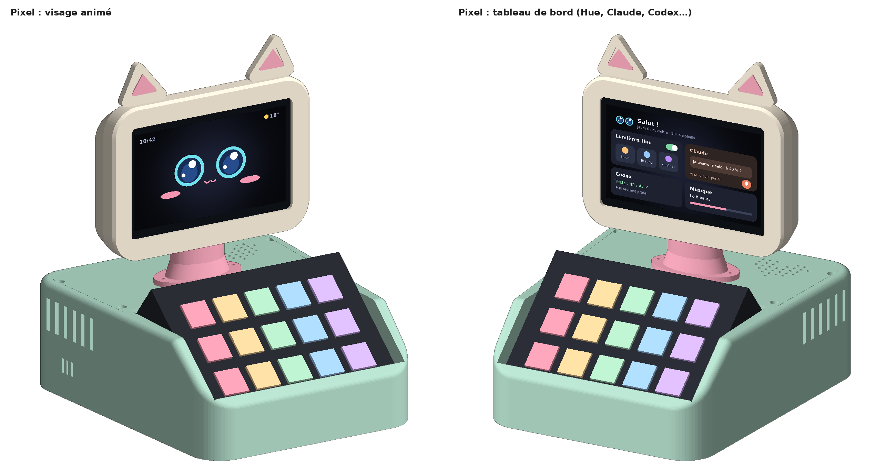
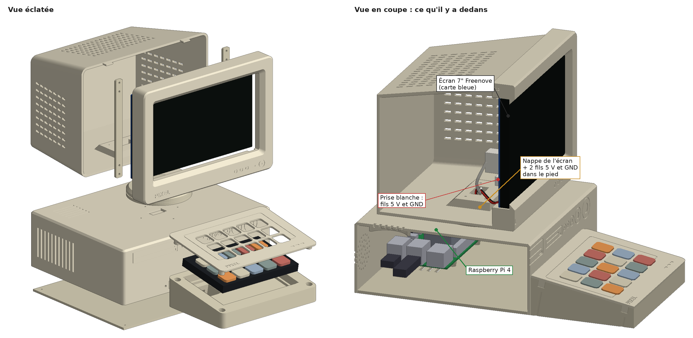
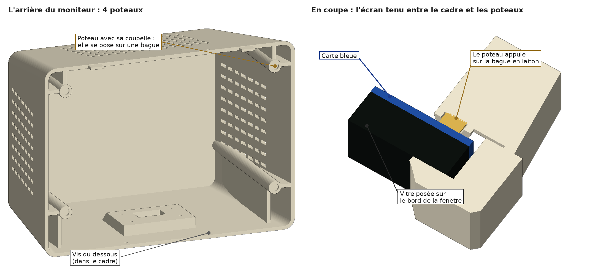
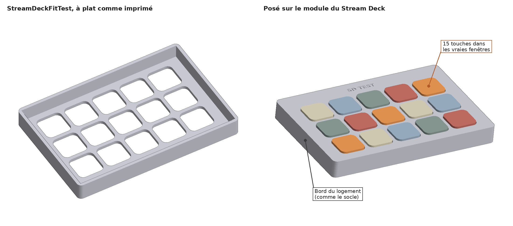
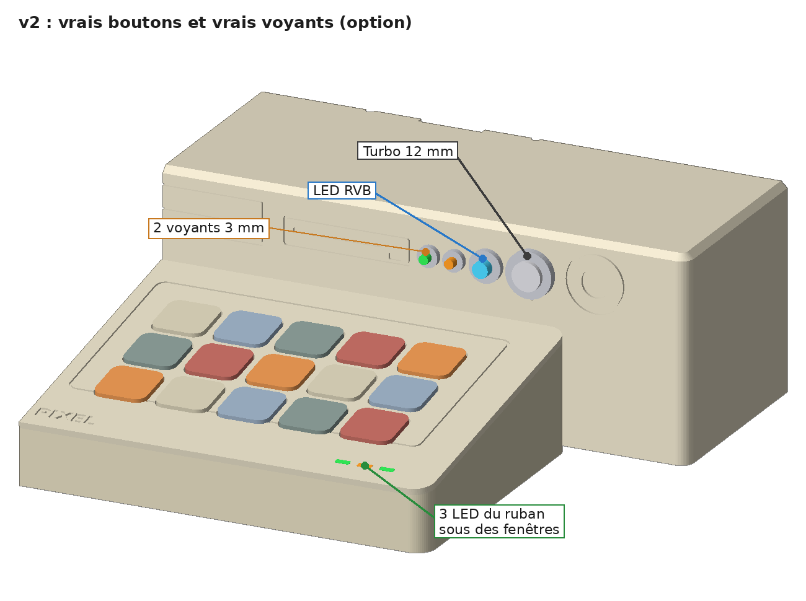
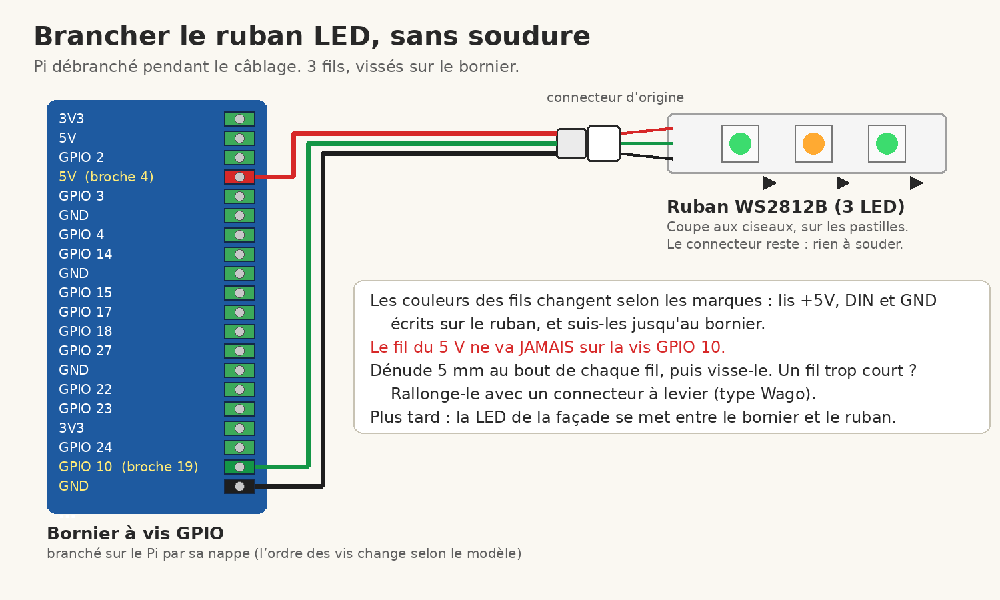

# Pixel (édition rétro) — v1

Un petit PC beige des années 90… qui est en réalité un Raspberry Pi 4.

- **Le moniteur cathodique** contient l'écran tactile **7"** Freenove à carte bleue (800 × 480, DSI). Il a de grandes grilles perforées, comme un vrai tube.
- **Le boîtier de bureau** cache le Pi 4. Sa façade a des lecteurs, des boutons et des voyants **gravés** : du décor pour la v1.
- **Le clavier beige** contient le Stream Deck MK.2 : on sort son module de sa coque noire et on le met dans un clavier rétro imprimé. C'est réversible.

**Aucune soudure, aucun fil à dénuder.** Il n'y a que quatre fils, sur le GPIO du Pi : le 5 V de l'écran (deux fils Dupont depuis sa prise blanche) et le bouton d'allumage du moniteur (deux fils, rallongés avec des Wago). Un seul câble sort de Pixel : l'alimentation USB-C du Pi.



L'écran affiche l'appli Pixel, avec ses trois thèmes (Rétro, Moderne, Manga) et ses menus pour Hue, Claude, Codex, la météo, l'agenda et le minuteur. Elle est dans [`pixel-app/`](../pixel-app/).



> **Le moniteur est fait pour ton écran : la version à carte bleue.** Vitre de **164,5 × 98,5 mm**, 10 mm d'épaisseur avec la carte, mesurée sur le vrai écran (et vérifiée avec le cadre de test). Le moniteur fait 184 mm de large. Le boîtier garde ses 210 mm.

## Pièces à imprimer

Elles sont toutes dans `stl/`, déjà posées dans le bon sens, **sans supports**. Tout en PLA beige ou ivoire. Le socle du clavier, le fond et le pied peuvent être d'un beige un peu plus foncé.

| Fichier | Taille (mm) | Sens d'impression | Filament |
| --- | --- | --- | --- |
| `ScreenFitTest.stl` | 172 × 106 × 6 | cadre de test de la vitre (carte bleue), à plat | 16 g |
| `ScreenMountTest.stl` | 170 × 104 × 12 | **à imprimer en premier** : test de l'écran, face avant sur le plateau, environ 40 min (voir plus bas) | 21 g |
| `ScreenPostTest.stl` | Ø 16 × 10 | **en premier aussi** : un bout de poteau avec sa coupelle, debout, 10 min | 1 g |
| `StreamDeckFitTest.stl` | 112 × 75 × 11 | test des touches du Stream Deck, à plat, environ 35 min. **Avant le clavier** (voir plus bas) | 19 g |
| `PixelMonitorFront.stl` | 184 × 136 × 26 | face avant sur le plateau (avec le trou du bouton d'allumage) | 81 g |
| `PixelMonitorBack.stl` | 180 × 132 × 111 | dos sur le plateau, avec ses 4 poteaux | 264 g |
| `PixelStand.stl` | Ø 72 × 10 | à l'envers | 16 g |
| `PixelCase.stl` | 210 × 160 × 64 | à l'envers (dessus sur le plateau) | 239 g |
| `PixelCaseBottom.stl` | 205 × 155 × 7 | à plat | 91 g |
| `PixelKeyboardTop.stl` | 136 × 96 × 8 | dessus du clavier, à l'envers. **À imprimer tôt** (voir plus bas) | 23 g |
| `PixelKeyboardBase.stl` | 136 × 94 × 34 | socle du clavier, à plat | 102 g |
| `PixelStreamDeckTray.stl` | 136 × 94 × 21 | *option* : plateau pour un Stream Deck resté entier, à la place des deux pièces du clavier | 72 g |

- **Imprimante :** tout tient sur une Bambu Lab P2S (256 × 256 × 256 mm), une grosse pièce par plateau. La plus haute est l'arrière du moniteur : 111 mm.
- **Réglages :** buse 0,4 mm, couches de 0,2 mm, 3 parois, 15 % de remplissage. Supports désactivés.
- **Filament :** environ **870 g** de beige, pièces de test comprises (estimation : 3 parois de 0,42 mm sur toute la surface, 15 % de remplissage dedans). Une bobine de 1 kg suffit, de justesse : prévois-en une deuxième.
- **Surplombs :** il ne reste que des petits ponts (fentes d'aération, tunnels de câbles). Le plus long fait 14 mm : ça s'imprime sans support.
- **Détails gravés :** les lecteurs CD et disquette, le bouton d'allumage, le Turbo, les voyants, les boutons du moniteur et les badges « PIXEL ». Tu peux colorier les voyants au feutre si tu veux.

### D'abord : le cadre de test de l'écran

1. Imprime `ScreenFitTest.stl` (172 × 106 × 6 mm, logement de 166 × 100). Pose l'écran dedans, la vitre vers le fond. Il doit entrer sans forcer, avec moins d'un millimètre de jeu. (Tu l'as déjà fait : ça passe.)
2. Allume l'écran (voir le montage, étape 2) : toute l'image doit être visible dans la fenêtre, avec un peu de noir tout autour.
3. Si ça ne va pas, suis la liste « Ce qui reste à mesurer » plus bas.

### Avant le moniteur : le test de l'écran

Ton écran, c'est la version à **carte bleue** : vitre de 164,5 × 98,5 mm, 10 mm d'épaisseur avec la carte. **Pas de vis dans l'écran, pas de ruban, pas de clip :** la vitre se pose sur le rebord de la fenêtre, et quand tu fermes le moniteur, **4 poteaux de l'arrière appuient sur les 4 bagues en laiton** des coins de la carte. Chaque poteau finit par une petite coupelle qui coiffe sa bague : elle la centre, et elle ne touche pas la carte. L'écran ne peut plus tomber vers l'arrière. Le logement (166 × 100) a 8 petites nervures qui centrent la vitre.



Deux petites pièces de test, avant les grosses :
- `ScreenMountTest.stl` : la zone de l'écran du vrai cadre, coupée court. La même fenêtre, le même logement avec ses nervures, et un bord aussi profond que vitre + carte (+ 0,4 mm). Le dos reste ouvert. Face avant sur le plateau, sans support, environ 40 min (21 g).
- `ScreenPostTest.stl` : un bout de poteau avec la vraie coupelle (1 g, 10 min).

1. Imprime les deux.
2. **La vitre :** pose l'écran dans `ScreenMountTest`, vitre vers le fond. Il doit entrer sans forcer et ne presque pas bouger (les nervures).
3. **L'épaisseur :** le dos de la carte bleue doit arriver **juste sous le bord** (0,4 mm). Pose une règle sur le bord : elle ne doit pas toucher la carte.
4. **La coupelle :** pose `ScreenPostTest` sur une bague en laiton. Elle doit la coiffer sans forcer, avec un tout petit jeu, et ne pas toucher la carte bleue.
5. **L'image :** branche l'écran (nappe et 2 fils, voir le montage, étape 2) et allume. Toute l'image doit être visible, avec un peu de noir tout autour. Essaie l'écran dans les deux sens (prises en haut, puis en bas) : la fenêtre est symétrique, l'image doit rester entière.
6. **Les prises :** la nappe, la prise blanche avec ses fils et l'interrupteur ne doivent toucher nulle part (le dos est ouvert).

Si ça ne va pas, change la cote en haut de `generate.py`, puis relance `python3 generate.py` et `python3 tools/verify.py`. Les tests et le vrai moniteur suivent ensemble :
- **la vitre n'entre pas, ou elle flotte :** `SCR_W`, `SCR_H` (164,5 et 98,5), le jeu `SCR_CLR` (0,75), ou la hauteur des nervures `SCR_RIB` (0,3 : elles laissent 0,45 mm) ;
- **la carte dépasse du bord, ou reste loin dedans :** l'épaisseur vitre + carte → `SCR_T` (10). Les poteaux suivent ;
- **la coupelle n'entre pas sur la bague, ou flotte :** le diamètre de la bague → `SCR_NUT_D` (5), ou celui de la coupelle → `SCR_CUP_D` (5,6) ;
- **la coupelle touche la carte :** la hauteur de la bague → `SCR_NUT_H` (3) ;
- **un bout de l'image est caché :** mesure le bord noir autour de l'image, vu de face → `SCR_BORDER` (3 à gauche, 7 à droite, 4 en haut, 8 en bas). La fenêtre suit, toujours centrée ; sa taille minimale, c'est `WIN_MIN` (152 × 93,5, mesurée sur ton test) ;
- **une prise ou l'interrupteur touche :** leur place vue de face → `SCR_DSI`, `SCR_PWR`, `SCR_SWITCH`.

### Avant le clavier : le test du Stream Deck

`StreamDeckFitTest.stl`, c'est le vrai dessus du clavier, coupé autour des touches. Mêmes 15 fenêtres, même pas, mêmes découpes. Dessous, un bord de 9,3 mm : c'est le logement du module dans le socle, avec le même jeu. Ça s'imprime à plat, sans support, en 35 min environ (19 g).



1. Imprime `StreamDeckFitTest.stl`. Le texte « SD TEST » est côté haut du module (là où il y a le plus de marge au-dessus des touches).
2. Pose le module à plat, touches vers le haut. Pose le test dessus et appuie doucement.
3. Les 15 touches doivent passer sans frotter et dépasser d'environ 1 mm. Appuie sur chaque touche : elle doit cliquer et remonter toute seule.
4. Le module doit entrer dans le bord sans forcer, sans jouer de plus d'un demi-millimètre. Retourne le tout : le dos du module doit arriver juste sous le bord (0,3 mm, la place de la mousse).

Si ça frotte, change les cotes en haut de `generate.py`, puis relance `python3 generate.py` et `python3 tools/verify.py`. Le test, le dessus et le socle suivent ensemble :
- **une touche frotte d'un côté, toutes les touches du même côté :** la grille est décalée. Change `MOD_KEY_X` (gauche-droite) ou `MOD_KEY_Y` (haut-bas) ;
- **ça frotte de plus en plus vers un bout :** c'est le pas. Change le `19.26` de `MOD_KEY_X` (ou l'écart de `MOD_KEY_Y`) ;
- **toutes les touches frottent un peu :** agrandis les fenêtres avec `KEY_CUT` (17), ou arrondis plus leurs coins avec `KEY_R` (3,5) ;
- **le module n'entre pas, ou il flotte :** mesure-le → `MOD_W`, `MOD_H` (107 et 70). Le jeu tout autour, c'est `MOD_CLR` (0,25) ;
- **le dos du module dépasse du bord, ou reste loin dedans :** son épaisseur → `MOD_T` (9). La profondeur du logement suit (`MOD_DEPTH`).

### Tôt : le dessus du clavier

Les cotes du module du Stream Deck viennent du plan publié par le projet [Stream Deck Module](https://github.com/stagehacks/Stream-Deck-Module) : 107 × 70 × 9 mm, touches espacées de 19,26 mm, découpes de 17 mm.
1. Quand le test du Stream Deck passe, imprime `PixelKeyboardTop.stl` (environ 25 g) et pose-le sur le module.
2. Les 15 touches doivent passer sans frotter et dépasser d'environ 1 mm.

## Matériel (v1)

| Pièce | Qté | Note |
| --- | --- | --- |
| Raspberry Pi 4 (4 Go ou plus) | 1 | tu l'as |
| Stream Deck MK.2 | 1 | tu l'as. On en sort le module ; garde la coque et la face avant d'origine |
| Écran tactile **Freenove 7"** 800 × 480, DSI, version à **carte bleue** | 1 | tu l'as. Vitre 164,5 × 98,5 mm |
| Nappe DSI 15 broches, pas de 1 mm, **300 mm** | 1 | les nappes livrées sont trop courtes. Prends le même type de contacts que la nappe livrée : regarde de quel côté ils sont à chaque bout |
| **2 fils Dupont**, un rouge et un noir, environ 40 cm | 2 | le 5 V et la masse de l'écran : de la prise blanche de l'écran aux broches 4 et 6 du Pi. Ceux que tu utilises déjà vont bien s'ils font au moins 30 cm |
| **Bouton poussoir métal 12 mm**, momentané, IP65, **précâblé** (fils de 15 cm) | 1 | le bouton d'allumage, en bas à droite du moniteur. Tu l'as. Trou de 12,2 mm, écrou à l'intérieur |
| [Fils Dupont **femelle-mâle**, 20 cm](https://www.amazon.fr/s?k=c%C3%A2bles+dupont+femelle+m%C3%A2le+20cm) | 2 | rallonges pour le bouton : le bout femelle sur le Pi, le bout mâle dans le Wago (ou femelle-femelle avec un bout coupé et dénudé) |
| [Connecteurs à levier **Wago 221**, 2 entrées](https://www.amazon.fr/s?k=wago+221+2+entr%C3%A9es) | 2 | relient les fils du bouton aux rallonges, sans soudure |
| **Câble USB-C coudé à 90° → USB-A**, environ 30 cm | 1 | pour le Stream Deck : la prise est au dos du module. La tête coudée doit faire 8 mm d'épaisseur maximum |
| Alimentation officielle Raspberry Pi 4, USB-C 5,1 V 3 A | 1 | le seul câble |
| Radiateur passif pour Pi 4 (25 mm de haut maximum) | 1 | |
| Mini micro USB | 1 | |
| Carte microSD (32 Go ou plus) | 1 | |
| Patins caoutchouc Ø 10 mm | 8 | 4 sous le boîtier, 4 sous le clavier |
| Mousse adhésive de 0,5 mm | une bande de 2,5 mm de large | sur le rebord qui porte le module, pour le serrer |
| [Pastilles adhésives en feutre ou caoutchouc, **1 mm**, Ø 5 mm environ](https://www.amazon.fr/s?k=pastilles+feutre+adh%C3%A9sives+1mm) | 4 | *option* : une au fond de chaque coupelle, seulement si l'écran a du jeu une fois le moniteur fermé |

Les liens sont des recherches Amazon.fr. Comme outil : un petit tournevis cruciforme.

### Vis (M2,5, vissées directement dans le plastique)

| Vis | Qté | Usage |
| --- | --- | --- |
| M2,5 × 8 | 4 | l'arrière du moniteur sur le cadre : 2 par le dessus, 2 par le dessous |
| M2,5 × 6 | 4 | le Pi sur le fond du boîtier |
| M2,5 × 8 | 4 | le fond sur le boîtier |
| M2,5 × 8 | 4 | le pied sur le boîtier (vissées depuis l'intérieur) |
| M2,5 × 10 | 4 | le moniteur sur le pied (vissées depuis l'intérieur du pied) |
| M2,5 × 10 | 4 | le dessus du clavier sur son socle (vissées par en dessous, au fond des puits) |
| M2,5 × 12 | 2 | le clavier contre le boîtier (vissées depuis l'intérieur) |

## Montage, sans soudure

1. **L'écran dans le cadre :**
   1. Pose l'avant du moniteur face contre une serviette.
   2. **Le bouton d'allumage :** passe-le par le trou en bas à droite, de face, et serre son écrou à l'intérieur, dans le creux derrière le trou.
   3. Pose l'écran dans son logement, vitre vers le fond : les nervures le centrent. La prise blanche et la prise de la nappe peuvent être en haut ou en bas, il y a la place des deux côtés. Si l'image est à l'envers, tourne-la dans le système (voir « À savoir »).
2. **Les fils de l'écran :**
   1. Branche la nappe DSI de 300 mm sur la prise de la carte bleue, contacts dans le bon sens.
   2. Branche le fil **rouge** sur le **5V** de la prise blanche et le fil **noir** sur le **GND**.
   3. Laisse l'interrupteur « Backlight » sur marche.
   4. **Le bouton :** mets un Wago sur chacun de ses 2 fils, et une rallonge Dupont de 20 cm dans chaque Wago (le bouton n'a pas de sens : n'importe quel fil sur n'importe quelle broche).
3. **Le moniteur :**
   1. Fais descendre la nappe, les 2 fils de l'écran et les 2 rallonges du bouton jusqu'au trou du fond, au-dessus du pied. Laisse les Wago dans le moniteur.
   2. **Ferme l'arrière :** accroche-le par ses deux languettes du haut, puis rabats-le vers le bas. Les 4 poteaux viennent appuyer sur les 4 bagues en laiton de l'écran.
   3. Visse l'arrière sur le cadre : 2 vis M2,5 × 8 par le dessus, 2 par le dessous (elles vont dans 4 pattes du cadre).
   4. Secoue doucement : l'écran ne doit pas bouger. S'il a du jeu, colle une pastille de feutre de 1 mm au fond de chaque coupelle.
4. **Le pied :** passe la nappe et les 4 fils dans le trou du pied. Visse le pied sous le moniteur avec 4 × M2,5 × 10, depuis l'intérieur du pied. Ces vis tiennent aussi l'arrière du moniteur.
5. **Sur le boîtier :** passe la nappe et les 4 fils dans le trou du dessus du boîtier. Visse le pied avec 4 × M2,5 × 8, depuis l'intérieur du boîtier.
6. **Dans le boîtier :**
   1. Visse le Pi sur le fond (4 × M2,5 × 6), prise USB-C vers l'arrière.
   2. Branche la nappe sur la prise **DISPLAY** du Pi.
   3. Branche le fil rouge sur la **broche 4 (5 V)** du Pi et le fil noir sur la **broche 6 (GND)**. Sur le connecteur du Pi, ce sont la 2e et la 3e broche de la rangée du bord, en partant du coin le plus proche de la carte microSD.
   4. Branche les 2 rallonges du bouton sur la **broche 5 (GPIO 3)** et la **broche 9 (GND)** : la 3e et la 5e de la rangée intérieure, depuis le même coin.
   5. Sur la carte microSD, ajoute cette ligne à la fin de `/boot/firmware/config.txt` :
      ```
      dtoverlay=gpio-shutdown,gpio_pin=3   # le bouton éteint Pixel ; un 2e appui le rallume
      ```
   4. Branche le micro sur un port USB.
7. **Sortir le module du Stream Deck :** débranche-le. Soulève un coin de sa face avant jusqu'au clic, puis l'autre coin (c'est la méthode d'Elgato pour changer la face). Retire la face, retourne la coque : le module tombe tout seul. Range la coque et la face d'origine, pour pouvoir le remonter.
8. **Le clavier :**
   1. Branche le câble coudé sur la prise au dos du module et fais-le passer par le tunnel du socle.
   2. Colle la bande de mousse sur le rebord, puis pose le module, touches vers le haut et prise vers l'arrière gauche.
   3. Pose le dessus et visse-le par en dessous (4 × M2,5 × 10).
9. **Contre le boîtier :** fais passer le câble du Stream Deck par le trou en bas à gauche de la façade. Branche-le sur le port USB de devant du Pi. Visse le clavier contre le boîtier avec 2 × M2,5 × 12, depuis l'intérieur.
10. **Fermer :** visse le fond du boîtier (4 × M2,5 × 8) et colle les patins.

*Option sans ouvrir le Stream Deck :* imprime `PixelStreamDeckTray.stl` à la place des deux pièces du clavier. Pose le Stream Deck entier dedans, sans son pied, et branche-le avec le même câble coudé.

## Ce qui reste à mesurer

La vitre (164,5 × 98,5), l'épaisseur (10 mm) et le bord noir du haut et des côtés (5 et 8 mm) sont mesurés sur ton écran. Il reste quelques cotes marquées `[measure]` en haut de `generate.py`, estimées sur ta photo du dos de l'écran. Le test de l'écran (plus haut) les vérifie presque toutes. Pour les mesures, pose l'écran vitre contre une serviette ; « vue de face », c'est comme si tu regardais l'image (donc gauche et droite inversées par rapport au dos).

1. **Le bord noir** est mesuré (3 à gauche, 7 à droite, 4 en haut, 8 en bas, `SCR_BORDER`) : plus rien à faire.
2. **Les bagues en laiton** des coins : leur diamètre → `SCR_NUT_D` (5) et leur hauteur au-dessus de la carte bleue → `SCR_NUT_H` (3). Les poteaux appuient dessus : c'est la cote la plus importante. `ScreenPostTest` la vérifie.
3. **Le serrage :** les poteaux enfoncent la bague de 0,3 mm (`SCR_SQUEEZE`). Si l'écran force trop, baisse-le ; s'il a du jeu, mets les pastilles de feutre (`TAKEUP_T`, 1 mm).
4. **Les prises :** la place de la prise de la nappe (`SCR_DSI`), de la prise blanche avec sa fiche (`SCR_PWR`) et de l'interrupteur « Backlight » (`SCR_SWITCH`), vue de face, depuis le centre de la vitre. Elles ne changent pas les pièces : tout le dos de la carte reste libre sur 12 mm (`SCR_BACK_FREE`), sauf aux 4 coins des poteaux. Elles servent aux vérifications (qui testent l'écran dans les deux sens).
5. **Les entretoises du Pi** sur la carte bleue (`SCR_PI_POSTS`, 6 mm de haut supposés) : seulement pour les vérifications.

Ensuite, dans le dossier `pixel-desk` :

```bash
python3 generate.py          # refait tous les STL
python3 tools/verify.py      # doit finir par « ALL CHECKS PASSED »
```

Si une vérification échoue, la ligne dit ce qui touche quoi. Le moniteur suit tout seul la taille de la vitre.

## Vérifications faites sur ordinateur

`python3 tools/verify.py` vérifie la v1 et la v2 (version 2 = `V2_PANEL = True`). Tout passe :

- **Collisions :** aucune entre les pièces. Aucune non plus avec les éléments réels :
  - l'écran, posé dans un sens ou dans l'autre : vitre, carte bleue, bagues en laiton, prise et pli de la nappe DSI, prise blanche avec sa fiche et ses fils, interrupteur « Backlight », entretoises du Pi ;
  - le Pi 4 (prises USB comprises) avec ses fiches : Stream Deck, micro, USB-C et les 2 fils de l'écran ;
  - le module du Stream Deck, ses 15 touches, sa prise USB-C et la prise coudée ; le plateau en option avec un Stream Deck entier ;
  - en v2 : les boutons, les supports de LED, le haut-parleur, le ruban LED et la barre translucide.
- **L'écran :** logement de 166 × 100 mm (comme le cadre de test qui passe), avec 8 nervures qui laissent 0,45 mm autour de la vitre. 12 mm libres derrière la carte, sauf aux 4 coins. Pas de vis dans l'écran, pas de ruban, pas de faux Pi.
- **Les 4 poteaux :** une coupelle de 5,6 mm sur chaque bague (0,3 mm de jeu tout autour), qui l'enfonce de 0,3 mm. Le bord de la coupelle reste à 1,2 mm de la carte. Ils évitent la nappe, la prise blanche et ses fils, l'interrupteur et les entretoises, l'écran dans un sens ou dans l'autre. Ils sont nervurés et soudés aux parois de l'arrière (libres sur 2 mm seulement), et s'impriment sans support.
- **L'arrière tient :** 4 vis dans 4 pattes du cadre. Le jeu des trous (0,15 mm) est plus petit que le serrage (0,3 mm) : les poteaux ne peuvent pas reculer.
- **La fenêtre :** 160,5 × 93,5 mm, centrée et symétrique. L'image (154,5 × 86,5) est décalée de 2 mm sur la vitre : la fenêtre la montre entière avec au moins 1 mm de marge, que l'écran soit monté dans un sens ou dans l'autre (et même à l'envers en miroir). Le rebord tient la vitre tout autour : 2 mm sur les côtés, 2,5 mm en haut et en bas (les poteaux la plaquent dessus). Près de la fenêtre, il garde 1,3 mm d'épaisseur droite (pas d'arête coupante).
- **Le bouton d'allumage :** trou de 12,2 mm en bas à droite du cadre, caché par la tête. Devant, 2,4 mm de cadre pour l'écrou ; derrière, un creux de 19 mm. Le bouton et ses fils ne touchent ni la carte de l'écran, ni ses prises, ni les poteaux, ni le pied. Ses fils font environ 22 cm de chemin jusqu'au Pi : les 15 cm d'origine + 20 cm de rallonge suffisent.
- **Les tests de l'écran :** même logement, mêmes nervures, même fenêtre que le vrai cadre ; bord 0,4 mm plus haut que la carte ; 21 g, environ 40 min. Et la même coupelle que les poteaux (1 g).
- **Le test du Stream Deck :** mêmes 15 fenêtres que le vrai dessus (0,375 mm de jeu autour de chaque touche), même jeu de 0,25 mm autour du module que le socle, bord à la hauteur du rebord. Moins de 25 g, moins d'une heure.
- **Le trou du pied** (20 × 11 mm) laisse passer la nappe de 16 mm et les 2 prises Dupont, à travers le moniteur, le pied et le boîtier.
- **Les longueurs :** la nappe fait environ 240 mm de chemin (+ 40 mm pour les plis), donc 300 mm suffisent. Les fils font environ 265 mm de chemin : prends-les d'au moins 30 cm.
- **L'impression :** chaque pièce tient sur la P2S. Chaque fichier est un seul objet fermé, propre. Aucun surplomb n'a besoin de support. Aucune paroi ni aucun fond ne fait moins de 1,2 mm. Les seules exceptions : de fines arêtes au bord de parties épaisses (entre deux gravures, ou là où deux formes se rejoignent), sans importance, et la barre translucide de la v2, fine exprès.
- **Stabilité :** Pixel pèse environ 1,3 kg. Il faut pousser d'environ **6,6 N** vers l'arrière, en haut de l'image, pour le faire basculer. Un toucher normal fait environ 1 N.
- Rien n'a encore été imprimé.

## À savoir

- **Si l'écran ne s'allume pas :** vérifie les 2 fils (rouge sur 5V et broche 4, noir sur GND et broche 6), la nappe (contacts dans le bon sens aux deux bouts) et l'interrupteur « Backlight ».
- **Ressortir l'écran :** dévisse les 4 vis de l'arrière, ouvre-le : l'écran sort tout seul.
- **Si l'écran a du jeu** même avec les pastilles : augmente `SCR_SQUEEZE` (0,3) de 0,2 mm et réimprime l'arrière.
- **Si l'image est à l'envers** (écran monté dans l'autre sens) : tourne-la de 180° dans le système, par exemple dans les réglages d'écran du bureau, ou avec `video=DSI-1:800x480@60,rotate=180` dans `/boot/firmware/cmdline.txt`.
- **Éteindre :** appuie sur le bouton d'allumage du moniteur : Pixel s'éteint proprement. Un 2e appui le rallume (tant que l'alimentation est branchée).
- **Le courant :** l'alimentation de 3 A suffit pour le Pi, l'écran et le Stream Deck.
- **La chaleur :** le Pi respire par le fond, les côtés, le « ventilateur » perforé à l'arrière et les fentes du dessus.

## Pour la v2

Plus tard, les vrais boutons et les vrais voyants (le bouton d'allumage, lui, est déjà sur le moniteur en v1 ; celui de la façade reste gravé). Mets `V2_PANEL = True` en haut de `generate.py` et relance `python3 generate.py` : la façade a alors de vrais trous, le dessus du clavier a 3 fenêtres et une barre translucide (`PixelKeyboardLeds.stl`), et son socle a la place du ruban LED.



| Pièce | Qté | Note |
| --- | --- | --- |
| [Bouton poussoir métal **12 mm**, momentané, **avec fils**](https://www.amazon.fr/s?k=bouton+poussoir+12mm+momentan%C3%A9+pr%C3%A9c%C3%A2bl%C3%A9) | 1 | le bouton « Turbo ». **Fils déjà montés** |
| [LED 3 mm précâblées 5 V](https://www.amazon.fr/s?k=LED+3mm+pr%C3%A9c%C3%A2bl%C3%A9es+5V), 1 verte et 1 orange | 2 | voyants « marche » et « activité » |
| [Supports chromés pour LED 3 mm](https://www.amazon.fr/s?k=support+LED+3mm+chrome) | 2 | trou de 5 mm dans la façade |
| [LED RVB **adressable** ronde 5 mm](https://www.amazon.fr/s?k=LED+adressable+5mm+PL9823) (PL9823 ou WS2812 « F5 ») | 1 | voyant de notification. **4 pattes**, 5 V |
| [Support chromé pour LED 5 mm](https://www.amazon.fr/s?k=support+LED+5mm+chrome) | 1 | trou de 8 mm dans la façade |
| [Ruban LED **WS2812B, 144 LED/m**, 5 V](https://www.amazon.fr/s?k=ruban+WS2812B+144+LED+5V) | 3 LED | les 3 voyants du clavier. Coupe les **3 premières LED du rouleau** : elles gardent le **connecteur d'origine** |
| [Câble JST SM 3 broches](https://www.amazon.fr/s?k=connecteur+JST+SM+3+broches+c%C3%A2ble+ruban+LED) | 1 | se branche sur le connecteur du ruban |
| [**Bornier à vis pour GPIO**, avec nappe 40 broches](https://www.amazon.fr/s?k=bornier+%C3%A0+vis+GPIO+raspberry+pi+nappe+40) | 1 | tous les fils s'y vissent, sans soudure. Les 2 fils de l'écran vont alors sur ses vis 5V et GND |
| [Connecteurs à levier (type Wago 221)](https://www.amazon.fr/s?k=wago+221+connecteur+levier) | 1 petit lot | pour relier deux fils sans soudure |
| [Fils Dupont femelle-femelle](https://www.amazon.fr/s?k=c%C3%A2bles+dupont+femelle+femelle) | 1 lot | pour les pattes de la LED RVB |
| [Mini haut-parleur USB](https://www.amazon.fr/s?k=mini+haut-parleur+USB+raspberry+pi) | 1 | sous les fentes du dessus du boîtier, branché sur un port USB |
| Pince à dénuder | 1 | pour visser les fils dans le bornier |

Les branchements prévus (numéros des broches du Pi, 1 à 40) :

| Pièce | Fil | Broche |
| --- | --- | --- |
| Écran (prise blanche) | 5 V / masse | 4 / 6 |
| Bouton d'allumage (moniteur, déjà en v1) | contact / masse | 5 (GPIO 3) / 9 |
| Bouton Turbo | contact / masse | 13 (GPIO 27) / 25 |
| Voyant vert « marche » | + / − | 15 (GPIO 22) / 30 |
| Voyant orange « activité » | + / − | 16 (GPIO 23) / 34 |
| LED RVB de la façade, puis les 3 du clavier (en chaîne) | données / 5 V / masse | 19 (GPIO 10) / 2 / 39 |



À ajouter alors dans `/boot/firmware/config.txt` (en plus de la ligne du bouton d'allumage) :

```
gpio=22=op,dh                        # le voyant vert s'allume dès le démarrage
dtparam=spi=on                       # les LED RVB
```

## Modifier / vérifier

Toutes les cotes sont en haut de `generate.py` : l'écran, les poteaux, le boîtier, `V2_PANEL`… Le moniteur se recalcule à partir de la taille de l'écran.

```bash
pip install trimesh manifold3d shapely mapbox_earcut numpy scipy matplotlib pillow
python3 generate.py            # refait les STL dans stl/ (et efface les anciens)
python3 tools/verify.py        # toutes les vérifications, v1 et v2 (environ 25 s)
python3 tools/render.py        # refait les images du README (environ 30 s)
```

Dans `tools/` :
- `verify.py` : collisions, écran (dans le moniteur et dans le test), nappe, tests, impression, filament, stabilité ;
- `mocks.py` : les pièces achetées, en volumes simples (écran, Pi, Stream Deck…) ;
- `checks.py` : les tests d'impression (surplombs, parois fines, maillage) ;
- `render.py` et `scenelib.py` : les images ; `ui/` : les captures de l'appli affichées sur l'écran.
