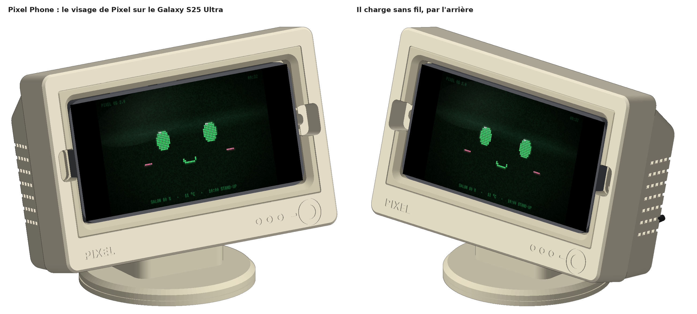
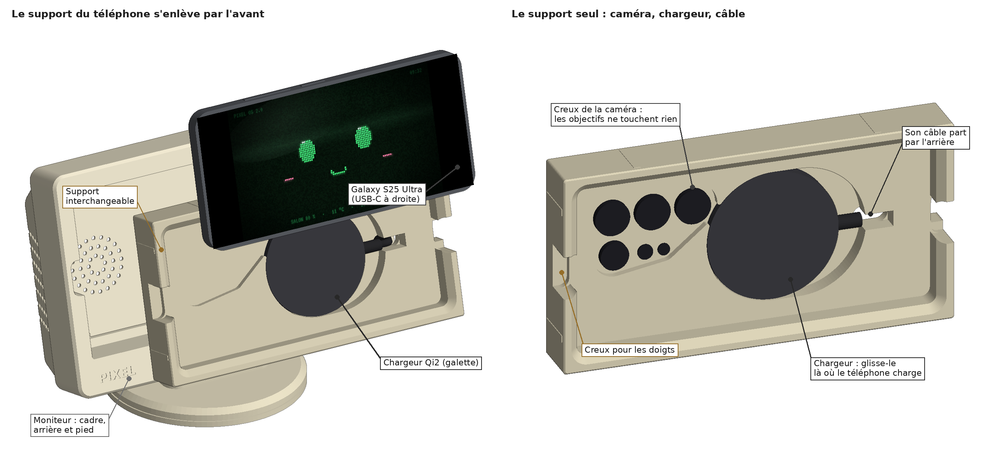
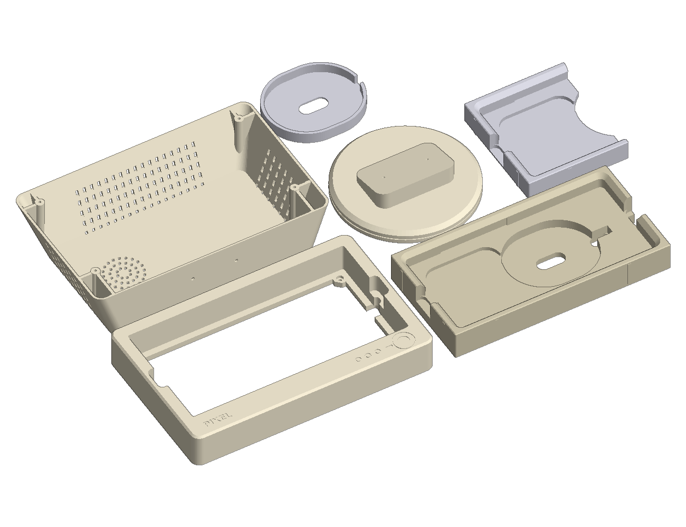

# Pixel Phone

Un petit moniteur cathodique beige, dans le style de Pixel, pour ton **Galaxy S25 Ultra** : le téléphone devient l'écran du moniteur et montre le visage de Pixel (l'appli Android [`pixel-mobile/`](../pixel-mobile/), en mode Pixel).

- **Il charge sans fil :** une galette Qi2 ronde (type « MagSafe ») est cachée derrière le téléphone.
- **Le support du téléphone est interchangeable :** il s'emboîte dans le cadre et s'enlève par l'avant. Pour une coque, un autre téléphone ou une autre galette, tu réimprimes seulement le support.



- Le moniteur penche en arrière de 15° sur son pied rond : l'écran se lit et se touche bien depuis ton bureau.
- Le téléphone se pose **en paysage, USB-C à droite** (boutons en haut). Dans ce sens, la caméra tombe dans un creux du support, les boutons ne touchent rien, et la galette arrive sous la bobine de charge du téléphone.
- Rien ne serre le téléphone : il tient par son poids, posé sur le bord du bas et appuyé contre le fond. Deux creux, à gauche et à droite, servent à le prendre par ses bouts. Le haut-parleur du bas souffle dans le creux de droite.
- Sur le bureau, il fait 199 mm de large, 110 mm de profondeur et 152 mm de haut.

L'image sur le téléphone est une vraie capture de l'appli Pixel (thème Rétro), à la forme de l'écran du S25 Ultra.



## Pièces à imprimer

Elles sont toutes dans `stl/`, déjà posées dans le bon sens, **sans supports**. Imprime **un seul** des deux supports : sans coque, ou avec coque.

| Fichier | Taille (mm) | Sens d'impression | Filament | Temps |
| --- | --- | --- | --- | --- |
| `PhoneFitTest_S25U.stl` | 83 × 93 × 16 | **à imprimer en premier** : le bout gauche du support, coupé court (voir plus bas) | 37 g | 1 h |
| `PuckFitTest.stl` | 78 × 66 × 9 | **en premier aussi** : le logement de la galette | 11 g | 25 min |
| `PixelPhoneFront.stl` | 199 × 125 × 29 | le cadre, face avant **vers le haut** | 118 g | 3 h |
| `PixelPhoneBack.stl` | 195 × 121 × 45 | l'arrière cathodique, le dos sur le plateau | 101 g | 2 h 30 |
| `PixelPhoneStand.stl` | Ø 110 × 25 | le pied, à plat | 55 g | 1 h 30 |
| `PixelPhoneSupport_S25U.stl` | 179 × 93 × 24 | le support, face avant vers le haut : **téléphone sans coque** | 106 g | 2 h 30 |
| `PixelPhoneSupport_S25U_Coque.stl` | 179 × 93 × 24 | *à la place du précédent* : téléphone dans une coque fine (voir « Avec une coque ») | 99 g | 2 h 30 |
| `PhoneFitTest_S25U_Coque.stl` | 85 × 93 × 19 | le test, version coque | 39 g | 1 h |

- **Imprimante :** tout tient sur la Bambu Lab P2S, une grande pièce par plateau.
- **Réglages :** buse 0,4 mm, couches de 0,2 mm, 3 parois, 15 % de remplissage. Supports désactivés.
- **Filament :** environ **380 g** pour le moniteur et un support, plus 50 g pour les deux tests. En PLA beige comme Pixel. Le support peut être d'un beige plus foncé ou gris, pour faire le tour de l'écran.
- **La face avant du cadre** est la face du dessus à l'impression : active le lissage (« ironing ») sur la surface du dessus si tu la veux bien lisse. C'est facultatif.
- **Le pied :** 40 % de remplissage le rend plus lourd, donc Pixel Phone plus stable. C'est facultatif.
- **Surplombs :** il ne reste que des petits ponts (fentes d'aération, passages de câble, creux des patins). Le plus long fait 10,5 mm.
- **Si ton téléphone chauffe beaucoup** en chargeant, imprime le support en PETG.

## D'abord : les deux tests

### Le téléphone : `PhoneFitTest_S25U.stl`

C'est le bout gauche du vrai support, du côté de la caméra : même entonnoir, même logement, même creux de caméra, même creux pour les doigts. Samsung ne publie pas la place de la caméra : ce test la vérifie sur ton téléphone.

1. Pose le test à plat. Mets dedans le bout gauche du téléphone : écran vers le haut, USB-C vers la droite, boutons vers le haut du test. Tiens l'autre bout à plat (ou cale-le sur un livre de la même hauteur).
2. **Le logement :** le téléphone entre sans forcer, avec un peu de jeu au bout et en haut (0,8 mm).
3. **La caméra :** le téléphone repose bien à plat sur le fond, il ne bascule pas sur sa caméra. Les objectifs pendent dans leur creux sans toucher.
4. **L'écran :** il arrive juste sous le bord de l'entonnoir (0,3 mm). Rien ne cache l'image.
5. **Les boutons** du haut ne sont pas appuyés.

Si ça ne va pas, change la cote en haut de `generate.py` (dans `PHONES["S25U"]`), puis relance `python3 generate.py` et `python3 tools/verify.py` :
- **le téléphone bascule sur sa caméra :** la place des objectifs → `camera` (vue de dos, en portrait) ;
- **il n'entre pas, ou il flotte :** `L`, `W`, `T`, ou les jeux `END_CLR` et `TOP_CLR` (0,8) ;
- **un bouton est appuyé :** `keys`.

### La galette : `PuckFitTest.stl`

1. Colle sous ta galette quelques carrés de **mousse adhésive double face de 0,5 mm** (celle de Pixel), en laissant libre le centre si son câble sort par le dos.
2. Pose-la dans le logement, câble vers la droite, dans la rainure. Elle entre avec un peu de jeu.
3. Sa face arrive **juste sous le bord** (0,3 mm) : une règle posée en travers ne la touche pas.

Si elle est trop grande ou trop épaisse : `PUCK_D` et `PUCK_T` (60 et 7 mm). Si elle est plus fine, mets deux couches de mousse.

## Matériel

| Pièce | Qté | Note |
| --- | --- | --- |
| [Chargeur sans fil **Qi2 en galette ronde**](https://www.amazon.fr/s?k=chargeur+sans+fil+magn%C3%A9tique+Qi2+15W) (type « MagSafe ») | 1 | **Ø 55 à 60 mm, 7 mm d'épaisseur au plus**, câble qui sort sur le côté (ou au centre du dos). Par exemple Anker MagGo, Belkin BoostCharge Pro ou ESR HaloLock, en Qi2. Avec le bloc secteur USB-C qu'il demande |
| Mousse adhésive double face, **0,5 mm** | quelques cm² | sous la galette : elle reste là où le téléphone charge le mieux |
| Vis M2,5 × 8 | 4 | l'arrière sur le cadre, vissées par l'avant |
| Vis M2,5 × 12 | 2 | le pied sous l'arrière, vissées de l'intérieur |
| Patins caoutchouc Ø 10 mm | 4 | sous le pied |
| *Option :* [câble **USB-C coudé à 90°**](https://www.amazon.fr/s?k=c%C3%A2ble+usb+c+coud%C3%A9+90+degr%C3%A9s) | 1 | pour charger par câble à la place de la galette (voir plus bas) |

Les liens sont des recherches Amazon.fr. Les vis, la mousse et les patins sont les mêmes que pour Pixel. Comme outil : un petit tournevis cruciforme.

**À savoir sur le S25 Ultra :** il est « Qi2 Ready », c'est-à-dire qu'il n'a pas d'aimants. Ici, ce sont les aimants de la galette qui ne servent à rien : c'est le support qui tient le téléphone. Il charge sur une galette Qi2 comme sur un chargeur Qi ordinaire. Évite le chargeur MagSafe d'Apple, qui charge lentement les téléphones Android.

## Montage

1. **Le pied sous l'arrière :** pose l'arrière sur le pied, son fond sur le cou incliné du pied. Visse 2 vis M2,5 × 12 depuis l'intérieur de l'arrière, à travers son fond, dans le cou. Colle les 4 patins sous le pied.
2. **L'arrière sur le cadre :** plaque le cadre contre l'arrière (le bord de l'arrière s'arrête 2 mm avant le bord du cadre) et pose le tout sur le pied. Par l'avant, dans le logement vide, visse **4 vis M2,5 × 8** dans les trous des 4 coins du rebord : elles vont dans les 4 poteaux de l'arrière. Leurs têtes descendent dans des creux : le support les cachera.
3. **La galette dans le support :**
   1. Colle la mousse sous la galette (comme pour le test).
   2. Pose-la dans sa fente, câble vers la droite dans la rainure, et fais passer le câble par le trou au bout de la rainure, vers l'arrière du support. Si son câble sort au centre de son dos, passe-le par le trou au fond de la fente.
   3. Pousse-la **à fond à gauche**, sans l'appuyer : la mousse ne doit pas encore coller.
4. **Le support dans le cadre :** passe le câble par le logement du cadre, puis dans l'arrière, jusqu'à l'encoche en bas du dos de l'arrière (elle est ouverte par le bas : le câble s'y glisse). Emboîte le support : il entre droit et s'arrête sur le rebord. Les petites nervures de ses côtés le serrent un peu. Branche la galette sur son bloc secteur.
5. **Le téléphone :** USB-C à droite, boutons en haut. Pose son bord du bas dans le support, puis laisse-le basculer contre le fond.
6. **La bonne place de la galette :** si le téléphone ne charge pas, ou s'arrête et reprend, enlève-le, glisse la galette de quelques millimètres vers la droite (la fente fait 12 mm) et réessaie. Quand il charge bien, enlève le téléphone et appuie sur la galette pour coller la mousse.

## Au quotidien

- **Prendre le téléphone :** pince-le par ses deux bouts, dans les creux à gauche et à droite, et soulève-le.
- **Le visage de Pixel :** ouvre l'appli Pixel sur le téléphone, en mode Pixel : son écran reste allumé. Si l'image ne tourne pas, active la rotation automatique.
- **La batterie :** un téléphone qui reste en charge toute la journée vieillit moins vite si sa charge s'arrête à 80 %. Dans les réglages Samsung : **Batterie › Protection de la batterie › Maximale**.
- **Changer de support :** enlève le téléphone, tire le support vers toi en le tenant par l'intérieur de son logement, décolle la galette et mets-la dans le nouveau support. Le câble de la galette a assez de mou.

## À savoir

- **Si le support force trop** pour entrer dans le cadre, ponce un peu ses 8 nervures (sur ses 4 côtés). **S'il a du jeu,** colle une bande de ruban adhésif sur un côté.
- **Le S Pen** sort en bas à droite du téléphone, derrière le bord du support : enlève d'abord le téléphone.
- **Si le téléphone chauffe :** la charge sans fil et l'écran toujours allumé le réchauffent. La protection de la batterie (plus haut) l'arrête à 80 % et limite la chaleur. Le PLA supporte bien la galette, mais un support en PETG résiste mieux à la chaleur.

## Option : charger par câble

Avec un câble **USB-C coudé à 90°**, branché le câble vers le dos du téléphone : la tête du câble loge dans le creux de droite, puis le câble passe par le trou au bout du support, le passage du cadre et l'encoche du rebord, jusque dans l'arrière. Un câble droit ne passe pas : le cadre est fermé sur les côtés.

## Avec une coque

`PixelPhoneSupport_S25U_Coque.stl` prend une coque fine : **1,6 mm** sur les côtés et au dos, un rebord de 1 mm devant l'écran et un anneau de 1,4 mm autour de la caméra. La charge sans fil passe à travers la coque. Pour une autre coque, change `CASE` en haut de `generate.py`, puis relance `python3 generate.py`.

## Un support pour un autre téléphone

Le moniteur ne change pas : son logement prend un téléphone (avec sa coque) jusqu'à **167,8 × 82,6 mm** et environ 11 mm d'épaisseur. Dans `generate.py`, ajoute une entrée à `PHONES` (taille, coins, écran, caméra vue de dos, boutons, prise USB-C, bobine de charge), mets `PHONE = "…"` et relance `python3 generate.py` puis `python3 tools/verify.py` : tu obtiens un nouveau `PixelPhoneSupport_….stl`.

## Ce qui reste à mesurer

Samsung publie la taille du S25 Ultra (162,8 × 77,6 × 8,2 mm) et son poids (218 g), pas le reste. Ces cotes sont **estimées** (marquées `[estimate]` dans `generate.py`) :

1. **La caméra** (`camera`) : la place et la taille des 3 grands objectifs, du périscope, du flash et du capteur laser. Ils dépassent de 2,4 mm (le chiffre des fuites d'avant la sortie). `PhoneFitTest` vérifie tout ça.
2. **La bobine de charge** (`coil_u`) : sous la caméra, vers 89 mm du haut du téléphone. Les 12 mm de la fente de la galette rattrapent l'écart.
3. **Les coins** (`R`, 9 mm) : ceux du logement sont plus serrés (4 mm), donc ils ne touchent jamais.
4. **Les boutons** (`keys`) : une rainure de 1 mm passe au-dessus d'eux, dans le haut du logement.

## Vérifications faites sur ordinateur

`python3 tools/verify.py` vérifie tout. Tout passe :

- **Le téléphone,** sans coque et en coque : il repose sur le bord du bas et contre le fond, avec 0,8 mm de jeu aux bouts et en haut. Les objectifs ont au moins 0,6 mm d'air tout autour. Les boutons ne sont pas appuyés, même 0,3 mm plus haut. Rien ne cache l'image.
- **La galette,** aux deux bouts de sa fente : elle ne touche ni le téléphone ni sa caméra (3 mm d'écart au moins). Sa face est à 0,3 mm du dos du téléphone, sur sa mousse de 0,5 mm. Son câble sort par l'arrière du support, dans l'ouverture du rebord.
- **Le support** entre droit dans le cadre et ressort par l'avant. Il ne touche les parois que par ses 8 nervures (0,05 mm de serrage) et repose sur le rebord.
- **Le câble USB-C coudé** (option) passe par le creux de droite, le support et le rebord.
- **Les vis :** les 4 M2,5 × 8 mordent 5,9 mm dans les poteaux de l'arrière, les 2 M2,5 × 12 mordent 10 mm dans le cou du pied. L'arrière reste à 2,6 mm au-dessus du pied, et seul le pied touche le bureau.
- **L'impression :** chaque pièce tient sur la P2S. Chaque fichier est un seul objet fermé, propre. Aucun surplomb n'a besoin de support. Aucune paroi ni aucun fond ne fait moins de 1,2 mm, sauf les fines arêtes entre les gravures.
- **Stabilité :** avec le téléphone et la galette, Pixel Phone pèse environ 650 g. Il faut pousser d'environ **3,5 N** en haut de l'écran pour le faire basculer en arrière (un toucher fait environ 1 N), et tirer à 2,1 N vers toi pour le faire basculer en avant (1,6 N sans le téléphone).
- Rien n'a encore été imprimé.



## Modifier / vérifier

Toutes les cotes sont en haut de `generate.py` : le téléphone (`PHONES`), la coque (`CASE`), la galette (`PUCK_…`), les jeux, l'inclinaison (`TILT`)…

```bash
pip install trimesh manifold3d shapely mapbox_earcut numpy scipy networkx matplotlib pillow
python3 generate.py            # refait les STL dans stl/ (et efface les anciens)
python3 tools/verify.py        # toutes les vérifications (environ 10 s) : doit finir par « ALL CHECKS PASSED »
python3 tools/render.py        # refait les images du README (environ 30 s)
```

Dans `tools/` :
- `verify.py` : téléphone, caméra, boutons, galette, câbles, support dans le cadre, vis, impression, filament, stabilité ;
- `mocks.py` : les choses achetées, en volumes simples (téléphone, coque, galette, prises) ;
- `render.py` : les images ; `ui/` : la capture de l'appli affichée sur le téléphone.

`verify.py` et `render.py` se servent aussi des outils de [`pixel-desk/tools/`](../pixel-desk/tools/) (`checks.py` pour les tests d'impression, `scenelib.py` pour les images).
