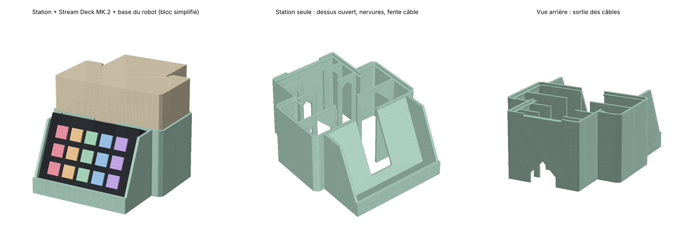

# Station Stream Deck

Socle imprimable pour le robot [Tiny Engineer](https://github.com/jamro/tiny-engineer) (version SG90). Le robot se pose dessus, et en dessous, à l'avant, une fente inclinée tient un Stream Deck, touches vers toi. Les câbles passent par l'intérieur et sortent à l'arrière.



Dans l'aperçu, la base du robot est un bloc simplifié. Son contour vient du vrai `BottomCover` SG90 du projet.

## Fichiers

| Fichier | Pour | Taille (L × P × H) | Plateau du robot à |
| --- | --- | --- | --- |
| `stl/StreamDeckDock_MK2.stl` | Stream Deck MK.2 (15 touches), pied retiré | 151 × 189 × 83 mm | 80 mm |
| `stl/StreamDeckDock_Neo.stl` | Stream Deck Neo, pied replié | 151 × 187 × 77 mm | 74 mm |

## Impression

- PLA ou PETG, buse 0,4 mm, couches de 0,2 mm.
- Imprime la pièce telle quelle, à plat. **Aucun support** : les murs sont verticaux, le dossier penche de 25°, et les rebords sous le robot sont en pente à 45°.
- 3 parois et 15 % de remplissage. Les murs de 2,4 mm sortent pleins, et le remplissage ne sert que pour la base de la fente.
- Il faut un plateau d'au moins **190 mm** (Ender 3, Bambu A1/P1/X1, Prusa MK4, etc.). Un Bambu A1 mini (180 mm) est trop petit.
- Compte environ **200 g** de filament.

Conseil : avant la grande impression, coupe le modèle dans le trancheur à ~25 mm de haut et imprime seulement le bas. Ça permet de vérifier que le Stream Deck rentre dans la fente et que la base du robot rentre dans le contour.

## Montage

1. Retire le pied du Stream Deck MK.2 (ou replie celui du Neo) et branche son câble USB-C.
2. Glisse le Stream Deck dans la fente. Le câble passe par l'ouverture au centre du dossier, suit le canal central et sort par l'arche en bas à l'arrière.
3. Pose le robot dans la poche du dessus, le bureau vers l'avant. Le rebord de 3 mm l'empêche de glisser quand les servos bougent. Son câble USB-C passe par l'encoche du rebord arrière.

## Modifier

Toutes les cotes sont en haut de `generate.py` : l'inclinaison (`RECLINE`), les jeux, l'épaisseur des murs, et la liste `DECKS` pour ajouter un autre modèle (largeur, hauteur, épaisseur). Relance ensuite :

```bash
pip install trimesh manifold3d shapely mapbox_earcut numpy
python generate.py
```

- **Stream Deck XL** (182 mm de large) : ajoute-le dans `DECKS`. La station devient plus large que le robot, donc vérifie la taille de ton plateau.
- **Stream Deck Mini** : sa forme en coin ne va pas dans cette fente, il faut un autre support.
- **Robot compact** (servos FS0307 / ES9051) : le contour du robot est différent. Remplace `FOOTPRINT_HALF` par le contour de ton `BottomCover`.
