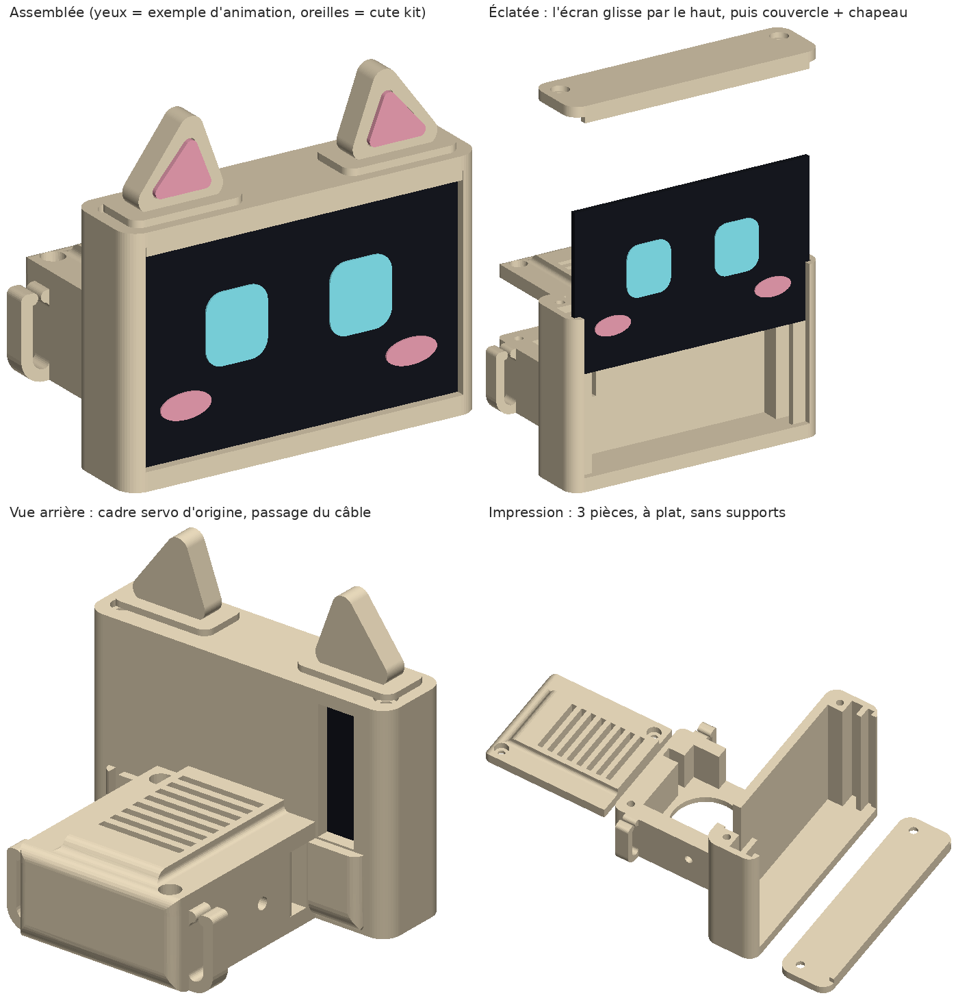

# Tête écran tactile

Nouvelle tête pour le robot [Tiny Engineer](https://github.com/jamro/tiny-engineer) (version SG90), avec un **Waveshare 2inch Capacitive Touch LCD** (240×320 couleur, tactile, SKU 29063) en paysage à la place du petit OLED.



Les yeux et les joues de l'aperçu sont un exemple de ce que l'écran pourra afficher. Les oreilles sont celles du [cute kit](../cute-kit/).

## Comment c'est fait

- **L'arrière est la pièce d'origine.** Le cadre du servo de tête est copié tel quel depuis le `Head` officiel. Le servo, le cou (`Neck`), la vis de pivot et les vis du chapeau se montent donc exactement comme dans le guide d'origine.
- **Seule la boîte de l'écran à l'avant change.** L'écran glisse par le haut dans une rainure derrière le cadre avant, comme l'OLED d'origine. Des butées derrière le bord du verre (à gauche et à droite) encaissent la pression des doigts. Un couvercle ferme le haut avec 2 vis.
- **Contrôle de l'ajustement.** Le placement est vérifié sur le modèle 3D officiel de Waveshare : zéro collision une fois en place, et l'écran peut glisser jusqu'en bas sans rien toucher.

## Fichiers

| Fichier | Taille | Rôle |
| --- | --- | --- |
| `stl/TouchHead.stl` | 53 × 63 × 39 mm | La tête (cadre servo d'origine + boîte écran) |
| `stl/TouchHeadHat.stl` | 38 × 33 × 5 mm | Le chapeau d'origine, raccourci pour finir contre la boîte |
| `stl/TouchHeadLid.stl` | 16 × 63 × 4 mm | Le couvercle de la boîte écran |

## Impression

- PLA ou PETG, buse 0,4 mm, couches de 0,16–0,2 mm, comme les pièces d'origine.
- Imprime les 3 pièces telles qu'exportées. **Aucun support** : la boîte est ouverte en haut, et le couvercle est exporté à l'envers (face du dessus sur le plateau).
- Compte environ 32 g de filament.
- Si ton `ScrewSizingTest` a donné une autre valeur que 2,1 mm, change `PILOT_D` dans `generate.py` et relance.

## Ce qu'il faut en plus

| Pièce | Qté |
| --- | --- |
| Waveshare 2inch Capacitive Touch LCD (SKU 29063), avec son câble 15 broches | 1 |
| Vis M2×8 pour le couvercle | 2 |

Les vis du chapeau et du cou sont les mêmes que dans la version d'origine.

## Montage

1. **Servo de tête :** même étape que le §1 du guide d'origine, sans l'OLED. Pose le servo dans le cadre et clipse son câble à l'arrière.
2. **Chapeau :** pose `TouchHeadHat` sur le cadre et visse-le avec 2 vis M2×8, comme le §2.
3. **Cou :** suis le §4 d'origine (`Neck` sur l'axe du servo, vis de pivot côté droit du robot).
4. **Écran :** branche d'abord le câble 15 broches sur l'écran. Fais glisser l'écran par le haut, verre vers l'avant, connecteur du côté droit du robot. Le câble sort par la fente verticale à l'arrière de la boîte.
5. **Couvercle :** emboîte `TouchHeadLid` (sa barre avant couvre le haut du verre) et visse-le avec 2 vis M2×8.
6. **Avant de tout serrer :** lance le test des servos dans l'assistant de configuration. La tête est plus large (63 mm au lieu de 53) et plus haute, donc vérifie qu'elle ne touche ni les bras levés ni l'écran du petit laptop. Si elle touche, réduis un peu les limites de la tête (`servo_mins` / `servo_maxs`) dans l'assistant.

## Branchement

| Écran | Carte du robot |
| --- | --- |
| VCC, GND, TP_SDA, TP_SCL | connecteur J2 « OLED » (3,3 V, GND, SDA, SCL), libéré par l'OLED |
| SCLK, MOSI, LCD_CS, LCD_DC | connecteur J4 : GP6 (broche 12), GP7 (10), GP20 (4), GP21 (2) |
| LCD_RST, LCD_BL, TP_RST | reliés ensemble au 3,3 V (J4 broche 7) |
| MISO, SD_CS, TP_INT | rien |

Astuce : fais la jonction RST / BL / 3,3 V près de la tête. Il ne descend alors que 8 fils dans le cou au lieu de 12.

**À savoir :** le firmware actuel du robot pilote un OLED 128×32. Pour cet écran (ST7789 + tactile CST816D), il faut une version modifiée du firmware. Elle n'est pas encore faite.

## Modifier

Toutes les cotes sont en haut de `generate.py`. Le script télécharge le `Head` et le `Hat` officiels à un commit précis et vérifie leur empreinte avant de les modifier.

```bash
pip install trimesh manifold3d shapely mapbox_earcut numpy
python generate.py
```

## Licence

Ce dossier contient une version modifiée des pièces `Head` et `Hat` de Tiny Engineer (© 2026 Krzysztof Jamroz), sous **CERN-OHL-S-2.0**. Tout le dossier est sous la même licence. Voir [NOTICE.md](NOTICE.md) et [LICENSE](LICENSE). Le nom et le logo Tiny Engineer ne sont pas couverts par cette licence.
